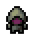
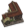
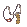
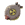

# 空巢者（The Empty Nester）

[原文与贡献者记录](https://ballxpit.wiki.gg/wiki/The_Empty_Nester) · [修订 4347](https://ballxpit.wiki.gg/index.php?oldid=4347) · [返回目录](../%E7%90%83%E6%AF%94%E4%BC%A6%E6%88%98%E8%AE%B0%20Wiki.md)

待完善

*此条目为 [待完善](../categories/Stubs.md). 你可以通过帮助 BALL x PIT 维基贡献一份力量。 [补充内容](https://ballxpit.wiki.gg/wiki/The_Empty_Nester?action=edit).*

## 空巢者 

有一对有很多很多孩子的夫妇。

## 基本信息

### 圆球（Ball）

[幽灵](Ghost.md) 

### 解锁

构筑 [独栋住宅](Single_Family_Home.md)

### 能力

否，小球。每次射击都会发射多个装备的专用小球实例。

**空巢者** 是 *[球比伦战记](Ball_x_Pit.md)* 中一名可解锁的可玩 [角色](Characters.md)。建造 [独栋住宅](Single_Family_Home.md)  即可解锁，其蓝图会在 [白雪海岸](The_SNOWYxSHORES.md)  中随机掉落。起始圆球为 [幽灵](Ghost.md) 。

## 能力说明

空巢者已经…… **没有小球**只有特殊圆球。但是，当发射特殊圆球时，它们都会是玩家某一特殊圆球的多个实例，这意味着同一种类型的特殊圆球会连续多次被发射。当玩家发射完所有圆球后，选定的圆球将自动切换到队列中的下一个圆球。如果某个圆球的多个副本尚未返回给玩家，则无法选择该圆球。

* 需要注意的是，小球和被动道具仍可能生成小球，例如 [育巢母体](Brood_Mother.md)  或 [弹弓](Slingshot.md) 。

## 策略

* 像 [黑暗](Dark.md)  或 [核弹](Nuclear_Bomb.md)  这样的冷却时间球，由于它们可以大量发射，因此效果要明显更强。
* 由于玩家可以更有控制地选择发射哪些小球，且不再有小球可以随意乱发，因此关闭自动发射功能可能是明智之举，这样玩家就能更有效地利用同一小球多次出现的机会。

## [匹配机](Matchmaker.md) 配对 

### 好

### 坏

### 不兼容

## 关卡

| 角色等级 | 总经验值 | [升级奖励](Character_Level_Mechanics.md) | 选择项 |
| --- | --- | --- | --- |
| 3 | 857 | [收获升级](Harvest_Upgrades_Character_Bonus.md) |  [小麦收割机](https://ballxpit.wiki.gg/wiki/Wheat_Harvester?action=edit&redlink=1) 或  [小麦大师](https://ballxpit.wiki.gg/wiki/Wheat_Master?action=edit&redlink=1) |
| 4 | 1,472 | [住房能力获取](Buildings.md#%E4%BD%8F%E6%88%BF) | 收获  每 6 分钟从邻近森林中收获 1 次。 |
| 6 | 3,574 | [收获升级](Harvest_Upgrades_Character_Bonus.md) |  [短跑手](https://ballxpit.wiki.gg/wiki/Sprinter?action=edit&redlink=1) 或  [时间守护者](https://ballxpit.wiki.gg/wiki/Time_Keeper?action=edit&redlink=1) |
| 7 | 5,262 | [住房能力升级](Buildings.md#%E4%BD%8F%E6%88%BF) | 每6分钟从相邻森林收获 2。 |
| 9 | 10,409 | [住房能力升级](Buildings.md#%E4%BD%8F%E6%88%BF) | 收获  每6分钟从相邻森林获取3个。 |
| 10 | 14,069 | [收获升级](Harvest_Upgrades_Character_Bonus.md) |  [木材大师](https://ballxpit.wiki.gg/wiki/Wood_Master?action=edit&redlink=1) 或  [小麦收割机](https://ballxpit.wiki.gg/wiki/Wheat_Harvester?action=edit&redlink=1) |
| ... | ... | ... | ... |

## 策略

## 冷知识

* “空巢老人”指的是那些子女均已成年并搬离家，使他们陷入孤独状态的父母。这体现在空巢老人的缺乏…… *宝贝* 圆球。

## 图片库

[共享导航](../navigation/nav-334e23d2914f.md)

**分类**　[分类 · 待完善](../categories/Stubs.md) · [分类 · 角色](../categories/Characters.md) · [分类 · 带有导航框的页面](../categories/Pages_with_navboxes.md)

[返回总入口](../%E7%90%83%E6%AF%94%E4%BC%A6%E6%88%98%E8%AE%B0%20Wiki.md) · [返回本分目录](%E7%9B%AE%E5%BD%95.md)
