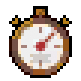

# 空巢者（The Empty Nester）

 

一对夫妇有很多孩子。

[原文与贡献者记录](https://ballxpit.wiki.gg/wiki/The_Empty_Nester) · [修订 4347](https://ballxpit.wiki.gg/index.php?oldid=4347) · [返回目录](../%E7%90%83%E6%AF%94%E4%BC%A6%E6%88%98%E8%AE%B0%20Wiki.md)

待补充条目

*这是一个 [待补充条目](../categories/Stubs.md)你可以帮助BALL xPIT Wiki通过 [补充此条目](https://ballxpit.wiki.gg/wiki/The_Empty_Nester?action=edit).*

#### 一般信息

##### 圆球（Ball）

[鬼魂](Ghost.md) 

##### 解锁

建立一个 [单身家庭](Single_Family_Home.md)

##### 能力

每次射击都会拍出一个装备的特殊球。

**空巢者** 是一个可以解锁的可播放 [角色](Characters.md) 在 *[球比伦战记](Ball_x_Pit.md)*它们通过构建 [单身家庭](Single_Family_Home.md) , 蓝图可以找到作为一个随机落入 [白雪海岸](The_SNOWYxSHORES.md)  他们开始说 [鬼魂](Ghost.md) .

#### 能力描述

"空巢"已经 **没有小球**只有特殊的球。然而，当他们发射特殊球时，它们都会是玩家的特殊球之一的多次实例，这意味着同一类特殊球将连续发射多次。一旦球员发射了所有的球，所选的球将被转向其阵容中的下一个球。如果所有的副本都没有返回给球员，则不能选择球。

* 应该指出的是，婴儿球仍然可以由球和被动的诸如 [育巢母体（Brood Mother）](Brood_Mother.md)  或是 [弹弓（Slingshot）](Slingshot.md) .

#### 策略

* 冷却球，如 [黑暗（Dark）](Dark.md)  或是 [核弹（Nuclear Bomb）](Nuclear_Bomb.md)  由于它们可以用更大的音量拍摄,
* 由于玩家对哪些球被发射有更多的控制权，并且他们不再有婴儿球来无分别垃圾邮件,

#### [匹配机](Matchmaker.md) 配对 

##### 很好。

##### 坏的

##### 不兼容

#### 关卡

| 性格水平 | 总经验值 | [提高奖励水平](Character_Level_Mechanics.md) | 选择 |
| --- | --- | --- | --- |
| 3 | 857 | [提高收获](Harvest_Upgrades_Character_Bonus.md) |  [麦机](https://ballxpit.wiki.gg/wiki/Wheat_Harvester?action=edit&redlink=1) 或是  [麦子主](https://ballxpit.wiki.gg/wiki/Wheat_Master?action=edit&redlink=1) |
| 4 | 1,472 | [住房能力增长](Buildings.md#%E4%BD%8F%E6%88%BF) | 收获  每6分钟就有1个来自邻近的森林。 |
| 6 | 3,574 | [提高收获](Harvest_Upgrades_Character_Bonus.md) |  [冲刺运动员](https://ballxpit.wiki.gg/wiki/Sprinter?action=edit&redlink=1) 或是  [时间守护者](https://ballxpit.wiki.gg/wiki/Time_Keeper?action=edit&redlink=1) |
| 7 | 5,262 | [提高住房能力](Buildings.md#%E4%BD%8F%E6%88%BF) | 收获  每6分钟有2次来自邻近森林。 |
| 9 | 10,409 | [提高住房能力](Buildings.md#%E4%BD%8F%E6%88%BF) | 收获  每6分钟就有3个来自邻近的森林。 |
| 10 | 14,069 | [提高收获](Harvest_Upgrades_Character_Bonus.md) |  [木材师](https://ballxpit.wiki.gg/wiki/Wood_Master?action=edit&redlink=1) 或是  [麦机](https://ballxpit.wiki.gg/wiki/Wheat_Harvester?action=edit&redlink=1) |
| ... | ... | ... | ... |

#### 策略

#### 冷知识

* "空巢者"一词是指孩子已全部成年并搬出家的家长，留下他们独自一人，这体现在空巢者缺乏*婴儿*球。

#### 图片库

[共享导航](../navigation/nav-334e23d2914f.md)

**分类**　[分类 · 坚力](../categories/Stubs.md) · [分类 · 角色](../categories/Characters.md) · [分类 · 页面有导航框](../categories/Pages_with_navboxes.md)

[返回总入口](../%E7%90%83%E6%AF%94%E4%BC%A6%E6%88%98%E8%AE%B0%20Wiki.md) · [返回本分目录](%E7%9B%AE%E5%BD%95.md)
