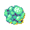
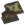
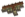
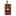
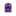
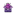
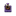

# 真菌森林（The FUNGALxFOREST）

[原文与贡献者记录](https://ballxpit.wiki.gg/wiki/The_FUNGALxFOREST) · [修订 3725](https://ballxpit.wiki.gg/index.php?oldid=3725) · [返回目录](../%E7%90%83%E6%AF%94%E4%BC%A6%E6%88%98%E8%AE%B0%20Wiki.md)

## 基本信息

### 解锁所需齿轮（Gears to unlock）

2

### 建筑蓝图（Blueprints）

10

### 解锁内容（Unlocks）

* [细胞（Cell）](Cell.md) 
*  [可怜洋葱](https://ballxpit.wiki.gg/wiki/Wretched_Onion?action=edit&redlink=1)
*  [尖刺项圈](https://ballxpit.wiki.gg/wiki/Spiked_Collar?action=edit&redlink=1)
*  [防护魅惑](https://ballxpit.wiki.gg/wiki/Protective_Charm?action=edit&redlink=1)

**真菌森林** 是 *[球比伦战记](Ball_x_Pit.md)* 的第四个 [关卡](Levels.md)。需要 2 个齿轮才能解锁。

## 解锁内容

通关本关卡后，玩家将解锁以下物品：

* [细胞（Cell）](Cell.md) 
*  [可怜洋葱](https://ballxpit.wiki.gg/wiki/Wretched_Onion?action=edit&redlink=1)
*  [尖刺项圈](https://ballxpit.wiki.gg/wiki/Spiked_Collar?action=edit&redlink=1)
*  [防护魅惑](https://ballxpit.wiki.gg/wiki/Protective_Charm?action=edit&redlink=1)

## 建筑蓝图

玩家可以在本关卡中获得以下 [建筑](Buildings.md)的建筑蓝图：

* [道路守护者（Road Keeper）](Road_Keeper.md) 
* [修道院（Abbey）](Abbey.md) 
* [匹配机（Matchmaker）](Matchmaker.md) 
* [死灵法师（Necromancer）](Necromancer.md) 
* [赌场（Casino）](Casino.md) 
* [珠宝匠（Jeweler）](Jeweler.md) 
* [豪宅（Mansion）](Mansion.md) 
* [铁堡](Iron_Fortress.md) 
* [实验室（Laboratory）](Laboratory.md) 
* [蘑菇奖杯](Shroom_Trophy.md) 

## 敌人

本关卡可能遇到下列[敌人](Enemies.md)。

* [蘑菇战士](Shroom_Fighter.md) 
* [双生蘑菇](Twin_Shrooms.md) 
* [潜行菇](Shroom_Stalker.md) 
* [层架菌](Bracket_Fungus.md) 
* [金针菇丛](Enoki_Cluster.md) 
* [爆炸菇（Boomshroom）](Boomshroom.md) 
* [虫草喷吐者](Cordyceps_Spitter.md) 
* [冲锋菇（Rushroom）](Rushroom.md) 
* [爆鸣菇](Shroomboomer.md) 
* [虫草女王](Cordyceps_Queen.md) 
* [长老爆炸菇](Elder_Boomshroom.md) 
* [菇群](Shroom_Swarm.md) 

[共享导航](../navigation/nav-47f674e55b3c.md)

**分类**　[分类 · 关卡](../categories/Levels.md) · [分类 · 带有导航框的页面](../categories/Pages_with_navboxes.md)

[返回总入口](../%E7%90%83%E6%AF%94%E4%BC%A6%E6%88%98%E8%AE%B0%20Wiki.md) · [返回本分目录](%E7%9B%AE%E5%BD%95.md)
