# 真菌森林（The FUNGALxFOREST）

[原文与贡献者记录](https://ballxpit.wiki.gg/wiki/The_FUNGALxFOREST) · [修订 3725](https://ballxpit.wiki.gg/index.php?oldid=3725) · [返回目录](../%E7%90%83%E6%AF%94%E4%BC%A6%E6%88%98%E8%AE%B0%20Wiki.md)

#### 一般信息

##### 解锁所需齿轮（Gears to unlock）

2

##### 建筑蓝图（Blueprints）

10

##### 解锁条件（Unlocks）

* [细胞（Cell）](Cell.md) 
*  [可怜洋葱（Wretched Onion）](https://ballxpit.wiki.gg/wiki/Wretched_Onion?action=edit&redlink=1)
*  [尖刺项圈（Spiked Collar）](https://ballxpit.wiki.gg/wiki/Spiked_Collar?action=edit&redlink=1)
*  [保护的魅力](https://ballxpit.wiki.gg/wiki/Protective_Charm?action=edit&redlink=1)

**真菌森林** 是第四个 [的水平](Levels.md) 在 *[球比伦战记](Ball_x_Pit.md)*。它需要2个装置来解锁。..

#### 解锁条件

清除此级别将使玩家能够解锁以下项目:

* [细胞（Cell）](Cell.md) 
*  [可怜洋葱（Wretched Onion）](https://ballxpit.wiki.gg/wiki/Wretched_Onion?action=edit&redlink=1)
*  [尖刺项圈（Spiked Collar）](https://ballxpit.wiki.gg/wiki/Spiked_Collar?action=edit&redlink=1)
*  [保护的魅力](https://ballxpit.wiki.gg/wiki/Protective_Charm?action=edit&redlink=1)

#### 建筑蓝图

玩家可以在此关卡中获取以下 [建筑](Buildings.md) 的蓝图 :

* [道路守护者（Road Keeper）](Road_Keeper.md) [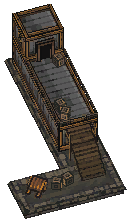](Road_Keeper.md)
* [修道院（Abbey）](Abbey.md) 
* [匹配机（Matchmaker）](Matchmaker.md) 
* [死灵法师（Necromancer）](Necromancer.md) 
* [赌场（Casino）](Casino.md) 
* [珠宝家（Jeweler）](Jeweler.md) 
* [豪宅（Mansion）](Mansion.md) 
* [铁堡垒（Iron Fortress）](Iron_Fortress.md) 
* [实验室（Laboratory）](Laboratory.md) 
* [蘑菇奖杯（Shroom Trophy）](Shroom_Trophy.md) [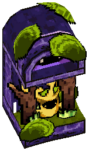](Shroom_Trophy.md)

#### 敌人

以下是在此级别上可遇到的[enemies](Enemies.md)列表:

* [蘑菇战士（Shroom Fighter）](Shroom_Fighter.md) [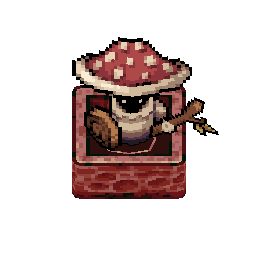](Shroom_Fighter.md)
* [双生蘑菇（Twin Shrooms）](Twin_Shrooms.md) [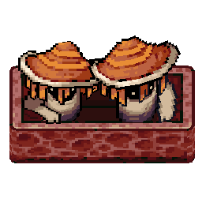](Twin_Shrooms.md)
* [潜行菇（Shroom Stalker）](Shroom_Stalker.md) [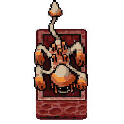](Shroom_Stalker.md)
* [层架菌（Bracket Fungus）](Bracket_Fungus.md) [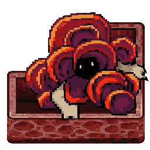](Bracket_Fungus.md)
* [伊诺基集团（Enoki Cluster）](Enoki_Cluster.md) [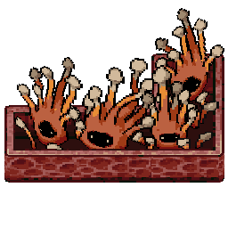](Enoki_Cluster.md)
* [爆炸菇（Boomshroom）](Boomshroom.md) [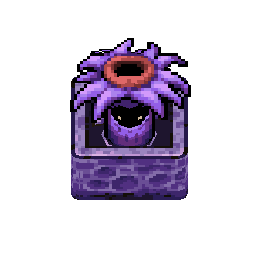](Boomshroom.md)
* [螺旋式螺旋桨（Cordyceps Spitter）](Cordyceps_Spitter.md) [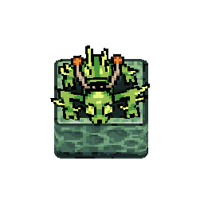](Cordyceps_Spitter.md)
* [工作室（Rushroom）](Rushroom.md) [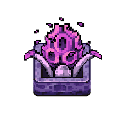](Rushroom.md)
* [爆鸣菇（Shroomboomer）](Shroomboomer.md) [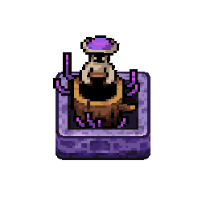](Shroomboomer.md)
* [科尔迪西普斯女王（Cordyceps Queen）](Cordyceps_Queen.md) [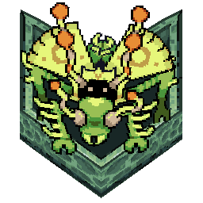](Cordyceps_Queen.md)
* [长老爆炸菇（Elder Boomshroom）](Elder_Boomshroom.md) [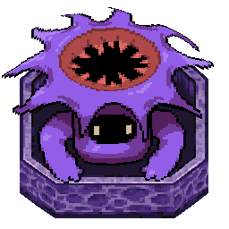](Elder_Boomshroom.md)
* [菇群（Shroom Swarm）](Shroom_Swarm.md) [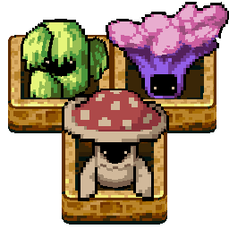](Shroom_Swarm.md)

[共享导航](../navigation/nav-47f674e55b3c.md)

**分类**　[分类 · 关卡](../categories/Levels.md) · [分类 · 页面有导航框](../categories/Pages_with_navboxes.md)

[返回总入口](../%E7%90%83%E6%AF%94%E4%BC%A6%E6%88%98%E8%AE%B0%20Wiki.md) · [返回本分目录](%E7%9B%AE%E5%BD%95.md)
