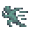
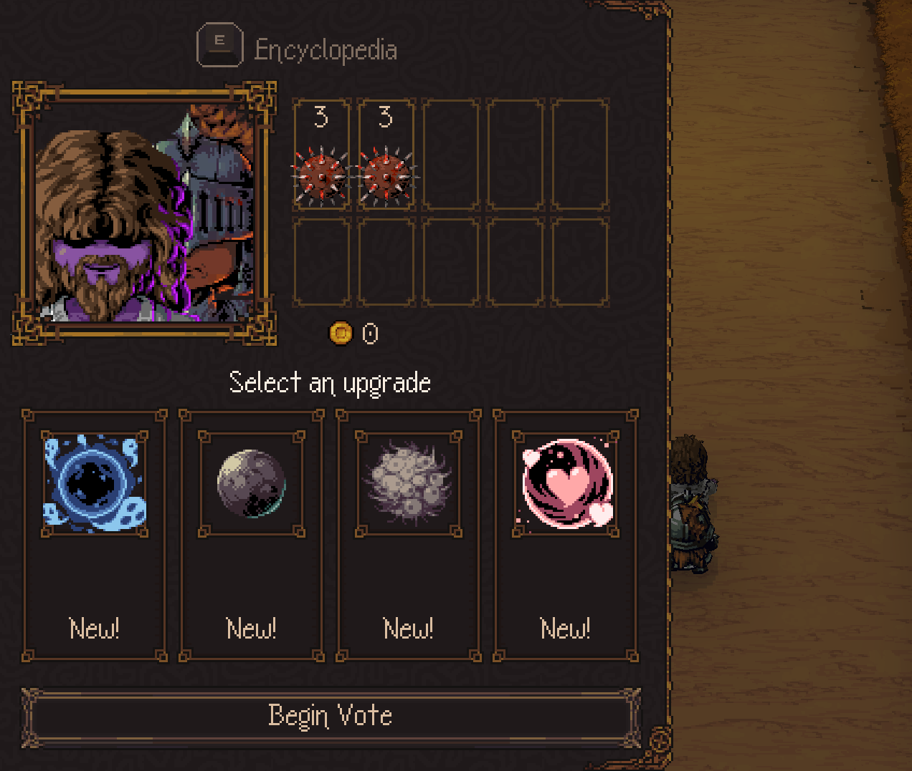
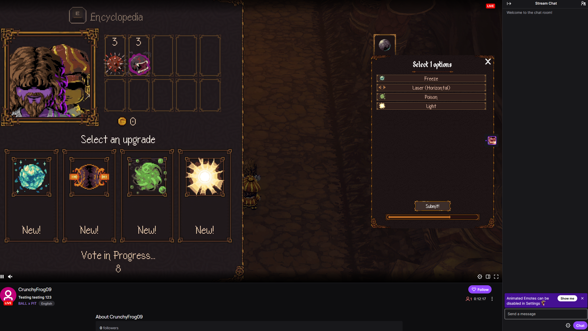
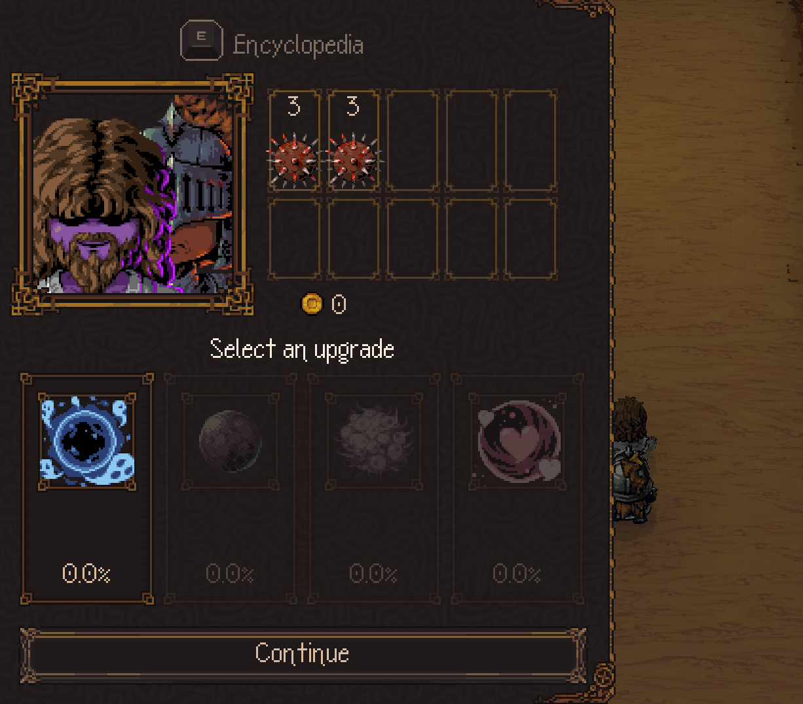

# 伪救世主（The False Messiah）

 

一位有争议的领导者，无限的魅力。..

[原文与贡献者记录](https://ballxpit.wiki.gg/wiki/The_False_Messiah) · [修订 2885](https://ballxpit.wiki.gg/index.php?oldid=2885) · [返回目录](../%E7%90%83%E6%AF%94%E4%BC%A6%E6%88%98%E8%AE%B0%20Wiki.md)

待补充条目

*这是一个 [待补充条目](../categories/Stubs.md)你可以帮助BALL xPIT Wiki通过 [补充此条目](https://ballxpit.wiki.gg/wiki/The_False_Messiah?action=edit).*

#### 一般信息

##### 圆球（Ball）

[流血](Bleed.md) 

##### 解锁

激活 Twitch 扩展和链接一个 Twitch 帐户 （专用PC / PC exclusive）

##### 能力

如果在Twitch上播放，观众可以投票对某些选择和随机事件。

**伪救世主** 是一个独特的 [性格](Characters.md) 专用于PC版本的 *[球比伦战记](Ball_x_Pit.md)* 这种特征不是通过建立任何相关的住房而解锁，而是通过激活 [Twitch](https://www.twitch.tv) 在选项菜单的一般标签下扩展，然后通过互联网浏览器链接 Twitch 帐户。 [流血](Bleed.md) .

有关设置和启用 Twitch 观众投票功能的详细指南，请参阅官方 [Twitch 扩展 FAQ](https://docs.google.com/document/d/1nz6Tkk9nvJ2gIskZaFNvTCi2YNy6LcxOA1cTY5go8HM/edit?tab=t.0#heading=h.uigggq5hzyjz).

#### 能力的机械

一旦解锁，选项菜单中会出现一个单独的Twitch标签，其中包含一些可以单独选择的选项，以在使用虚假弥赛亚的过程中增强游戏体验。这些包括选择合作伙伴的角色，在中期升级上升的升级选择，选择哪些具体 [圆球](Balls.md) 及 [被动道具](Passives.md) 参与进化或融合的过程 [聚合反应堆](Fusion_Reactor.md),以及就各种随机的正负游戏事件进行表决，如怪物产卵增加或产生额外的黄金皮卡{TODO:列出随机事件及其影响的完整清单}。只要使用The False Messiah,这些选项都会在扩展启用时运行，即使玩家目前没有流媒体或没有观众 (尽管在这种情况下，所有投票都会最终得到零，最后的选择将默认到游戏中呈现的最左边选项)。然而，如果只有一个可选的选择 (或除了资源升级之外，没有其他选择)，无论是否可以投票，玩家将直接控制选择剩下的选择，而不会引发投票。此外，如果选项投票对升级是活跃的，那么玩家不被授权禁止任何特定的升级。

如果所有投票选项都被禁用，那么，假弥赛亚的功能就像 [战士](The_Warrior.md)  没有直接的机械特点或游戏能力。对于此特征的级别清除仍然包括奖金，但它们不能分配给建筑物，它们没有住房或相关能力/升级，并且不能用于收获模式，并且在升级时不会收获收获升级。禁用Twitch扩展将删除角色的访问，但重新启用它将带来他们之前获得的所有经验，类似于拆除和重建任何其他角色的住房。

#### 配对器

假弥赛亚永远不能被选为第二个字符，除非有权投票第二个字符，否则他们不能让第二个字符加入他们。但如果能够，他们可以通过投票获得合作伙伴身份, [匹配机](Matchmaker.md) 已经建成。

查看可配对字符的完整列表

#### 策略

玩家可以独立启用或禁用各种游戏玩法方面的投票选项，因此最终的游戏玩法可以根据允许的选项而异。然而，一般来说，在这里用于相关选项的策略与 [沉思者](The_Cogitator.md)  在这种情况下，升级选项的控制也同样失去了。延迟核聚变反应堆拉动延迟核聚核反应堆，以提升球/被动性，并促成更多后续选择，或使选择能够实现银行升级点，等待核聚变或演变产生预期的球或升级，或释放一个被动或球槽，以获得其他选择，在就相关方面进行投票时是有用的，尽管注意到，在那些情况下，有能力通过实施 [驱魔者](Exorcist.md) 另外，因为"假弥赛亚"开始于"假弥赛亚" [流血](Bleed.md)  如果玩家在这些方面给自己选择了，则建议围绕协同球和被动球进行策略。否则，如果没有投票选项，那么角色的功能是相同的 [战士](The_Warrior.md)  没有其他定义能力来策略。

#### 基本数据

| 属性 | 属性 |
| --- | --- |
|  耐力 | - 什么意思? |
|  力量 | 基地损坏? |
|  领导力 | 宝贝球计数?；婴儿球损伤? |
|  速度 | 球速?；移动速度? |
|  敏捷 | 关键机会?；发生火灾率? |
|  智力 | 公司发动力?；状态效应功率 - ?；动力? |

#### 性格水平的进步

假弥赛亚没有住所，并不能在收获模式中使用，所以他们没有通过 [升级](Character_Level_Mechanics.md) 并且无法获得从 [退伍军人小屋](Veteran_s_Hut.md)然而，他们仍然获得各级的属性奖励,

[将奖金归类进步](Attributes.md)

| 性格水平 | 总经验值 | 下一个级别的经验值 | 奖金 |
| --- | --- | --- | --- |
| 1 | 0 | 400 | - |
| 2 | 400 | 457 | ? |
| 3 | 857 | 615 | ? |
| 4 | 1,472 | 872 | ? |
| 5 | 2,344 | 1,230 | ? |
| 6 | 3,574 | 1,688 | ? |
| 7 | 5,262 | 2,245 | ? |
| 8 | 7,507 | 2,902 | ? |
| 9 | 10,409 | 3,660 | ? |
| 10 | 14,069 | 4,518 | ? |
| 11 | 18,587 | 5,475 | ? |
| 12 | 24,062 | 6,532 | ? |
| 13 | 30,594 | 7,690 | ? |
| 14 | 38,284 | 8,948 | ? |
| 15 | 47,232 | ? | ? |
| 16 |  | ? | ? |
| 17 |  | ? | ? |
| ... | ... | ... | ... |

#### 冷知识

#### 图片库

* 启用Twitch扩展将打开Twitch选项菜单。

  
* 投票引发事件的一个例子。

  
* 投票正在进行

  
* Twitch观众投票UI的例子

  
* 投票结果屏幕

  

[共享导航](../navigation/nav-334e23d2914f.md)

**分类**　[分类 · 坚力](../categories/Stubs.md) · [分类 · 角色](../categories/Characters.md) · [分类 · 页面有导航框](../categories/Pages_with_navboxes.md)

[返回总入口](../%E7%90%83%E6%AF%94%E4%BC%A6%E6%88%98%E8%AE%B0%20Wiki.md) · [返回本分目录](%E7%9B%AE%E5%BD%95.md)
