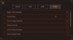
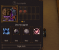
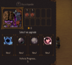
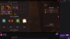
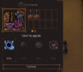

# 伪救世主（The False Messiah）

[原文与贡献者记录](https://ballxpit.wiki.gg/wiki/The_False_Messiah) · [修订 2885](https://ballxpit.wiki.gg/index.php?oldid=2885) · [返回目录](../%E7%90%83%E6%AF%94%E4%BC%A6%E6%88%98%E8%AE%B0%20Wiki.md)

待完善

*此条目为 [待完善](../categories/Stubs.md). 你可以通过帮助 BALL x PIT 维基贡献一份力量。 [补充内容](https://ballxpit.wiki.gg/wiki/The_False_Messiah?action=edit).*

## 假弥赛亚 

一位拥有无限魅力的争议性领袖……

## 基本信息

### 圆球（Ball）

[流血](Bleed.md) 

### 解锁

激活 Twitch 扩展程序并关联你的 Twitch 账户（仅限电脑端 / PC exclusive）

### 能力

如果在 Twitch 上直播，观众可以对某些选择和随机事件进行投票。

**伪救世主** 是独一无二的 [角色](Characters.md) 仅限 PC 版本独有 *[球比伦战记](Ball_x_Pit.md)* 该角色具有许多与流媒体和观众参与相关的功能。该角色并非通过建造相关住房解锁，而是通过激活 [Twitch](https://www.twitch.tv) 在选项菜单的“General”选项卡下扩展，然后通过互联网浏览器关联Twitch账户。他们从这里开始。 [流血](Bleed.md) .

关于设置并启用 Twitch 观众投票功能的详细指南，请参阅官方 [Twitch 扩展常见问题解答](https://docs.google.com/document/d/1nz6Tkk9nvJ2gIskZaFNvTCi2YNy6LcxOA1cTY5go8HM/edit?tab=t.0#heading=h.uigggq5hzyjz)。

## 能力机制

一旦解锁，选项菜单中会出现一个单独的 Twitch 标签页，其中包含多个可单独选择的选项，用于在等级提升过程中增强游戏体验，这些选项都围绕 Twitch 直播观众对玩家提出的各种选项进行投票展开。这些选项包括选择搭档角色、选择等级提升时的升级内容，以及选择具体哪一项升级。 [圆球](Balls.md) 及 [被动道具](Passives.md) 在拾取时涉及进化或融合 [融合反应堆](Fusion_Reactor.md)此外，玩家还可以投票支持各种随机的积极或消极游戏内活动，例如增加怪物出现数量或额外拾取金币的机会{待办事项：列出所有随机活动及其效果的全览表}。只要“伪弥赛亚”仍在启用中，这些选项在扩展功能开启时都会生效，即使玩家当前没有进行直播或没有观众（不过在这种情况下，所有投票结果都将为零，最终选择将默认为游戏中显示的左侧选项）。然而，如果只有一个可选选项（或者除了资源升级外没有其他选项），那么无论是否启用投票功能，玩家都将直接获得选择剩余选项的权利，无需进行投票。另外，如果投票升级的选项处于激活状态，玩家将无法选择驱逐任何特定的升级选项。

如果所有投票选项都被禁用，那么“伪弥赛亚”这个角色的游戏玩法将完全与[战士](The_Warrior.md)  相同，没有直接的机制特殊或技能。该角色的胜利仍然会获得奖杯奖励，但这些奖励无法分配到建筑上，它没有住房或相关技能/升级，也无法用于收获模式，且升级时不会获得收获升级。禁用 Twitch 扩展程序会移除对该角色的访问权限，但重新启用后，该角色将恢复所有已获得的经验值，类似于对其他任何角色拆除重建住房的方式。

## 配对系统

假弥赛亚永远无法被选为其他角色的第二个角色，除非启用了选择第二个角色的选项，否则他们无法让第二个角色加入等级挑战。但是，如果启用了该选项，无论是否构建了[匹配机](Matchmaker.md)，他们都可以通过投票获得一个搭档角色。

{待办：确定可搭配的角色完整列表}

## 策略

玩家可以独立开启或关闭对游戏各个方面投票的选项，因此最终的游戏体验可能会因允许的选项不同而有所差异。不过，一般来说，这里针对相关选项的策略与 [沉思者](The_Cogitator.md)  中的策略类似，在后者中，升级选择的控制权同样会丢失。当开启相关方面的投票时，延迟获取融合反应堆以升级球/被动道具，并启用更多后续选项，或者启用将升级点数存入并等待融合或进化产生所需的球或升级，或释放被动道具或球位以使用额外选项，这些策略都很有用。不过需要注意的是，在这些情况下，无法使用 [驱魔人](Exorcist.md) 驱逐升级项目或重新滚动升级项目。此外，鉴于《The False Messiah》以 [流血](Bleed.md)  开始，如果玩家在这些方面赋予了自己选择权，那么建议围绕协同作用的球和被动道具进行策略制定。否则，如果没有启用投票选项，那么该角色的功能上将与 [战士](The_Warrior.md)  完全相同，没有其他可策略化的独特能力。

## 基础属性

| 属性 | 属性 |
| --- | --- |
|  耐力 | 生命值未知 |
|  力量 | 基础伤害 - ? |
|  领导力 | 小球数量 - ?；小球伤害 - ? |
|  速度 | 球速 - ?；移动速度 - ? |
|  敏捷 | 暴击率 - ?；发射频率 - ? |
|  智力 | 范围效果强度 – 待确认；状态效果强度 - ?；被动效果强度 – 待确认 |

## 角色等级进展

假弥赛亚没有住房，在收获模式下无法使用，因此两者都不会获得升级。 [等级提升](Character_Level_Mechanics.md) 并且无法获得该机制带来的额外经验值收益。 [老兵小屋](Veteran_s_Hut.md)不过，他们仍然会像其他角色一样，每升一级获得属性加成。

[属性加成进展](Attributes.md)

| 角色等级 | 总经验值 | 下一等级所需的额外经验值 | 加成 |
| --- | --- | --- | --- |
| 1 | 0 | 400 | - |
| 2 | 400 | 457 | ? |
| 3 | 857 | 615 | ? |
| 4 | 1,472 | 872 | ? |
| 5 | 2,344 | 1,230 | ? |
| 6 | 3,574 | 1,688 | ? |
| 7 | 5,262 | 2,245 | ? |
| 8 | 7,507 | 2,902 | ? |
| 9 | 10,409 | 3,660 | ? |
| 10 | 14,069 | 4,518 | ? |
| 11 | 18,587 | 5,475 | ? |
| 12 | 24,062 | 6,532 | ? |
| 13 | 30,594 | 7,690 | ? |
| 14 | 38,284 | 8,948 | ? |
| 15 | 47,232 | ? | ? |
| 16 |  | ? | ? |
| 17 |  | ? | ? |
| ... | ... | ... | ... |

## 冷知识

## 图片库

* 启用 Twitch 扩展程序会打开 Twitch 选项菜单。

  
* 一个触发投票事件的示例。

  
* 投票进行中

  
* Twitch 观看者投票界面示例

  
* 投票结果屏幕

  

[共享导航](../navigation/nav-334e23d2914f.md)

**分类**　[分类 · 待完善](../categories/Stubs.md) · [分类 · 角色](../categories/Characters.md) · [分类 · 带有导航框的页面](../categories/Pages_with_navboxes.md)

[返回总入口](../%E7%90%83%E6%AF%94%E4%BC%A6%E6%88%98%E8%AE%B0%20Wiki.md) · [返回本分目录](%E7%9B%AE%E5%BD%95.md)
