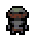

# 自笞者（The Flagellant）

 

只是你的平均旗手。

[原文与贡献者记录](https://ballxpit.wiki.gg/wiki/The_Flagellant) · [修订 4335](https://ballxpit.wiki.gg/index.php?oldid=4335) · [返回目录](../%E7%90%83%E6%AF%94%E4%BC%A6%E6%88%98%E8%AE%B0%20Wiki.md)

#### 一般信息

##### 圆球（Ball）

[蛋袋](Egg_Sac.md) 

##### 解锁

建筑物 [修道院](Monastery.md) 

##### 能力

球通常从屏幕底部跳出。

**自笞者** 是一个可玩的 [性格](Characters.md) 在基本游戏版本中推出了 *[球比伦战记](Ball_x_Pit.md)*它们通过构建 [修道院](Monastery.md)  据报道, [血腥草原](The_GORYxGRASSLANDS.md)  他们的起始球是 [蛋袋](Egg_Sac.md) .

#### 能力的机械

当玩法时，球会像其他墙一样从屏幕底部跳出，而不是回到玩家身上。

#### 策略

* 由于球不会再回到玩家的后面墙上，所以理论上它们可以保持无限，只要玩家没有手动抓住它们。 [闪烁（Flicker）](Flicker.md)  由于他们欣赏了空气时间的增加。

#### [匹配机](Matchmaker.md) 配对 

##### 很好。

##### 坏的

##### 不兼容

* [忏悔者（The Repentant）](The_Repentant.md) 
* [持盾者（The Shieldbearer）](The_Shieldbearer.md) 
* [物理学家（The Physicist）](The_Physicist.md) 
* [掘地者（The Tunneller）](The_Tunneller.md) 
* [战术家（The Tactician）](The_Tactician.md) 
* [File:The Recollector.png](https://ballxpit.wiki.gg/wiki/Special%3AUpload?wpDestFile=The_Recollector.png) [记忆者](https://ballxpit.wiki.gg/wiki/The_Recollector?action=edit&redlink=1)

#### 基本数据

| 属性 | 属性 |
| --- | --- |
|  耐力 | - 什么意思? |
|  力量 | 基地损坏? |
|  领导力 | 宝贝球计数?；婴儿球损伤? |
|  速度 | 球速?；移动速度? |
|  敏捷 | 关键机会?；发生火灾率? |
|  智力 | 公司发动力?；状态效应功率 - ?；动力? |

#### 性格水平的进步

[性格升级奖励](Character_Level_Mechanics.md)

| 性格水平 | 总经验值 | 提高奖励水平 | 选择 |
| --- | --- | --- | --- |
| TBA | TBA | TBA | TBA |

#### 冷知识

* "鞭子"是鞭打自己或他人的人，通常是宗教悔改的形式。

#### 图片库

待补充条目

*这是一个 [待补充条目](../categories/Stubs.md)你可以帮助BALL xPIT Wiki通过 [补充此条目](https://ballxpit.wiki.gg/wiki/The_Flagellant?action=edit).*

[共享导航](../navigation/nav-334e23d2914f.md)

**分类**　[分类 · 角色](../categories/Characters.md) · [分类 · 有破损文件链接的页面](../categories/Pages_with_broken_file_links.md) · [分类 · 坚力](../categories/Stubs.md) · [分类 · 页面有导航框](../categories/Pages_with_navboxes.md)

[返回总入口](../%E7%90%83%E6%AF%94%E4%BC%A6%E6%88%98%E8%AE%B0%20Wiki.md) · [返回本分目录](%E7%9B%AE%E5%BD%95.md)
