# 血腥草原（The GORYxGRASSLANDS）

[原文与贡献者记录](https://ballxpit.wiki.gg/wiki/The_GORYxGRASSLANDS) · [修订 3726](https://ballxpit.wiki.gg/index.php?oldid=3726) · [返回目录](../%E7%90%83%E6%AF%94%E4%BC%A6%E6%88%98%E8%AE%B0%20Wiki.md)

## 基本信息

### 解锁所需齿轮（Gears to unlock）

3

### 建筑蓝图（Blueprints）

9

### 解锁内容（Unlocks）

*  [手镜](https://ballxpit.wiki.gg/wiki/Hand_Mirror?action=edit&redlink=1)
*  [手扇](https://ballxpit.wiki.gg/wiki/Hand_Fan?action=edit&redlink=1)
*  [恋人的箭袋](https://ballxpit.wiki.gg/wiki/Lover%27s_Quiver?action=edit&redlink=1)
* [肉身（Flesh）](Flesh.md) 

**血腥草原** 是 *[球比伦战记](Ball_x_Pit.md)* 的第五个 [关卡](Levels.md)。解锁需要 3 个齿轮。

## 解锁内容

通关本关卡后，玩家将解锁以下物品：

*  [手镜](https://ballxpit.wiki.gg/wiki/Hand_Mirror?action=edit&redlink=1)
*  [手扇](https://ballxpit.wiki.gg/wiki/Hand_Fan?action=edit&redlink=1)
*  [恋人的箭袋](https://ballxpit.wiki.gg/wiki/Lover%27s_Quiver?action=edit&redlink=1)
* [肉身（Flesh）](Flesh.md) 

## 建筑蓝图

玩家可以在本关卡中获得以下 [建筑](Buildings.md)的建筑蓝图：

* [密集小麦（Dense Wheat）](Dense_Wheat.md) [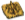](Dense_Wheat.md)
* [大树（Grand Tree）](Grand_Tree.md) [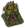](Grand_Tree.md)
* [采集者小屋](Gatherer_s_Hut.md) [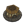](Gatherer_s_Hut.md)
* [赌徒巢穴](Gambler_s_Den.md) [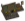](Gambler_s_Den.md)
* [古董店](Antique_Shop.md) [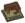](Antique_Shop.md)
* [宝石匠（Gemsmith）](Gemsmith.md) [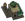](Gemsmith.md)
* [剧场（Theater）](Theater.md) [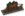](Theater.md)
* [修道院（Monastery）](Monastery.md) [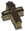](Monastery.md)
* [血腥草原奖杯（Gory Trophy）](Gory_Trophy.md) [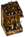](Gory_Trophy.md)

## 敌人

本关卡可能遇到下列[敌人](Enemies.md)。

* [座狼（Warg）](Warg.md) [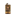](Warg.md)
* [座狼骑手（Warg Rider）](Warg_Rider.md) 
* [座狼弓手（Warg Archer）](Warg_Archer.md) 
* [老鼠（Mouse）](Mouse.md) [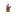](Mouse.md)
* [远古座狼](Ancient_Warg.md) 
* [哥布林军阀](Goblin_Warlord.md) [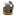](Goblin_Warlord.md)
* [哥布林狙击手](Goblin_Sniper.md) [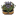](Goblin_Sniper.md)
* [剑齿兽（Sabertooth）](Sabertooth.md) [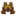](Sabertooth.md)

## 冷知识

* 这是游戏中唯一包含三个小首领的关卡，分别是 [远古座狼](Ancient_Warg.md) 、[哥布林军阀](Goblin_Warlord.md)  和 [哥布林狙击手](Goblin_Sniper.md) 。

[共享导航](../navigation/nav-47f674e55b3c.md)

**分类**　[分类 · 关卡](../categories/Levels.md) · [分类 · 带有导航框的页面](../categories/Pages_with_navboxes.md)

[返回总入口](../%E7%90%83%E6%AF%94%E4%BC%A6%E6%88%98%E8%AE%B0%20Wiki.md) · [返回本分目录](%E7%9B%AE%E5%BD%95.md)
