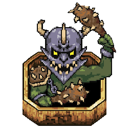
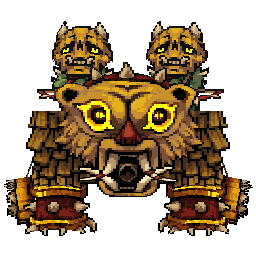

# 血腥草原（The GORYxGRASSLANDS）

[原文与贡献者记录](https://ballxpit.wiki.gg/wiki/The_GORYxGRASSLANDS) · [修订 3726](https://ballxpit.wiki.gg/index.php?oldid=3726) · [返回目录](../%E7%90%83%E6%AF%94%E4%BC%A6%E6%88%98%E8%AE%B0%20Wiki.md)

#### 一般信息

##### 解锁所需齿轮（Gears to unlock）

3

##### 建筑蓝图（Blueprints）

9

##### 解锁条件（Unlocks）

*  [手镜](https://ballxpit.wiki.gg/wiki/Hand_Mirror?action=edit&redlink=1)
*  [手机风扇](https://ballxpit.wiki.gg/wiki/Hand_Fan?action=edit&redlink=1)
*  [恋人的箭袋（Lover's Quiver）](https://ballxpit.wiki.gg/wiki/Lover%27s_Quiver?action=edit&redlink=1)
* [肉类（Flesh）](Flesh.md) 

**血腥草原** 是第五个 [的水平](Levels.md) 在 *[球比伦战记](Ball_x_Pit.md)*。它需要3个齿变才能解锁。..

#### 解锁条件

清除此级别将使玩家能够解锁以下项目:

*  [手镜](https://ballxpit.wiki.gg/wiki/Hand_Mirror?action=edit&redlink=1)
*  [手机风扇](https://ballxpit.wiki.gg/wiki/Hand_Fan?action=edit&redlink=1)
*  [恋人的箭袋（Lover's Quiver）](https://ballxpit.wiki.gg/wiki/Lover%27s_Quiver?action=edit&redlink=1)
* [肉类（Flesh）](Flesh.md) 

#### 建筑蓝图

玩家可以在此关卡中获取以下 [建筑](Buildings.md) 的蓝图 :

* [密集的小麦（Dense Wheat）](Dense_Wheat.md) 
* [大树（Grand Tree）](Grand_Tree.md) 
* [收藏家的小屋（Gatherer's Hut）](Gatherer_s_Hut.md) 
* [赌徒巢穴（Gambler's Den）](Gambler_s_Den.md) 
* [古董店（Antique Shop）](Antique_Shop.md) 
* [石家庄（Gemsmith）](Gemsmith.md) 
* [剧院（Theater）](Theater.md) 
* [修道院（Monastery）](Monastery.md) 
* [戈里奖杯（Gory Trophy）](Gory_Trophy.md) 

#### 敌人

以下是在此级别上可遇到的[enemies](Enemies.md)列表:

* [华格（Warg）](Warg.md) 
* [沃格骑手（Warg Rider）](Warg_Rider.md) 
* [沃格·阿彻（Warg Archer）](Warg_Archer.md) 
* [鼠标（Mouse）](Mouse.md) 
* [古代的华格（Ancient Warg）](Ancient_Warg.md) 
* [妖精战主（Goblin Warlord）](Goblin_Warlord.md) 
* [妖精狙击手（Goblin Sniper）](Goblin_Sniper.md) 
* [沙伯牙（Sabertooth）](Sabertooth.md) 

#### 冷知识

* 这是游戏中的唯一一个含有三位迷你老板, [古代的华格（Ancient Warg）](Ancient_Warg.md)  在 [妖精战主（Goblin Warlord）](Goblin_Warlord.md)  在 [妖精狙击手（Goblin Sniper）](Goblin_Sniper.md) .

[共享导航](../navigation/nav-47f674e55b3c.md)

**分类**　[分类 · 关卡](../categories/Levels.md) · [分类 · 页面有导航框](../categories/Pages_with_navboxes.md)

[返回总入口](../%E7%90%83%E6%AF%94%E4%BC%A6%E6%88%98%E8%AE%B0%20Wiki.md) · [返回本分目录](%E7%9B%AE%E5%BD%95.md)
