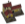
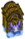
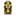
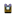
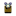
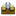
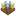

# 天堂之门（The HEAVENLYxGATES）

[原文与贡献者记录](https://ballxpit.wiki.gg/wiki/The_HEAVENLYxGATES) · [修订 3728](https://ballxpit.wiki.gg/index.php?oldid=3728) · [返回目录](../%E7%90%83%E6%AF%94%E4%BC%A6%E6%88%98%E8%AE%B0%20Wiki.md)

## 基本信息

### 解锁所需齿轮（Gears to unlock）

4

### 建筑蓝图（Blueprints）

9

### 解锁内容（Unlocks）

* [魅惑（Charm）](Charm.md) 
*  [幽灵护盾](https://ballxpit.wiki.gg/wiki/Ghostly_Shield?action=edit&redlink=1)
* [叛徒斗篷](Traitor_s_Cowl.md) 
*  [幽灵紧身衣](https://ballxpit.wiki.gg/wiki/Ghostly_Corset?action=edit&redlink=1)

**天堂之门** 是 *[球比伦战记](Ball_x_Pit.md)* 的第七个 [关卡](Levels.md)。需要 4 个齿轮才能解锁。

## 解锁内容

通关本关卡后，玩家将解锁以下物品：

* [魅惑（Charm）](Charm.md) 
*  [幽灵护盾](https://ballxpit.wiki.gg/wiki/Ghostly_Shield?action=edit&redlink=1)
* [叛徒斗篷](Traitor_s_Cowl.md) 
*  [幽灵紧身衣](https://ballxpit.wiki.gg/wiki/Ghostly_Corset?action=edit&redlink=1)

## 建筑蓝图

玩家可以在本关卡中获得以下 [建筑](Buildings.md)的建筑蓝图：

* [工人工会](Worker_s_Guild_Building.md) 
* [木匠](Carpenter_Building.md) 
* [包制师](Bag_Maker_Building.md) 
* [进化室](Evolution_Chamber_Building.md) 
* [遗迹收集者](Relic_Collector_Building.md) 
* [露营地（Campground）](Campground.md) 
* [驯鹰小屋](Falconry_Hut.md) 
* [不稳定塔](Unstable_Tower.md) 
* [天堂之门奖杯](Heavenly_Trophy.md) 

## 敌人

本关卡可能遇到下列[敌人](Enemies.md)。

* [天使眷属（Angelspawn）](Angelspawn.md) 
* [双头天使](Angelic_Twinhead.md) 
* [天使巨鸮](Angelic_Great_Owl.md) 
* [天使眷属狂战士](Angelspawn_Berserker.md) 
* [天使眷属唱诗班](Angelspawn_Choir.md) 
* [有翼天使眷属](Winged_Angelspawn.md) 
* [有翼天使眷属斥候](Winged_Angelspawn_Scout.md) 
* [天使眷属女祭司](Angelspawn_Priestess.md) 
* [天使眷属掠夺者](Angelspawn_Snatcher.md) 
* [不安者](Restless_One.md) 
* [枯瘦劫掠者](Wizened_Snatcher.md) 
* [猫头鹰领主](Lord_of_Owls.md) 

[共享导航](../navigation/nav-47f674e55b3c.md)

**分类**　[分类 · 关卡](../categories/Levels.md) · [分类 · 带有导航框的页面](../categories/Pages_with_navboxes.md)

[返回总入口](../%E7%90%83%E6%AF%94%E4%BC%A6%E6%88%98%E8%AE%B0%20Wiki.md) · [返回本分目录](%E7%9B%AE%E5%BD%95.md)
