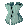
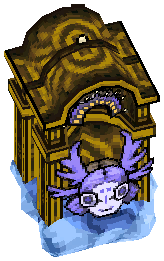
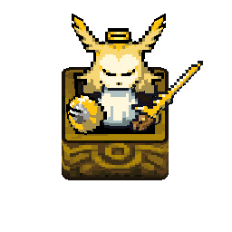
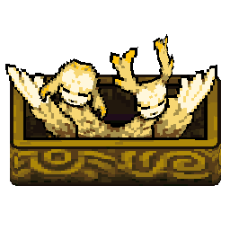
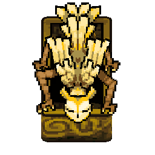
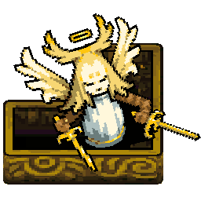
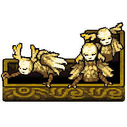
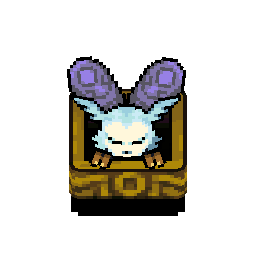
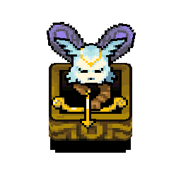
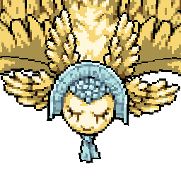

# 天堂之门（The HEAVENLYxGATES）

[原文与贡献者记录](https://ballxpit.wiki.gg/wiki/The_HEAVENLYxGATES) · [修订 3728](https://ballxpit.wiki.gg/index.php?oldid=3728) · [返回目录](../%E7%90%83%E6%AF%94%E4%BC%A6%E6%88%98%E8%AE%B0%20Wiki.md)

#### 一般信息

##### 解锁所需齿轮（Gears to unlock）

4

##### 建筑蓝图（Blueprints）

9

##### 解锁条件（Unlocks）

* [迷人（Charm）](Charm.md) 
*  [幽灵盾牌](https://ballxpit.wiki.gg/wiki/Ghostly_Shield?action=edit&redlink=1)
* [叛徒的外套（Traitor's Cowl）](Traitor_s_Cowl.md) 
*  [幽灵的皮套](https://ballxpit.wiki.gg/wiki/Ghostly_Corset?action=edit&redlink=1)

**天堂之门** 是第七个 [的水平](Levels.md) 在 *[球比伦战记](Ball_x_Pit.md)*需要4个齿轮才能解锁

#### 解锁条件

清除此级别将使玩家能够解锁以下项目:

* [迷人（Charm）](Charm.md) 
*  [幽灵盾牌](https://ballxpit.wiki.gg/wiki/Ghostly_Shield?action=edit&redlink=1)
* [叛徒的外套（Traitor's Cowl）](Traitor_s_Cowl.md) 
*  [幽灵的皮套](https://ballxpit.wiki.gg/wiki/Ghostly_Corset?action=edit&redlink=1)

#### 建筑蓝图

玩家可以在此关卡中获取以下 [建筑](Buildings.md) 的蓝图 :

* [工人协会（Worker's Guild）](Worker_s_Guild_Building.md) 
* [木匠](Carpenter_Building.md) 
* [包装机器](Bag_Maker_Building.md) 
* [进化室](Evolution_Chamber_Building.md) 
* [遗物收藏家](Relic_Collector_Building.md) 
* [露营场（Campground）](Campground.md) 
* [驯鹰小屋（Falconry Hut）](Falconry_Hut.md) 
* [不稳定的塔楼（Unstable Tower）](Unstable_Tower.md) 
* [天上的奖杯（Heavenly Trophy）](Heavenly_Trophy.md) 

#### 敌人

以下是在此级别上可遇到的[enemies](Enemies.md)列表:

* [天使眷属（Angelspawn）](Angelspawn.md) 
* [天使双头（Angelic Twinhead）](Angelic_Twinhead.md) 
* [天使巨鸮（Angelic Great Owl）](Angelic_Great_Owl.md) 
* [Angelspawn 贝尔塞尔（Angelspawn Berserker）](Angelspawn_Berserker.md) 
* [天使队合唱团（Angelspawn Choir）](Angelspawn_Choir.md) 
* [双翼天使（Winged Angelspawn）](Winged_Angelspawn.md) 
* [双翼天使童子军（Winged Angelspawn Scout）](Winged_Angelspawn_Scout.md) 
* [Angelspawh 女祭司（Angelspawn Priestess）](Angelspawn_Priestess.md) 
* [Angelspawn Snatcher 天使捕猎者（Angelspawn Snatcher）](Angelspawn_Snatcher.md) 
* [一个不安的人（Restless One）](Restless_One.md) 
* [枯瘦劫掠者（Wizened Snatcher）](Wizened_Snatcher.md) 
* [猫头鹰领主（Lord of Owls）](Lord_of_Owls.md) 

[共享导航](../navigation/nav-47f674e55b3c.md)

**分类**　[分类 · 关卡](../categories/Levels.md) · [分类 · 页面有导航框](../categories/Pages_with_navboxes.md)

[返回总入口](../%E7%90%83%E6%AF%94%E4%BC%A6%E6%88%98%E8%AE%B0%20Wiki.md) · [返回本分目录](%E7%9B%AE%E5%BD%95.md)
