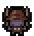
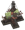

# 白发囤积者（The Hoary Hoarder）

[原文与贡献者记录](https://ballxpit.wiki.gg/wiki/The_Hoary_Hoarder) · [修订 3999](https://ballxpit.wiki.gg/index.php?oldid=3999) · [返回目录](../%E7%90%83%E6%AF%94%E4%BC%A6%E6%88%98%E8%AE%B0%20Wiki.md)

## 白发囤积者 

别人的垃圾可能是别人的宝藏。

## 基本信息

### 解锁

构建 [不稳定塔](Unstable_Tower.md) 

### 能力

只有2个球槽，但剩余的装备槽将变为被动槽。

**白发囤积者** 是 *[球比伦战记](Ball_x_Pit.md)* 在 [自然主义者更新](https://ballxpit.wiki.gg/wiki/The_Naturalist_Update?action=edit&redlink=1) 中加入的一名可玩的 [角色](Characters.md)。建造 [不稳定塔](Unstable_Tower.md)  即可解锁该角色，其蓝图位于 [天堂之门](The_HEAVENLYxGATES.md) 。该角色拥有两倍的被动槽位，但只能携带两颗圆球，且没有初始圆球。

## 能力机制

**TBA**

## 配对系统

**TBA**

## 策略

[点击此处添加策略！](https://ballxpit.wiki.gg/wiki/The_Hoary_Hoarder?action=edit&section=new)

## 基础属性

| 属性 | 属性 |
| --- | --- |
|  耐力 | 生命值未知 |
|  力量 | 基础伤害 - ? |
|  领导力 | 小球数量 - ?；小球伤害 - ? |
|  速度 | 球速 - ?；移动速度 - ? |
|  敏捷 | 暴击率 - ?；发射频率 - ? |
|  智力 | 范围效果强度 – 待确认；状态效果强度 - ?；被动效果强度 – 待确认 |

## 角色等级进展

[角色等级提升奖励](Character_Level_Mechanics.md)

| 角色等级 | 总经验值 | 升级奖励 | 选择项 |
| --- | --- | --- | --- |
| TBA | TBA | TBA | TBA |

## 冷知识

## 图片库

待完善

*此条目为 [待完善](../categories/Stubs.md). 你可以通过帮助 BALL x PIT 维基贡献一份力量。 [补充内容](https://ballxpit.wiki.gg/wiki/The_Hoary_Hoarder?action=edit).*

[共享导航](../navigation/nav-334e23d2914f.md)

**分类**　[分类 · 角色](../categories/Characters.md) · [分类 · 待完善](../categories/Stubs.md) · [分类 · 带有导航框的页面](../categories/Pages_with_navboxes.md)

[返回总入口](../%E7%90%83%E6%AF%94%E4%BC%A6%E6%88%98%E8%AE%B0%20Wiki.md) · [返回本分目录](%E7%9B%AE%E5%BD%95.md)
