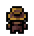
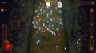
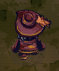

# 快枪手（The Itchy Finger）

[原文与贡献者记录](https://ballxpit.wiki.gg/wiki/The_Itchy_Finger) · [修订 4321](https://ballxpit.wiki.gg/index.php?oldid=4321) · [返回目录](../%E7%90%83%E6%AF%94%E4%BC%A6%E6%88%98%E8%AE%B0%20Wiki.md)

待完善

*此条目为 [待完善](../categories/Stubs.md). 你可以通过帮助 BALL x PIT 维基贡献一份力量。 [补充内容](https://ballxpit.wiki.gg/wiki/The_Itchy_Finger?action=edit).*

## 快枪手 

一个蒙羞的副警长。

## 基本信息

### 圆球（Ball）

[灼烧](Burn.md) 

### 解锁

构筑 [警长办公室](Sheriff_s_Office.md)

### 能力

射击目标分散，但速度提高一倍，且如果有球可用，会持续发射。射击时仍可全速移动。

**快枪手**是*[《球比伦战记》](Ball_x_Pit.md)*的可玩[角色](Characters.md)。建造[警长办公室](Sheriff_s_Office.md)即可解锁，蓝图在[骸骨墓园](The_BONExYARD.md) 随机掉落。所有圆球以两倍基础速度发射，只要有球可用就会自动发射。发射时角色仍以全速移动，圆球的发射轨迹会散开。初始圆球是[灼烧](Burn.md) 。

## 能力机制

无论自动发射选项如何设置，快枪手始终会自动发射，手头的圆球用完才会停下。[婴儿摇铃](Baby_Rattle.md) 和[飞毛腿](https://ballxpit.wiki.gg/wiki/Fleet_Feet?action=edit&redlink=1)的特效与该角色的能力重合，不能叠加，但它们提供的基础小球数量和移动速度加成仍然生效。两倍基础发射速度也能与[耀光羽毛](https://ballxpit.wiki.gg/wiki/Radiant_Feather?action=edit&redlink=1)等被动道具的发射速度加成叠加。

## 配对系统

### 好

### 坏

### 不兼容

* [战术家](The_Tactician.md) 

## 策略

快枪手的初始圆球是 [灼烧](Burn.md) ，因此 [午夜灯油](Midnight_Oil.md)  这类被动道具是构筑的自然补充。 [飞毛腿](https://ballxpit.wiki.gg/wiki/Fleet_Feet?action=edit&redlink=1) 或  [耀光羽毛](https://ballxpit.wiki.gg/wiki/Radiant_Feather?action=edit&redlink=1) 等被动道具提供的移动和圆球发射速度加成，与角色天生的速度优势相得益彰；[File:Rubber Band.png](https://ballxpit.wiki.gg/wiki/Special%3AUpload?wpDestFile=Rubber_Band.png) [橡皮筋](https://ballxpit.wiki.gg/wiki/Rubber_Band?action=edit&redlink=1) 带来的发射速度惩罚也因此得到补偿。此外，散射效果也…… [婴儿摇铃](Baby_Rattle.md)  不会与角色已有的同类效果叠加，因此其基础小球数量加成本身并无明显弊端。自然的圆球搭配可能包括：用 [铁](Iron.md)  补偿发射速度并进行构筑，搭配 [炸弹](Bomb.md) ，最终再以 [中毒](Poison.md)  合成 [核弹](Nuclear_Bomb.md) 。

## 基础属性

| 属性 | 属性 |
| --- | --- |
|  耐力 | 生命值未知 |
|  力量 | 基础伤害 - ? |
|  领导力 | 小球数量 - ?；小球伤害 - ? |
|  速度 | 球速 - ?；移动速度 - ? |
|  敏捷 | 暴击率 - ?；发射频率 - ? |
|  智力 | 范围效果强度 – 待确认；状态效果强度 - ?；被动效果强度 – 待确认 |

## 角色等级进展

[角色等级提升奖励](Character_Level_Mechanics.md)

| 角色等级 | 总经验值 | 升级奖励 | 选择项 |
| --- | --- | --- | --- |
| 3 | 857 | [收获升级](Harvest_Upgrades_Character_Bonus.md) |  [短跑手](https://ballxpit.wiki.gg/wiki/Sprinter?action=edit&redlink=1) 或  [长柄镰刀（Long Sickle）](https://ballxpit.wiki.gg/wiki/Long_Sickle?action=edit&redlink=1) |
| 4 | 1,472 | [住房能力获取](Buildings.md#%E4%BD%8F%E6%88%BF) | 每消灭10个敌人，即可获得1个额外 金币的奖励。 |
| 6 | 3,574 | [收获升级](Harvest_Upgrades_Character_Bonus.md) |  [破坏者](https://ballxpit.wiki.gg/wiki/Demolitionist?action=edit&redlink=1) 或  [小麦收割机](https://ballxpit.wiki.gg/wiki/Wheat_Harvester?action=edit&redlink=1) |
| 7 | 5,262 | [住房能力升级](Buildings.md#%E4%BD%8F%E6%88%BF) | 每杀死9个敌人，即可获得1个金币的奖励。 |
| 9 | 10,409 | [住房能力升级](Buildings.md#%E4%BD%8F%E6%88%BF) | 每消灭8个敌人，即可获得1个金币的奖励。 |
| 10 | 14,069 | [收获升级](Harvest_Upgrades_Character_Bonus.md) |  [啄木鸟（Woodpecker）](https://ballxpit.wiki.gg/wiki/Woodpecker?action=edit&redlink=1) 或  [石匠](https://ballxpit.wiki.gg/wiki/Stonepiercer?action=edit&redlink=1) |
| ... | ... | ... |  |

[属性加成进展](Attributes.md)

| 角色等级 | 总经验值 | 下一等级所需的额外经验值 | 加成 |
| --- | --- | --- | --- |
| 1 | 0 | 400 | - |
| 2 | 400 | 457 | ? |
| 3 | 857 | 615 | ? |
| 4 | 1,472 | 872 | ? |
| 5 | 2,344 | 1,230 | ? |
| 6 | 3,574 | 1,688 | ? |
| 7 | 5,262 | 2,245 | ? |
| 8 | 7,507 | 2,902 | ? |
| 9 | 10,409 | 3,660 | ? |
| 10 | 14,069 | 4,518 | ? |
| 11 | 18,587 | 5,475 | ? |
| 12 | 24,062 | 6,532 | ? |
| 13 | 30,594 | 7,690 | ? |
| 14 | 38,284 | 8,948 | ? |
| 15 | 47,232 | ? | ? |
| 16 |  | ? | ? |
| 17 |  | ? | ? |
| ... | ... | ... | ... |

## 冷知识

## 图片库

* 快枪手行动中。

  
* 快枪手的特写镜头。

  

[共享导航](../navigation/nav-334e23d2914f.md)

**分类**　[分类 · 待完善](../categories/Stubs.md) · [分类 · 角色](../categories/Characters.md) · [分类 · 文件链接失效的页面](../categories/Pages_with_broken_file_links.md) · [分类 · 带有导航框的页面](../categories/Pages_with_navboxes.md)

[返回总入口](../%E7%90%83%E6%AF%94%E4%BC%A6%E6%88%98%E8%AE%B0%20Wiki.md) · [返回本分目录](%E7%9B%AE%E5%BD%95.md)
