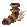
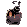
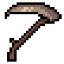
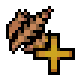
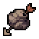
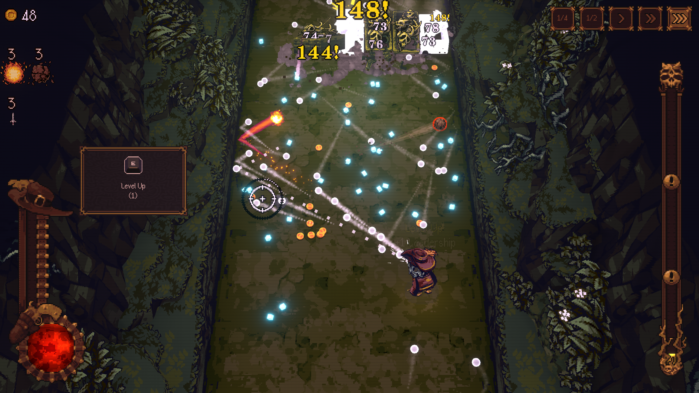

# 快枪手（The Itchy Finger）

 

一个可耻的副手

[原文与贡献者记录](https://ballxpit.wiki.gg/wiki/The_Itchy_Finger) · [修订 4321](https://ballxpit.wiki.gg/index.php?oldid=4321) · [返回目录](../%E7%90%83%E6%AF%94%E4%BC%A6%E6%88%98%E8%AE%B0%20Wiki.md)

待补充条目

*这是一个 [待补充条目](../categories/Stubs.md)你可以帮助BALL xPIT Wiki通过 [补充此条目](https://ballxpit.wiki.gg/wiki/The_Itchy_Finger?action=edit).*

#### 一般信息

##### 圆球（Ball）

[灼烧](Burn.md) 

##### 解锁

建立一个 [警长办公室](Sheriff_s_Office.md)

##### 能力

射击速度是两倍的，如果有任何可用的球，他会不断发射球。

**快枪手** 是一个可玩的 [性格](Characters.md) 在 *[球比伦战记](Ball_x_Pit.md)*它们通过构建 [警长办公室](Sheriff_s_Office.md), 蓝图可以找到作为一个随机落入 [骸骨墓园](The_BONExYARD.md) .它们的定义能力是，所有的球都以基本速度的两倍发射,此外，默认情况下，角色在拍摄时以全速移动，但他们的球发射轨迹分散。他们的起始球是 [灼烧](Burn.md) .

#### 能力的机械

极右手指的功能行为似乎自动火力总是活跃的不管是否选择了自动火力选项， 球的发射只能因存储的球流出而中断。此外, [婴儿摇铃](Baby_Rattle.md)  及  [舰队脚](https://ballxpit.wiki.gg/wiki/Fleet_Feet?action=edit&redlink=1) 它们重叠并不会与"刺痛手指"的默认能力堆叠 (减去这些被动者的基本婴儿球数量和角色运动速度奖励)，但翻倍的基本球发射速度确实与被动的相同奖励堆叠，如  [发光的羽毛](https://ballxpit.wiki.gg/wiki/Radiant_Feather?action=edit&redlink=1).

#### 配对器

##### 很好。

##### 坏的

##### 不兼容

* [战术家（The Tactician）](The_Tactician.md) 

#### 策略

痒指开始于 [灼烧](Burn.md) ,所以被动，如 [午夜油](Midnight_Oil.md)  运动和弹射速度奖励从被动的诸如  [舰队脚](https://ballxpit.wiki.gg/wiki/Fleet_Feet?action=edit&redlink=1) 或是  [发光的羽毛](https://ballxpit.wiki.gg/wiki/Radiant_Feather?action=edit&redlink=1) 与角色的自然速度边缘， 和发射速度罚则从 [File:Rubber Band.png](https://ballxpit.wiki.gg/wiki/Special%3AUpload?wpDestFile=Rubber_Band.png) [橡皮筋](https://ballxpit.wiki.gg/wiki/Rubber_Band?action=edit&redlink=1) 另外，除了这种效果之外, [婴儿摇铃](Baby_Rattle.md)  基本的婴儿球数额奖励没有有效的缺点。自然的球配对可能包括 [铁](Iron.md)  为了补偿发射速度, [炸弹](Bomb.md)  并且最终, [中毒](Poison.md)  在 [核弹](Nuclear_Bomb.md) .

#### 基本数据

| 属性 | 属性 |
| --- | --- |
|  耐力 | - 什么意思? |
|  力量 | 基地损坏? |
|  领导力 | 宝贝球计数?；婴儿球损伤? |
|  速度 | 球速?；移动速度? |
|  敏捷 | 关键机会?；发生火灾率? |
|  智力 | 公司发动力?；状态效应功率 - ?；动力? |

#### 性格水平的进步

[性格升级奖励](Character_Level_Mechanics.md)

| 性格水平 | 总经验值 | 提高奖励水平 | 选择 |
| --- | --- | --- | --- |
| 3 | 857 | [提高收获](Harvest_Upgrades_Character_Bonus.md) |  [冲刺运动员](https://ballxpit.wiki.gg/wiki/Sprinter?action=edit&redlink=1) 或是  [长柄镰刀（Long Sickle）](https://ballxpit.wiki.gg/wiki/Long_Sickle?action=edit&redlink=1) |
| 4 | 1,472 | [住房能力增长](Buildings.md#%E4%BD%8F%E6%88%BF) | 丢掉1个奖金  每10个敌人被杀的水平就会有黄金。 |
| 6 | 3,574 | [提高收获](Harvest_Upgrades_Character_Bonus.md) |  [拆除主义者](https://ballxpit.wiki.gg/wiki/Demolitionist?action=edit&redlink=1) 或是  [麦机](https://ballxpit.wiki.gg/wiki/Wheat_Harvester?action=edit&redlink=1) |
| 7 | 5,262 | [提高住房能力](Buildings.md#%E4%BD%8F%E6%88%BF) | 丢掉1个奖金  每9个敌人被杀的水平就会有黄金。 |
| 9 | 10,409 | [提高住房能力](Buildings.md#%E4%BD%8F%E6%88%BF) | 丢掉1个奖金  每8个敌人被杀时，就会有黄金。 |
| 10 | 14,069 | [提高收获](Harvest_Upgrades_Character_Bonus.md) |  [啄木鸟（Woodpecker）](https://ballxpit.wiki.gg/wiki/Woodpecker?action=edit&redlink=1) 或是  [石头破碎者](https://ballxpit.wiki.gg/wiki/Stonepiercer?action=edit&redlink=1) |
| ... | ... | ... |  |

[将奖金归类进步](Attributes.md)

| 性格水平 | 总经验值 | 下一个级别的经验值 | 奖金 |
| --- | --- | --- | --- |
| 1 | 0 | 400 | - |
| 2 | 400 | 457 | ? |
| 3 | 857 | 615 | ? |
| 4 | 1,472 | 872 | ? |
| 5 | 2,344 | 1,230 | ? |
| 6 | 3,574 | 1,688 | ? |
| 7 | 5,262 | 2,245 | ? |
| 8 | 7,507 | 2,902 | ? |
| 9 | 10,409 | 3,660 | ? |
| 10 | 14,069 | 4,518 | ? |
| 11 | 18,587 | 5,475 | ? |
| 12 | 24,062 | 6,532 | ? |
| 13 | 30,594 | 7,690 | ? |
| 14 | 38,284 | 8,948 | ? |
| 15 | 47,232 | ? | ? |
| 16 |  | ? | ? |
| 17 |  | ? | ? |
| ... | ... | ... | ... |

#### 冷知识

#### 图片库

* 刺痛手指在行动中。

  
* 这是一部"刺痛手指"的近距离。

  

[共享导航](../navigation/nav-334e23d2914f.md)

**分类**　[分类 · 坚力](../categories/Stubs.md) · [分类 · 角色](../categories/Characters.md) · [分类 · 有破损文件链接的页面](../categories/Pages_with_broken_file_links.md) · [分类 · 页面有导航框](../categories/Pages_with_navboxes.md)

[返回总入口](../%E7%90%83%E6%AF%94%E4%BC%A6%E6%88%98%E8%AE%B0%20Wiki.md) · [返回本分目录](%E7%9B%AE%E5%BD%95.md)
