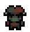

# 杂耍者（The Juggler）

 

一个街头表演者，繁荣丰富。

[原文与贡献者记录](https://ballxpit.wiki.gg/wiki/The_Juggler) · [修订 4331](https://ballxpit.wiki.gg/index.php?oldid=4331) · [返回目录](../%E7%90%83%E6%AF%94%E4%BC%A6%E6%88%98%E8%AE%B0%20Wiki.md)

待补充条目

*这是一个 [待补充条目](../categories/Stubs.md)你可以帮助BALL xPIT Wiki通过 [补充此条目](https://ballxpit.wiki.gg/wiki/The_Juggler?action=edit).*

#### 一般信息

##### 圆球（Ball）

[闪电](Lightning.md) 

##### 解锁

建立一个 [剧院](Theater.md)

##### 能力

在球场上的目标位置，球球在达到地面之前不会开始跳起来。

**杂耍者** 是一个可以解锁的可播放 [角色](Characters.md) 在 *[球比伦战记](Ball_x_Pit.md)*它们通过构建 [剧院](Theater.md), 蓝图可以找到作为一个随机落入 [血腥草原](The_GORYxGRASSLANDS.md)  他们的起始球是 [闪电](Lightning.md) .

#### 能力描述

当Juggler发射一个球时，它不是像往常那样直接从字符中射击，而是在弧弧中通过空气，直接降落在玩家的光标上。只有在球落地后，它才会以它通常拥有的同样轨迹自行发射，并开始弹出并影响墙壁、敌人和射弹。

#### 策略

[单击这里，添加一个策略!](https://ballxpit.wiki.gg/wiki/The_Juggler?action=edit&section=new)

#### [匹配机](Matchmaker.md) 配对 

##### 很好。

* [忏悔者（The Repentant）](The_Repentant.md)  使玩家能“插入”球体进入大批敌人的中间， 这些敌人可以迅速积聚起来,
* [物理学家（The Physicist）](The_Physicist.md) : 允许精确的目标充分利用跳跃能力。

##### 坏的

##### 不兼容

* [同居者（The Cohabitants）](The_Cohabitants.md) 
* [File:The Sentinel.png](https://ballxpit.wiki.gg/wiki/Special%3AUpload?wpDestFile=The_Sentinel.png) [卫兵](https://ballxpit.wiki.gg/wiki/The_Sentinel?action=edit&redlink=1)
* [File:The Recollector.png](https://ballxpit.wiki.gg/wiki/Special%3AUpload?wpDestFile=The_Recollector.png) [记忆者](https://ballxpit.wiki.gg/wiki/The_Recollector?action=edit&redlink=1)

#### 关卡

[性格升级奖励](Character_Level_Mechanics.md)

| 性格水平 | 总经验值 | 提高奖励水平 | 选择 |
| --- | --- | --- | --- |
| 3 | 857 | [提高收获](Harvest_Upgrades_Character_Bonus.md) |  [麦机](https://ballxpit.wiki.gg/wiki/Wheat_Harvester?action=edit&redlink=1) 或是  [冲刺运动员](https://ballxpit.wiki.gg/wiki/Sprinter?action=edit&redlink=1) |
| 4 | 1,472 | [住房能力增长](Buildings.md#%E4%BD%8F%E6%88%BF) | 收获  每10分钟从相邻的巨石中取出1枚。 |
| 6 | 3,574 | [提高收获](Harvest_Upgrades_Character_Bonus.md) |  [冲刺运动员](https://ballxpit.wiki.gg/wiki/Sprinter?action=edit&redlink=1) 或是  [石头破碎者](https://ballxpit.wiki.gg/wiki/Stonepiercer?action=edit&redlink=1) |
| 7 | 5,262 | [提高住房能力](Buildings.md#%E4%BD%8F%E6%88%BF) | 收获  每10分钟就会从邻近的岩石中2个。 |
| 9 | 10,409 | [提高住房能力](Buildings.md#%E4%BD%8F%E6%88%BF) | 收获  每10分钟就会从邻近的岩石中3个。 |
| 10 | 14,069 | [提高收获](Harvest_Upgrades_Character_Bonus.md) |  [麦子主](https://ballxpit.wiki.gg/wiki/Wheat_Master?action=edit&redlink=1) 或是  [麦机](https://ballxpit.wiki.gg/wiki/Wheat_Harvester?action=edit&redlink=1) |
| ... | ... | ... |  |

#### 冷知识

在游戏文件中， 游戏文件中将“ 杂耍者” 内部称为“ 懦夫 ” 。

#### 图片库

[共享导航](../navigation/nav-334e23d2914f.md)

**分类**　[分类 · 坚力](../categories/Stubs.md) · [分类 · 角色](../categories/Characters.md) · [分类 · 有破损文件链接的页面](../categories/Pages_with_broken_file_links.md) · [分类 · 页面有导航框](../categories/Pages_with_navboxes.md)

[返回总入口](../%E7%90%83%E6%AF%94%E4%BC%A6%E6%88%98%E8%AE%B0%20Wiki.md) · [返回本分目录](%E7%9B%AE%E5%BD%95.md)
