# 边境沙漠（The LIMINALxDESERT）

[原文与贡献者记录](https://ballxpit.wiki.gg/wiki/The_LIMINALxDESERT) · [修订 3723](https://ballxpit.wiki.gg/index.php?oldid=3723) · [返回目录](../%E7%90%83%E6%AF%94%E4%BC%A6%E6%88%98%E8%AE%B0%20Wiki.md)

## 基本信息

### 解锁所需齿轮（Gears to unlock）

2

### 建筑蓝图（Blueprints）

12

### 解锁内容（Unlocks）

* [光（Light）](Light.md) 
* [吸血剑](Vampiric_Sword.md) [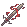](Vampiric_Sword.md)
* [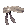](https://ballxpit.wiki.gg/wiki/Silver_Blindfold) [银色蒙眼](https://ballxpit.wiki.gg/wiki/Silver_Blindfold?action=edit&redlink=1)
* [神射手护符](Deadeye_s_Amulet.md) 

**边境沙漠** 是 *[球比伦战记](Ball_x_Pit.md)* 的第三个 [关卡](Levels.md)。需要 2 个齿轮才能解锁。

## 解锁内容

通关本关卡后，玩家将解锁以下物品：

* [光（Light）](Light.md) 
* [吸血剑](Vampiric_Sword.md) 
*  [银色蒙眼](https://ballxpit.wiki.gg/wiki/Silver_Blindfold?action=edit&redlink=1)
* [神射手护符](Deadeye_s_Amulet.md) 

## 建筑蓝图

玩家可以在本关卡中获得以下 [建筑](Buildings.md)的建筑蓝图：

* [金矿（Gold Mine）](Gold_Mine.md) [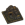](Gold_Mine.md)
* [市场（Market）](Market.md) [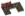](Market.md)
* [温泉浴场（Spa）](Spa.md) [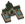](Spa.md)
* [军事学院](Military_Academy.md) [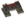](Military_Academy.md)
* [外交厅](Diplomacy_Hall.md) [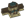](Diplomacy_Hall.md)
* [射箭场](Archery_Range.md) [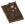](Archery_Range.md)
* [银行（Bank）](Bank.md) [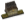](Bank.md)
* [磁铁工厂](Magnet_Factory.md) [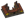](Magnet_Factory.md)
* [岩石山丘（Rocky Hill）](Rocky_Hill.md) [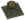](Rocky_Hill.md)
* [陵墓（Mausoleum）](Mausoleum.md) [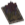](Mausoleum.md)
* [公会大厅（Guild Hall）](Guild_Hall.md) [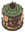](Guild_Hall.md)
* [沙漠奖杯](Desert_Trophy.md) [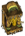](Desert_Trophy.md)

## 敌人

本关卡可能遇到下列[敌人](Enemies.md)。

* [蜥蜴（Lizard）](Lizard.md) [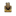](Lizard.md)
* [蛮力蜥蜴](Lizard_Brute.md) [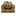](Lizard_Brute.md)
* [滑蜥（Slizard）](Slizard.md) [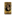](Slizard.md)
* [蜥蜴壮汉](Lizard_Strongman.md) [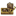](Lizard_Strongman.md)
* [蜥蜴堡垒](Lizard_Bastion.md) [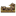](Lizard_Bastion.md)
* [激光蝗虫](Laser_Locust.md) [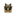](Laser_Locust.md)
* [蠕虫（Worm）](Worm.md) [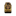](Worm.md)
* [踏沙者（Sandwalker）](Sandwalker.md) [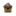](Sandwalker.md)
* [变形眼镜蛇](Shifting_Cobra.md) [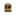](Shifting_Cobra.md)
* [沙漠哨兵](Desert_Sentinel.md) [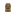](Desert_Sentinel.md)
* [狂怒蝗虫](Seething_Locust.md) [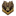](Seething_Locust.md)
* [巨型哨兵](Great_Sentinel.md) [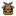](Great_Sentinel.md)
* [扭曲之蛇](Twisted_Serpent.md) [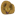](Twisted_Serpent.md)

[共享导航](../navigation/nav-47f674e55b3c.md)

**分类**　[分类 · 关卡](../categories/Levels.md) · [分类 · 带有导航框的页面](../categories/Pages_with_navboxes.md)

[返回总入口](../%E7%90%83%E6%AF%94%E4%BC%A6%E6%88%98%E8%AE%B0%20Wiki.md) · [返回本分目录](%E7%9B%AE%E5%BD%95.md)
