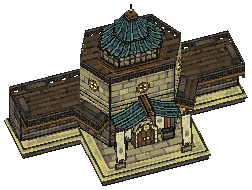
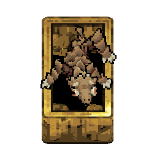
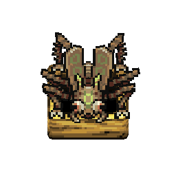
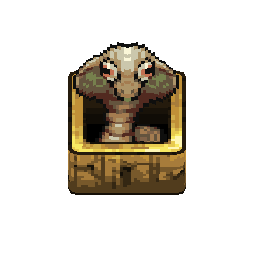

# 边境沙漠（The LIMINALxDESERT）

[原文与贡献者记录](https://ballxpit.wiki.gg/wiki/The_LIMINALxDESERT) · [修订 3723](https://ballxpit.wiki.gg/index.php?oldid=3723) · [返回目录](../%E7%90%83%E6%AF%94%E4%BC%A6%E6%88%98%E8%AE%B0%20Wiki.md)

#### 一般信息

##### 解锁所需齿轮（Gears to unlock）

2

##### 建筑蓝图（Blueprints）

12

##### 解锁条件（Unlocks）

* [光（Light）](Light.md) 
* [吸血鬼剑（Vampiric Sword）](Vampiric_Sword.md) 
*  [银眼罩](https://ballxpit.wiki.gg/wiki/Silver_Blindfold?action=edit&redlink=1)
* [死亡眼睛的宝藏（Deadeye's Amulet）](Deadeye_s_Amulet.md) 

**边境沙漠** 是第三个 [的水平](Levels.md) 在 *[球比伦战记](Ball_x_Pit.md)*。它需要2个装置来解锁。..

#### 解锁条件

清除此级别将使玩家能够解锁以下项目:

* [光（Light）](Light.md) 
* [吸血鬼剑（Vampiric Sword）](Vampiric_Sword.md) 
*  [银眼罩](https://ballxpit.wiki.gg/wiki/Silver_Blindfold?action=edit&redlink=1)
* [死亡眼睛的宝藏（Deadeye's Amulet）](Deadeye_s_Amulet.md) 

#### 建筑蓝图

玩家可以在此关卡中获取以下 [建筑](Buildings.md) 的蓝图 :

* [金矿（Gold Mine）](Gold_Mine.md) 
* [市场（Market）](Market.md) 
* [热水池（Spa）](Spa.md) 
* [军事学院（Military Academy）](Military_Academy.md) 
* [外交厅（Diplomacy Hall）](Diplomacy_Hall.md) 
* [射箭射击范围（Archery Range）](Archery_Range.md) 
* [银行（Bank）](Bank.md) 
* [磁铁工厂（Magnet Factory）](Magnet_Factory.md) 
* [洛基山（Rocky Hill）](Rocky_Hill.md) 
* [陵墓（Mausoleum）](Mausoleum.md) 
* [协会厅（Guild Hall）](Guild_Hall.md) 
* [沙漠奖杯（Desert Trophy）](Desert_Trophy.md) 

#### 敌人

以下是在此级别上可遇到的[enemies](Enemies.md)列表:

* [蜥蜴（Lizard）](Lizard.md) 
* [蛮力蜥蜴（Lizard Brute）](Lizard_Brute.md) 
* [滑蜥（Slizard）](Slizard.md) 
* [蜥蜴壮汉（Lizard Strongman）](Lizard_Strongman.md) 
* [蜥蜴堡垒（Lizard Bastion）](Lizard_Bastion.md) 
* [激光蝗虫（Laser Locust）](Laser_Locust.md) 
* [蠕虫（Worm）](Worm.md) 
* [沙步行者（Sandwalker）](Sandwalker.md) 
* [转移的科布拉（Shifting Cobra）](Shifting_Cobra.md) 
* [沙漠哨兵（Desert Sentinel）](Desert_Sentinel.md) 
* [狂怒蝗虫（Seething Locust）](Seething_Locust.md) 
* [伟大的卫兵（Great Sentinel）](Great_Sentinel.md) 
* [扭曲的蛇（Twisted Serpent）](Twisted_Serpent.md) 

[共享导航](../navigation/nav-47f674e55b3c.md)

**分类**　[分类 · 关卡](../categories/Levels.md) · [分类 · 页面有导航框](../categories/Pages_with_navboxes.md)

[返回总入口](../%E7%90%83%E6%AF%94%E4%BC%A6%E6%88%98%E8%AE%B0%20Wiki.md) · [返回本分目录](%E7%9B%AE%E5%BD%95.md)
