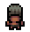
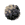
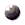
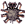
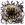
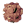

# 临时西西弗斯（The Makeshift Sisyphus）

[原文与贡献者记录](https://ballxpit.wiki.gg/wiki/The_Makeshift_Sisyphus) · [修订 4337](https://ballxpit.wiki.gg/index.php?oldid=4337) · [返回目录](../%E7%90%83%E6%AF%94%E4%BC%A6%E6%88%98%E8%AE%B0%20Wiki.md)

## 临时西西弗斯 

一位被时间折磨的前国王。

## 基本信息

### 圆球（Ball）

[地震](Earthquake.md) 

### 解锁

建造 [岩石山丘](Rocky_Hill.md) 

### 能力

小球不再造成直接命中伤害，但范围效果和状态效果伤害增加4倍。没有小球。

**临时西西弗斯** 是 *[球比伦战记](Ball_x_Pit.md)* 基础游戏中就包含的一名可玩的 [角色](Characters.md)。建造 [岩石山丘](Rocky_Hill.md)  即可解锁，其蓝图位于 [边境沙漠](The_LIMINALxDESERT.md) 。起始圆球为 [地震](Earthquake.md) 。

## 能力说明

由临时西西弗斯投掷的小球在直接命中时不会造成伤害。然而，这些小球造成的任何范围效果或状态效果伤害将增加400%。此外，临时西西弗斯没有小球。

## 策略

* 临时西西弗斯几乎只追求对范围效果和状态效果造成伤害的构筑方式，这会使许多通常威力强大的构筑和球种变得几乎毫无用处。例如：
  + [石头（Stone）](Stone.md) 
  + [铁（Iron）](Iron.md) 
  + [钢铁（Steel）](Steel.md) 
  + [肉身（Flesh）](Flesh.md) 
  + [细胞（Cell）](Cell.md) 
  + [幽灵（Ghost）](Ghost.md) 
* 虽然临时西西弗斯无法自行发射小球，但由生成小球的球来生成小球仍然是可行的。不过，仍应避开它们，因为它们生成的小球不会造成任何伤害。例如：
  + [育巢母体](Brood_Mother.md) 
  + [卵囊（Egg Sac）](Egg_Sac.md) 
  + [蜘蛛女王](Spider_Queen.md) 
  + [丰满的卵囊](Voluptuous_Egg_Sac.md) 
  + [肉丘（Flesh Mound）](Flesh_Mound.md) 
  + [后代（Offspring）](Offspring.md) 
  + [文件：Water Bug.png](https://ballxpit.wiki.gg/wiki/Special%3AUpload?wpDestFile=Water_Bug.png) [水虫](https://ballxpit.wiki.gg/wiki/Water_Bug?action=edit&redlink=1)

## [匹配机](Matchmaker.md) 配对 

### 好

* [空巢者](The_Empty_Nester.md) ：这两个角色都没有小球，且都注重原始特殊球伤害，因此他们配合得相当默契。
* [File:The Conduit.png](https://ballxpit.wiki.gg/wiki/Special%3AUpload?wpDestFile=The_Conduit.png) [导管](https://ballxpit.wiki.gg/wiki/The_Conduit?action=edit&redlink=1)：导管的核心机制基于范围效果伤害，这意味着它们可以从西西弗斯带来的4倍范围效果伤害中获益匪浅。

### 坏

### 不兼容

* [同居者](The_Cohabitants.md) 
* [暗影（The Shade）](The_Shade.md) 
* [挥霍者](The_Spendthrift.md) 

## 基础属性

| 属性 | 属性 |
| --- | --- |
|  耐力 | 生命值未知 |
|  力量 | 基础伤害 - ? |
|  领导力 | 小球数量 - ?；小球伤害 - ? |
|  速度 | 球速 - ?；移动速度 - ? |
|  敏捷 | 暴击率 - ?；发射频率 - ? |
|  智力 | 范围效果强度 – 待确认；状态效果强度 - ?；被动效果强度 – 待确认 |

## 角色等级进展

[角色等级提升奖励](Character_Level_Mechanics.md)

| 角色等级 | 总经验值 | 升级奖励 | 选择项 |
| --- | --- | --- | --- |
| TBA | TBA | TBA | TBA |

## 冷知识

* [西西弗斯（Sisyphus）](https://en.wikipedia.org/wiki/Sisyphus) 他是希腊神话中的一位国王。因激怒宙斯并逃脱死亡，他被判在冥界遭受永恒的惩罚，被迫将一块巨大的石头推上高山，但每当他接近山顶时，石头总会滚回底部。

## 图片库

待完善

*此条目为 [待完善](../categories/Stubs.md). 你可以通过帮助 BALL x PIT 维基贡献一份力量。 [补充内容](https://ballxpit.wiki.gg/wiki/The_Makeshift_Sisyphus?action=edit).*

[共享导航](../navigation/nav-334e23d2914f.md)

**分类**　[分类 · 角色](../categories/Characters.md) · [分类 · 文件链接失效的页面](../categories/Pages_with_broken_file_links.md) · [分类 · 待完善](../categories/Stubs.md) · [分类 · 带有导航框的页面](../categories/Pages_with_navboxes.md)

[返回总入口](../%E7%90%83%E6%AF%94%E4%BC%A6%E6%88%98%E8%AE%B0%20Wiki.md) · [返回本分目录](%E7%9B%AE%E5%BD%95.md)
