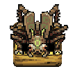
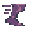

# 临时西西弗斯（The Makeshift Sisyphus）

 

一位前国王，被时间折磨。

[原文与贡献者记录](https://ballxpit.wiki.gg/wiki/The_Makeshift_Sisyphus) · [修订 4337](https://ballxpit.wiki.gg/index.php?oldid=4337) · [返回目录](../%E7%90%83%E6%AF%94%E4%BC%A6%E6%88%98%E8%AE%B0%20Wiki.md)

#### 一般信息

##### 圆球（Ball）

[地震](Earthquake.md) 

##### 解锁

建筑物 [洛基山](Rocky_Hill.md) 

##### 能力

球不会直接造成伤害，但范围效果和状态影响的伤害增加了4倍。

**临时西西弗斯** 是一个可玩的 [性格](Characters.md) 在基本游戏版本中推出了 *[球比伦战记](Ball_x_Pit.md)*它们通过构建 [洛基山](Rocky_Hill.md)  据报道, [边境沙漠](The_LIMINALxDESERT.md)  他们的起始球是 [地震](Earthquake.md) .

#### 能力描述

临时西西弗斯抛出的球不会对直接击中造成伤害。然而，球的任何范围效果或状态效应伤害增加了400%。

#### 策略

* 临时西西弗几乎完全希望构建范围效果和状态效应伤害，这可以使许多通常相当强大的球和构建几乎无用。
  + [石头（Stone）](Stone.md) 
  + [铁（Iron）](Iron.md) 
  + [钢铁（Steel）](Steel.md) 
  + [肉类（Flesh）](Flesh.md) 
  + [细胞（Cell）](Cell.md) 
  + [鬼魂（Ghost）](Ghost.md) 
* 虽然临时西西弗斯本身不能发射婴儿球，但它们仍然可以由生育婴儿球的球创造出来。
  + [育巢母体（Brood Mother）](Brood_Mother.md) 
  + [蛋袋（Egg Sac）](Egg_Sac.md) 
  + [蜘蛛女王（Spider Queen）](Spider_Queen.md) 
  + [雪茄沙卡（Voluptuous Egg Sac）](Voluptuous_Egg_Sac.md) 
  + [肉山（Flesh Mound）](Flesh_Mound.md) 
  + [后代（Offspring）](Offspring.md) 
  + [File:Water Bug.png](https://ballxpit.wiki.gg/wiki/Special%3AUpload?wpDestFile=Water_Bug.png) [水虫](https://ballxpit.wiki.gg/wiki/Water_Bug?action=edit&redlink=1)

#### [匹配机](Matchmaker.md) 配对 

##### 很好。

* [空巢者（The Empty Nester）](The_Empty_Nester.md)  这两个角色都没有婴儿球， 并且专注于原始特殊球损伤,
* [文件:Conduit.png](https://ballxpit.wiki.gg/wiki/Special%3AUpload?wpDestFile=The_Conduit.png) [Conduit](https://ballxpit.wiki.gg/wiki/The_Conduit?action=edit&redlink=1):Conduit的核心机械师围绕着范围效果伤害构建，这意味着它们可以从Sisyphus的4倍范围效果伤害中受益很大。

##### 坏的

##### 不兼容

* [同居者（The Cohabitants）](The_Cohabitants.md) 
* [暗影（The Shade）](The_Shade.md) 
* [挥霍者（The Spendthrift）](The_Spendthrift.md) 

#### 基本数据

| 属性 | 属性 |
| --- | --- |
|  耐力 | - 什么意思? |
|  力量 | 基地损坏? |
|  领导力 | 宝贝球计数?；婴儿球损伤? |
|  速度 | 球速?；移动速度? |
|  敏捷 | 关键机会?；发生火灾率? |
|  智力 | 公司发动力?；状态效应功率 - ?；动力? |

#### 性格水平的进步

[性格升级奖励](Character_Level_Mechanics.md)

| 性格水平 | 总经验值 | 提高奖励水平 | 选择 |
| --- | --- | --- | --- |
| TBA | TBA | TBA | TBA |

#### 冷知识

* [西西弗斯（Sisyphus）](https://en.wikipedia.org/wiki/Sisyphus) 希腊神话中的国王。在激起宙斯的愤怒和作弊死亡后，他在冥界中被著名地判处永久惩罚，其中他被判将大块巨石推到高山上，只有当他接近高峰时，它才能永远向下滚回底部。

#### 图片库

待补充条目

*这是一个 [待补充条目](../categories/Stubs.md)你可以帮助BALL xPIT Wiki通过 [补充此条目](https://ballxpit.wiki.gg/wiki/The_Makeshift_Sisyphus?action=edit).*

[共享导航](../navigation/nav-334e23d2914f.md)

**分类**　[分类 · 角色](../categories/Characters.md) · [分类 · 有破损文件链接的页面](../categories/Pages_with_broken_file_links.md) · [分类 · 坚力](../categories/Stubs.md) · [分类 · 页面有导航框](../categories/Pages_with_navboxes.md)

[返回总入口](../%E7%90%83%E6%AF%94%E4%BC%A6%E6%88%98%E8%AE%B0%20Wiki.md) · [返回本分目录](%E7%9B%AE%E5%BD%95.md)
