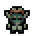
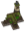
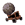
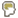

# 物理学家（The Physicist）

[原文与贡献者记录](https://ballxpit.wiki.gg/wiki/The_Physicist) · [修订 4339](https://ballxpit.wiki.gg/index.php?oldid=4339) · [返回目录](../%E7%90%83%E6%AF%94%E4%BC%A6%E6%88%98%E8%AE%B0%20Wiki.md)

## 物理学家 

该领域的先驱。

## 基本信息

### 圆球（Ball）

[光](Light.md) 

### 解锁

建造 [实验室](Laboratory.md) 

### 能力

球会受到向屏幕后方向作用的重力影响。

**物理学家** 是 *[球比伦战记](Ball_x_Pit.md)* 基础游戏中就包含的一名可玩的 [角色](Characters.md)。建造 [实验室](Laboratory.md)  即可解锁，其蓝图位于 [真菌森林](The_FUNGALxFOREST.md) 。起始圆球为 [光](Light.md) 。

## 能力说明

与那些以可预测角度刚性弹跳的圆球不同，物理学家发射的圆球表现得就像被重力拉向屏幕顶部的物理物体。一旦它们到达屏幕顶部，就会消失，并在一轮发射结束后返回给物理学家。

## 策略

* 物理学家球体的独特物理特性使它们在“卡住”时容易反复弹跳到敌人前方，这使得物理学家成为以命中效果为核心的构筑中非常强大的选择，比如 [流血](Bleed.md)  或 [育巢母体](Brood_Mother.md)  这样的球体，以及 [钻石柄匕首](Diamond_Hilted_Dagger.md)  这样的被动道具。此外，这种特性还使得它们会在场上停留的时间比平常更长，这意味着那些在空中触发效果的球体，如 [闪烁](Flicker.md)  或 [投石机](Catapult.md) ，也可能非常有效。
* 相反，物理学家的重力机制使得从背后攻击敌人几乎变得不可能，这使得像 [红宝石柄匕首](Ruby_Hilted_Dagger.md)  和 [File:Kris Knife.png](https://ballxpit.wiki.gg/wiki/Special%3AUpload?wpDestFile=Kris_Knife.png) [Kris Knife](https://ballxpit.wiki.gg/wiki/Kris_Knife?action=edit&redlink=1) 这样的武器成为 [驱魔者](Exorcist.md)  的绝佳选择，同时也极大地限制了像 [幽灵](Ghost.md)  这样的穿刺球的实用性。

## [匹配机](Matchmaker.md) 配对 

### 好

* [忏悔者](The_Repentant.md) ：如前所述，物理学家制造的球体具有独特的物理特性，容易导致球体卡在敌人的正面，从而迅速受到忏悔者被动效果的伤害。此外，忏悔者的返回机制使得球体在到达屏幕背面后还能继续造成伤害。

### 中立

* [掘地者](The_Tunneller.md) ：球可以永久保持活跃状态，因为它们会不断在屏幕上循环，直到击中敌人或被玩家捕获。这对于那些依赖球持续活跃状态的特定构建方式（如[闪烁](Flicker.md) ）来说是个优势，但也可能导致玩家不得不特意去收集球并将其射向其他需要它们的位置。

### 坏

### 不兼容

* [持盾者](The_Shieldbearer.md) 
* [自笞者](The_Flagellant.md) 
* [文件：The Scrupulous Scoundrel.png](https://ballxpit.wiki.gg/wiki/Special%3AUpload?wpDestFile=The_Scrupulous_Scoundrel.png) [无耻小人](https://ballxpit.wiki.gg/wiki/The_Scrupulous_Scoundrel?action=edit&redlink=1)
* [文件：The Recollector.png](https://ballxpit.wiki.gg/wiki/Special%3AUpload?wpDestFile=The_Recollector.png) [回忆者](https://ballxpit.wiki.gg/wiki/The_Recollector?action=edit&redlink=1)
* [文件：The Scandalmonger.png](https://ballxpit.wiki.gg/wiki/Special%3AUpload?wpDestFile=The_Scandalmonger.png)  [Scandalmonger](https://ballxpit.wiki.gg/wiki/The_Scandalmonger?action=edit&redlink=1)

## 基础属性

| 属性 | 属性 |
| --- | --- |
|  耐力 | 生命值未知 |
|  力量 | 基础伤害 - ? |
|  领导力 | 小球数量 - ?；小球伤害 - ? |
|  速度 | 球速 - ?；移动速度 - ? |
|  敏捷 | 暴击率 - ?；发射频率 - ? |
|  智力 | 范围效果强度 – 待确认；状态效果强度 - ?；被动效果强度 – 待确认 |

## 角色等级进展

[角色等级提升奖励](Character_Level_Mechanics.md)

| 角色等级 | 总经验值 | 升级奖励 | 选择项 |
| --- | --- | --- | --- |
| TBA | TBA | TBA | TBA |

## 冷知识

## 图片库

待完善

*此条目为 [待完善](../categories/Stubs.md). 你可以通过帮助 BALL x PIT 维基贡献一份力量。 [补充内容](https://ballxpit.wiki.gg/wiki/The_Physicist?action=edit).*

[共享导航](../navigation/nav-334e23d2914f.md)

**分类**　[分类 · 角色](../categories/Characters.md) · [分类 · 文件链接失效的页面](../categories/Pages_with_broken_file_links.md) · [分类 · 待完善](../categories/Stubs.md) · [分类 · 带有导航框的页面](../categories/Pages_with_navboxes.md)

[返回总入口](../%E7%90%83%E6%AF%94%E4%BC%A6%E6%88%98%E8%AE%B0%20Wiki.md) · [返回本分目录](%E7%9B%AE%E5%BD%95.md)
