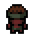

# 激进者（The Radical）

 

经过多年的独居而变得极端。

[原文与贡献者记录](https://ballxpit.wiki.gg/wiki/The_Radical) · [修订 4345](https://ballxpit.wiki.gg/index.php?oldid=4345) · [返回目录](../%E7%90%83%E6%AF%94%E4%BC%A6%E6%88%98%E8%AE%B0%20Wiki.md)

待完善

*此条目为 [待完善](../categories/Stubs.md). 你可以通过帮助 BALL x PIT 维基贡献一份力量。 [补充内容](https://ballxpit.wiki.gg/wiki/The_Radical?action=edit).*

## 基本信息

### 圆球（Ball）

[风](Wind.md) 

### 解锁

建造 [露营地](Campground.md)

### 能力

玩游戏并自动选择升级项目

**激进者** 是 *[球比伦战记](Ball_x_Pit.md)* 中一名可解锁的可玩 [角色](Characters.md)。建造 [露营地](Campground.md)  即可解锁，其蓝图会在 [天堂之门](The_HEAVENLYxGATES.md)  中随机掉落。起始圆球为 [风](Wind.md) 。

## 能力说明

一旦玩家开始单局游戏，激进者将完全独立于玩家的操作来运行游戏；它自行移动、射击以及选择升级和融合，直到等级完成或玩家死亡为止，这意味着在整个单局游戏中，游戏实际上是在自我运行。

## 策略

* 鉴于“激进者”完全自动化了单局游戏的所有环节，玩家无法提供任何输入，因此使用“激进者”影响游戏进程的唯一真正方法，就是通过[匹配机](Matchmaker.md)  决定与哪些角色搭配，以及在开始游戏前尽可能增加任何与建造相关的属性加成和/或能力。这使得“激进者”可以说是整个*[球比伦战记](Ball_x_Pit.md)*中最难玩且最难升级的角色。通常，“激进者”可以应对大多数敌人和投射物，但他们特别难以对付那些发射大量投射物的首领，比如[File:The Moon.png](https://ballxpit.wiki.gg/wiki/Special%3AUpload?wpDestFile=The_Moon.png) [月球](The_Moon.md)。

## [匹配机](Matchmaker.md) 配对 

### 好

* [战术家](The_Tactician.md) : 战术家显著减缓了游戏节奏，这大大提升了激进者的胜率，尤其是在更高速等级段位上。

### 坏

* [物理学家](The_Physicist.md) ：激进者的AI在射击时预期球的轨迹会保持直线，因此将其与物理学家配合使用时，由于物理学家发射的弧线球，它们很少能击中目标。

## 关卡

[角色等级提升奖励](Character_Level_Mechanics.md)

| 角色等级 | 总经验值 | 升级奖励 | 选择项 |
| --- | --- | --- | --- |
| 3 | 857 | [收获升级](Harvest_Upgrades_Character_Bonus.md) |  [短跑手](https://ballxpit.wiki.gg/wiki/Sprinter?action=edit&redlink=1) 或  [长柄镰刀（Long Sickle）](https://ballxpit.wiki.gg/wiki/Long_Sickle?action=edit&redlink=1) |
| 4 | 1,472 | [住房能力获取](Buildings.md#%E4%BD%8F%E6%88%BF) | 附近的森林再生速度加快25%。 |
| 6 | 3,574 | [收获升级](Harvest_Upgrades_Character_Bonus.md) |  [破坏者](https://ballxpit.wiki.gg/wiki/Demolitionist?action=edit&redlink=1) 或  [森林守护者](https://ballxpit.wiki.gg/wiki/Forester?action=edit&redlink=1) |
| 7 | 5,262 | [住房能力升级](Buildings.md#%E4%BD%8F%E6%88%BF) | 附近的森林再生速度提高 35%。 |
| 9 | 10,409 | [住房能力升级](Buildings.md#%E4%BD%8F%E6%88%BF) | 附近的森林再生速度提高 45%。 |
| 10 | 14,069 | [收获升级](Harvest_Upgrades_Character_Bonus.md) |  [啄木鸟（Woodpecker）](https://ballxpit.wiki.gg/wiki/Woodpecker?action=edit&redlink=1) 或  [小麦收割机](https://ballxpit.wiki.gg/wiki/Wheat_Harvester?action=edit&redlink=1) |
| ... | ... | ... |  |

## 冷知识

* “The Radical”是由开发者Kenny Sun为自动测试而创建的调试工具衍生出来的，其剩余代码被直接移植到了一个专门的角色上。[[1]](https://www.reddit.com/r/xbox/comments/1o7kkrt/comment/nk09uzl/?utm_source=share&utm_medium=web3x&utm_name=web3xcss&utm_term=1&utm_content=share_button)

## 图片库

[共享导航](../navigation/nav-334e23d2914f.md)

**分类**　[分类 · 待完善](../categories/Stubs.md) · [分类 · 角色](../categories/Characters.md) · [分类 · 文件链接失效的页面](../categories/Pages_with_broken_file_links.md) · [分类 · 带有导航框的页面](../categories/Pages_with_navboxes.md)

[返回总入口](../%E7%90%83%E6%AF%94%E4%BC%A6%E6%88%98%E8%AE%B0%20Wiki.md) · [返回本分目录](%E7%9B%AE%E5%BD%95.md)
