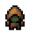
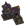
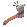
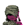
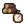

# 忏悔者（The Repentant）

[原文与贡献者记录](https://ballxpit.wiki.gg/wiki/The_Repentant) · [修订 4289](https://ballxpit.wiki.gg/index.php?oldid=4289) · [返回目录](../%E7%90%83%E6%AF%94%E4%BC%A6%E6%88%98%E8%AE%B0%20Wiki.md)

待完善

*此条目为 [待完善](../categories/Stubs.md). 你可以通过帮助 BALL x PIT 维基贡献一份力量。 [补充内容](https://ballxpit.wiki.gg/wiki/The_Repentant?action=edit).*

## 忏悔者 

一个充满悔恨的悲伤样本。

## 基本信息

### 圆球（Ball）

[冻结](Freeze.md) 

### 解锁

建造 [鬼屋](Haunted_House.md)

### 能力

每次弹跳时，球造成的伤害会增加5%。但是，当它们撞到后墙时，会返回到玩家身上，并对每个穿透的敌人造成伤害。

**忏悔者** 是 *[球比伦战记](Ball_x_Pit.md)* 中一名可解锁的可玩 [角色](Characters.md)。建造 [鬼屋](Haunted_House.md)  即可解锁，其蓝图会在 [骸骨墓园](The_BONExYARD.md)  中随机掉落。起始圆球为 [冻结](Freeze.md) 。

## 能力机制

* 每当“忏悔者”的球反弹时，无论是从墙壁还是从敌人/投射物上反弹，它们的伤害都会增加5%。为了抵消这一效果，当球撞击后墙时，它们会沿直线返回到玩家所在位置，就像撞击前墙一样，途中还会击中并伤害敌人。

## 策略

* “忏悔者”的反弹伤害叠加机制自然激励玩家尽可能多次地反弹球，这意味着玩家应始终尝试调整球的位置以最大化反弹次数，并避免击中关卡的背面。这使得“忏悔者”与那些具有命中/反弹效果或触发机制的球非常契合，例如： [流血（Bleed）](Bleed.md) 、 [闪光（Flash）](Flash.md) 、 [疯长（Overgrowth）](Overgrowth.md) 、 [灼烧（Burn）](Burn.md) /[激光（垂直）（Laser (Vertical)）](Laser_Vertical.md)  或 [激光（水平）（Laser (Horizontal)）](Laser_Horizontal.md) （这些还具有可逐步建设的额外优势）、 [冰冻火焰（Frozen Flame）](Frozen_Flame.md) /[冰冻射线（Freeze Ray）](Freeze_Ray.md) ——这两者恰好与忏悔者的起始 [冻结（Freeze）](Freeze.md)  圆球相配，等等，以及像  [Wagon Wheel](https://ballxpit.wiki.gg/wiki/Wagon_Wheel?action=edit&redlink=1) 这样的被动道具。
  + 相反，像 [幽灵](Ghost.md)  或 [风](Wind.md)  这样的穿透球，由于无法在击中敌人之前反弹，最终不可避免地会撞到后墙而破碎。而像 [卵囊](Egg_Sac.md)  或 [时间](Time.md)  这样的破击球，也无法从忏悔者的被动技能中获益。
* 由于提高球速能让球反弹得更快，从而更快地造成伤害，像[耀光羽毛](https://ballxpit.wiki.gg/wiki/Radiant_Feather?action=edit&redlink=1)和[橡胶头带](https://ballxpit.wiki.gg/wiki/Rubber_Headband?action=edit&redlink=1)这样的被动道具对忏悔者也非常有效。
* 由于球在撞击后壁时会返回，因此像  [Upturned Hatchet](https://ballxpit.wiki.gg/wiki/Upturned_Hatchet?action=edit&redlink=1)、[虚灵斗篷](Ethereal_Cloak.md)  这样的被动道具，以及 [刺客](Assassin.md)  这样的球，实际上毫无价值，应予以避免。

## 配对系统

### 好

* [潜伏者](The_Embedded.md) /[杂耍者](The_Juggler.md) ：这些角色的独特发射行为使玩家能够将球“插入”到大量敌人的中间，从而迅速获得反弹/伤害加成。
* [物理学家](The_Physicist.md) ：物理学家的重力效果可以反复将球拉向敌人，导致多次弹跳，进而使伤害大幅增加。
* [战术家](The_Tactician.md) ：战术家基于回合制的玩法特点，让玩家有时间设定精确的发射角度，以最大化反弹效果。

### 坏

* [暗影](The_Shade.md) ：由于忏悔者无法利用后墙弹跳，与暗影配对变得更加困难。

### 不兼容

* [持盾者](The_Shieldbearer.md) 
* [自笞者](The_Flagellant.md) 
* [掘地者](The_Tunneller.md) 

## 关卡

[角色等级提升奖励](Character_Level_Mechanics.md)

| 角色等级 | 总经验值 | 升级奖励 | 选择项 |
| --- | --- | --- | --- |
| 3 | 857 | [收获升级](Harvest_Upgrades_Character_Bonus.md) |  [破坏者](https://ballxpit.wiki.gg/wiki/Demolitionist?action=edit&redlink=1) 或  [石匠大师](https://ballxpit.wiki.gg/wiki/Stone_Master?action=edit&redlink=1) |
| 4 | 1,472 | [住房能力获取](Buildings.md#%E4%BD%8F%E6%88%BF) | 每次收获时，最先在这座建筑上弹开的 2 名工人获得 25% 移动速度加成。 |
| 6 | 3,574 | [收获升级](Harvest_Upgrades_Character_Bonus.md) |  [木材大师](https://ballxpit.wiki.gg/wiki/Wood_Master?action=edit&redlink=1) 或  [小麦大师](https://ballxpit.wiki.gg/wiki/Wheat_Master?action=edit&redlink=1) |
| 7 | 5,262 | [住房能力升级](Buildings.md#%E4%BD%8F%E6%88%BF) | 每次收获时，首次反弹到该建筑上的前3名工人将获得30%的移动速度加成。 |
| 9 | 10,409 | [住房能力升级](Buildings.md#%E4%BD%8F%E6%88%BF) | 每次收获时，反弹在该建筑上的前4名工人将获得35%的移动速度加成。 |
| 10 | 14,069 | [收获升级](Harvest_Upgrades_Character_Bonus.md) |  [建造者](https://ballxpit.wiki.gg/wiki/Builder?action=edit&redlink=1) 或  [小麦收割机](https://ballxpit.wiki.gg/wiki/Wheat_Harvester?action=edit&redlink=1) |
| ... | ... | ... |  |

## 冷知识

## 图片库

待完善

*此条目为 [待完善](../categories/Stubs.md). 你可以通过帮助 BALL x PIT 维基贡献一份力量。 [补充内容](https://ballxpit.wiki.gg/wiki/The_Repentant?action=edit).*

[共享导航](../navigation/nav-334e23d2914f.md)

**分类**　[分类 · 待完善](../categories/Stubs.md) · [分类 · 角色](../categories/Characters.md) · [分类 · 带有导航框的页面](../categories/Pages_with_navboxes.md)

[返回总入口](../%E7%90%83%E6%AF%94%E4%BC%A6%E6%88%98%E8%AE%B0%20Wiki.md) · [返回本分目录](%E7%9B%AE%E5%BD%95.md)
