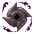
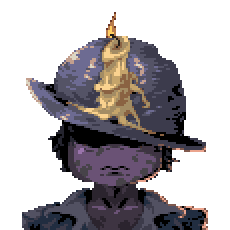
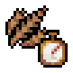
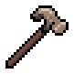

# 忏悔者（The Repentant）

 

一个悲伤的样本，充满了遗憾。

[原文与贡献者记录](https://ballxpit.wiki.gg/wiki/The_Repentant) · [修订 4289](https://ballxpit.wiki.gg/index.php?oldid=4289) · [返回目录](../%E7%90%83%E6%AF%94%E4%BC%A6%E6%88%98%E8%AE%B0%20Wiki.md)

待补充条目

*这是一个 [待补充条目](../categories/Stubs.md)你可以帮助BALL xPIT Wiki通过 [补充此条目](https://ballxpit.wiki.gg/wiki/The_Repentant?action=edit).*

#### 一般信息

##### 圆球（Ball）

[冻结](Freeze.md) 

##### 解锁

建立一个 [鬼鬼之家](Haunted_House.md)

##### 能力

球每次跳起来就会造成5%的伤害，但当他们撞到后墙时，他们会返回玩家,

**忏悔者** 是一个可以解锁的可播放 [角色](Characters.md) 在 *[球比伦战记](Ball_x_Pit.md)*它们通过构建 [鬼鬼之家](Haunted_House.md) , 蓝图可以找到作为一个随机落入 [骸骨墓园](The_BONExYARD.md)  他们的起始球是 [冻结](Freeze.md) .

#### 能力的机械

* 每一次忏悔者的一个球弹跳，无论是从墙上跳出，还是从敌人/投球上跳出，它们都得到5%的破坏增加。为了抵制这种情况，每当球撞到后墙时，它们就像撞到前墙一样直线返回玩家,

#### 策略

* 反弹的堆积损伤放大自然会激励球员尽可能多地弹出球体意思是球员应该总是试着瞄准球体以最大限度地弹出避免弹出后台这使后悔者配对很好，有击球/反弹效果/反弹效果，如 [流血（Bleed）](Bleed.md) 、 [闪光（Flash）](Flash.md) 、 [过度增长（Overgrowth）](Overgrowth.md) 、 [灼烧（Burn）](Burn.md) /[激光 (垂直)（Laser (Vertical)）](Laser_Vertical.md)  或是 [激光 (水平)（Laser (Horizontal)）](Laser_Horizontal.md)  (这些有增加的好处是建立在 [冰冻火焰（Frozen Flame）](Frozen_Flame.md) /[冰冻射线（Freeze Ray）](Freeze_Ray.md)  在悔改者开始的时候, [冻结（Freeze）](Freeze.md)  ball )，等，以及像被动的  [车轮](https://ballxpit.wiki.gg/wiki/Wagon_Wheel?action=edit&redlink=1).
  + 而反过来，穿过球的 [鬼魂（Ghost）](Ghost.md)  或是 [风（Wind）](Wind.md)  在不可避免地撞到后墙之前，无法反弹敌人, [蛋袋（Egg Sac）](Egg_Sac.md)  或是 [时间（Time）](Time.md)  也没有从悔改者的被动性中获益。
* 随着球速的增加，球可以更快地跳转，然后更快地损坏,  [发光的羽毛](https://ballxpit.wiki.gg/wiki/Radiant_Feather?action=edit&redlink=1) 及  [橡胶头带（Rubber Headband）](https://ballxpit.wiki.gg/wiki/Rubber_Headband?action=edit&redlink=1) 这对于悔改者来说，也是非常有效的。
* 由于球在撞到后墙时返回,  [翻转的斧头](https://ballxpit.wiki.gg/wiki/Upturned_Hatchet?action=edit&redlink=1) 及 [虚灵斗篷（Ethereal Cloak）](Ethereal_Cloak.md)  和像这样的球 [凶手（Assassin）](Assassin.md)  实际上是无价值的，应该避免。

#### 配对器

##### 很好。

* [潜伏者（The Embedded）](The_Embedded.md) /[杂耍者（The Juggler）](The_Juggler.md) :这些角色的独特射击行为有效地使玩家能够"插入"球到大群敌人的中间，并快速获得反弹/伤害奖金。
* [物理学家（The Physicist）](The_Physicist.md)  医生的重力效应可以反复把球拉到敌人身上,
* [战术家（The Tactician）](The_Tactician.md)  战术师的轮流性质让玩家有时间设置精确的射击角度，以最大限度地跳动。

##### 坏的

* [暗影（The Shade）](The_Shade.md)  与沙德相比要困难得多， 因为忏悔者无法利用后墙反弹。

##### 不兼容

* [持盾者（The Shieldbearer）](The_Shieldbearer.md) 
* [自笞者（The Flagellant）](The_Flagellant.md) 
* [掘地者（The Tunneller）](The_Tunneller.md) 

#### 关卡

[性格升级奖励](Character_Level_Mechanics.md)

| 性格水平 | 总经验值 | 提高奖励水平 | 选择 |
| --- | --- | --- | --- |
| 3 | 857 | [提高收获](Harvest_Upgrades_Character_Bonus.md) |  [拆除主义者](https://ballxpit.wiki.gg/wiki/Demolitionist?action=edit&redlink=1) 或是  [石头师](https://ballxpit.wiki.gg/wiki/Stone_Master?action=edit&redlink=1) |
| 4 | 1,472 | [住房能力增长](Buildings.md#%E4%BD%8F%E6%88%BF) | 每次收获时，最先在这座建筑上弹开的 2 名工人获得 25% 移动速度加成。 |
| 6 | 3,574 | [提高收获](Harvest_Upgrades_Character_Bonus.md) |  [木材师](https://ballxpit.wiki.gg/wiki/Wood_Master?action=edit&redlink=1) 或是  [麦子主](https://ballxpit.wiki.gg/wiki/Wheat_Master?action=edit&redlink=1) |
| 7 | 5,262 | [提高住房能力](Buildings.md#%E4%BD%8F%E6%88%BF) | 每次收获时，第一批在这座建筑上跳跃的3名工人获得30%的移动速度。 |
| 9 | 10,409 | [提高住房能力](Buildings.md#%E4%BD%8F%E6%88%BF) | 每一次收获，这栋建筑上头4名工人的反弹，都获得了35%的运动速度。 |
| 10 | 14,069 | [提高收获](Harvest_Upgrades_Character_Bonus.md) |  [建筑师](https://ballxpit.wiki.gg/wiki/Builder?action=edit&redlink=1) 或是  [麦机](https://ballxpit.wiki.gg/wiki/Wheat_Harvester?action=edit&redlink=1) |
| ... | ... | ... |  |

#### 冷知识

#### 图片库

待补充条目

*这是一个 [待补充条目](../categories/Stubs.md)你可以帮助BALL xPIT Wiki通过 [补充此条目](https://ballxpit.wiki.gg/wiki/The_Repentant?action=edit).*

[共享导航](../navigation/nav-334e23d2914f.md)

**分类**　[分类 · 坚力](../categories/Stubs.md) · [分类 · 角色](../categories/Characters.md) · [分类 · 页面有导航框](../categories/Pages_with_navboxes.md)

[返回总入口](../%E7%90%83%E6%AF%94%E4%BC%A6%E6%88%98%E8%AE%B0%20Wiki.md) · [返回本分目录](%E7%9B%AE%E5%BD%95.md)
