# 阴燃深渊（The SMOLDERINGxDEPTHS）

[原文与贡献者记录](https://ballxpit.wiki.gg/wiki/The_SMOLDERINGxDEPTHS) · [修订 3727](https://ballxpit.wiki.gg/index.php?oldid=3727) · [返回目录](../%E7%90%83%E6%AF%94%E4%BC%A6%E6%88%98%E8%AE%B0%20Wiki.md)

#### 一般信息

##### 解锁所需齿轮（Gears to unlock）

4

##### 建筑蓝图（Blueprints）

9

##### 解锁条件（Unlocks）

* [时间（Time）](Time.md) 
*  [宝石之春](https://ballxpit.wiki.gg/wiki/Gemspring?action=edit&redlink=1)
* [动力石（Dynamite）](Dynamite.md) [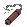](Dynamite.md)
*  [车轮](https://ballxpit.wiki.gg/wiki/Wagon_Wheel?action=edit&redlink=1)

**阴燃深渊** 是第六个 [的水平](Levels.md) 在 *[球比伦战记](Ball_x_Pit.md)*需要4个齿轮才能解锁

#### 解锁条件

清除此级别将使玩家能够解锁以下项目:

* [时间（Time）](Time.md) 
*  [宝石之春](https://ballxpit.wiki.gg/wiki/Gemspring?action=edit&redlink=1)
* [动力石（Dynamite）](Dynamite.md) 
*  [车轮](https://ballxpit.wiki.gg/wiki/Wagon_Wheel?action=edit&redlink=1)

#### 建筑蓝图

玩家可以在此关卡中获取以下 [建筑](Buildings.md) 的蓝图 :

* [花岗岩板（Granite Slab）](Granite_Slab.md) 
* [蜡烛作坊（Candle Maker）](Candle_Maker.md) 
* [愿意好好（Wishing Well）](Wishing_Well.md) 
* [冥想帐篷（Meditation Tent）](Meditation_Tent.md) 
* [战争室（War Room）](War_Room.md) 
* [队长的四处（Captain's Quarters）](Captain_s_Quarters.md) 
* [石域（Stone Domain）](Stone_Domain.md) 
* [隐秘神殿（Hidden Temple）](Hidden_Temple.md) 
* [生动的奖杯（Smoldering Trophy）](Smoldering_Trophy.md) 

#### 敌人

以下是在此级别上可遇到的[enemies](Enemies.md)列表:

* [幼龙（Dragonling）](Dragonling.md) [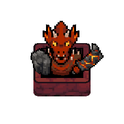](Dragonling.md)
* [龙头野兽（Dragonling Brute）](Dragonling_Brute.md) [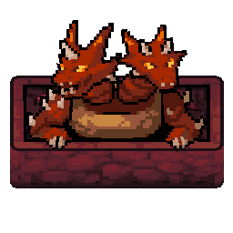](Dragonling_Brute.md)
* [龙号号号（Dragonling Thrall）](Dragonling_Thrall.md) [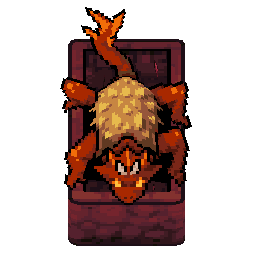](Dragonling_Thrall.md)
* [龙头屠夫（Dragonling Butcher）](Dragonling_Butcher.md) [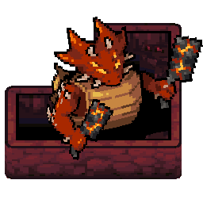](Dragonling_Butcher.md)
* [龙子族（Dragonling Clan）](Dragonling_Clan.md) [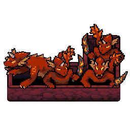](Dragonling_Clan.md)
* [集群群（Grub Cluster）](Grub_Cluster.md) 
* [幼虫（Grub）](Grub.md) 
* [消防员（Firespitter）](Firespitter.md) [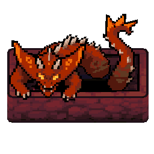](Firespitter.md)
* [幼虫母体（Grub Mother）](Grub_Mother.md) [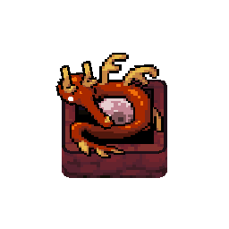](Grub_Mother.md)
* [Great Grub 群集群集（Great Grub Cluster）](Great_Grub_Cluster.md) [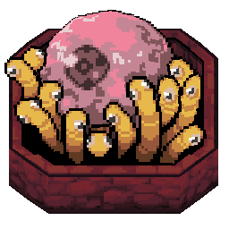](Great_Grub_Cluster.md)
* [喷焰者（Flamespitter）](Flamespitter.md) [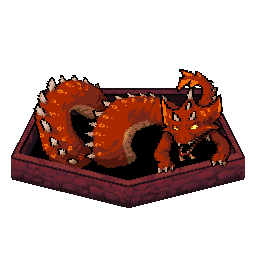](Flamespitter.md)
* [龙王子（Dragon Prince）](Dragon_Prince.md) [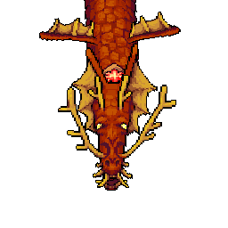](Dragon_Prince.md)

[共享导航](../navigation/nav-47f674e55b3c.md)

**分类**　[分类 · 关卡](../categories/Levels.md) · [分类 · 页面有导航框](../categories/Pages_with_navboxes.md)

[返回总入口](../%E7%90%83%E6%AF%94%E4%BC%A6%E6%88%98%E8%AE%B0%20Wiki.md) · [返回本分目录](%E7%9B%AE%E5%BD%95.md)
