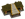
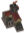
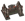
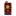
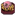
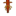

# 阴燃深渊（The SMOLDERINGxDEPTHS）

[原文与贡献者记录](https://ballxpit.wiki.gg/wiki/The_SMOLDERINGxDEPTHS) · [修订 3727](https://ballxpit.wiki.gg/index.php?oldid=3727) · [返回目录](../%E7%90%83%E6%AF%94%E4%BC%A6%E6%88%98%E8%AE%B0%20Wiki.md)

## 基本信息

### 解锁所需齿轮（Gears to unlock）

4

### 建筑蓝图（Blueprints）

9

### 解锁内容（Unlocks）

* [时间（Time）](Time.md) 
*  [Gemspring](https://ballxpit.wiki.gg/wiki/Gemspring?action=edit&redlink=1)
* [炸药（Dynamite）](Dynamite.md) 
*  [Wagon Wheel](https://ballxpit.wiki.gg/wiki/Wagon_Wheel?action=edit&redlink=1)

**阴燃深渊** 是 *[球比伦战记](Ball_x_Pit.md)* 的第六个 [关卡](Levels.md)。需要 4 个齿轮才能解锁。

## 解锁内容

通关本关卡后，玩家将解锁以下物品：

* [时间（Time）](Time.md) 
*  [Gemspring](https://ballxpit.wiki.gg/wiki/Gemspring?action=edit&redlink=1)
* [炸药（Dynamite）](Dynamite.md) 
*  [Wagon Wheel](https://ballxpit.wiki.gg/wiki/Wagon_Wheel?action=edit&redlink=1)

## 建筑蓝图

玩家可以在本关卡中获得以下 [建筑](Buildings.md)的建筑蓝图：

* [花岗岩板](Granite_Slab.md) 
* [蜡烛作坊](Candle_Maker.md) 
* [许愿池](Wishing_Well.md) 
* [冥想帐篷](Meditation_Tent.md) 
* [作战室（War Room）](War_Room.md) 
* [队长宿舍](Captain_s_Quarters.md) 
* [石之领域](Stone_Domain.md) 
* [隐秘神殿](Hidden_Temple.md) 
* [阴燃深渊奖杯](Smoldering_Trophy.md) 

## 敌人

本关卡可能遇到下列[敌人](Enemies.md)。

* [幼龙（Dragonling）](Dragonling.md) 
* [蛮力幼龙](Dragonling_Brute.md) 
* [幼龙奴仆](Dragonling_Thrall.md) 
* [幼龙屠夫](Dragonling_Butcher.md) 
* [幼龙氏族](Dragonling_Clan.md) 
* [幼虫群](Grub_Cluster.md) 
* [幼虫（Grub）](Grub.md) 
* [喷火者（Firespitter）](Firespitter.md) 
* [幼虫母体（Grub Mother）](Grub_Mother.md) 
* [巨型幼虫群](Great_Grub_Cluster.md) 
* [喷焰者](Flamespitter.md) 
* [龙王子](Dragon_Prince.md) 

[共享导航](../navigation/nav-47f674e55b3c.md)

**分类**　[分类 · 关卡](../categories/Levels.md) · [分类 · 带有导航框的页面](../categories/Pages_with_navboxes.md)

[返回总入口](../%E7%90%83%E6%AF%94%E4%BC%A6%E6%88%98%E8%AE%B0%20Wiki.md) · [返回本分目录](%E7%9B%AE%E5%BD%95.md)
