# 白雪海岸（The SNOWYxSHORES）

[原文与贡献者记录](https://ballxpit.wiki.gg/wiki/The_SNOWYxSHORES) · [修订 3724](https://ballxpit.wiki.gg/index.php?oldid=3724) · [返回目录](../%E7%90%83%E6%AF%94%E4%BC%A6%E6%88%98%E8%AE%B0%20Wiki.md)

#### 一般信息

##### 解锁所需齿轮（Gears to unlock）

2

##### 建筑蓝图（Blueprints）

12

##### 解锁条件（Unlocks）

* [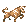](https://ballxpit.wiki.gg/wiki/Golden_Bull) [黄金牛](https://ballxpit.wiki.gg/wiki/Golden_Bull?action=edit&redlink=1)
*  [医生的效果](https://ballxpit.wiki.gg/wiki/Healer%27s_Effigy?action=edit&redlink=1)
* [弓箭手雕像（Archer's Effigy）](Archer_s_Effigy.md) 
* [石头（Stone）](Stone.md) 

**白雪海岸** 是第二个 [的水平](Levels.md) 在 *[球比伦战记](Ball_x_Pit.md)*。它需要2个装置来解锁。..

#### 解锁条件

清除此级别将使玩家能够解锁以下项目:

*  [黄金牛](https://ballxpit.wiki.gg/wiki/Golden_Bull?action=edit&redlink=1)
*  [医生的效果](https://ballxpit.wiki.gg/wiki/Healer%27s_Effigy?action=edit&redlink=1)
* [弓箭手雕像（Archer's Effigy）](Archer_s_Effigy.md) 
* [石头（Stone）](Stone.md) 

#### 建筑蓝图

玩家可以在此关卡中获取以下 [建筑](Buildings.md) 的蓝图 :

* [农场（Farm）](Farm.md) 
* [木工场（Lumberyard）](Lumberyard.md) 
* [石矿（Stone Mine）](Stone_Mine.md) 
* [卫报（Watch Tower）](Watch_Tower.md) 
* [化学家（Alchemist）](Alchemist.md) 
* [车手（Wheelwright）](Wheelwright.md) 
* [大学（University）](University.md) 
* [退伍军人小屋（Veteran's Hut）](Veteran_s_Hut.md) 
* [单身家庭（Single Family Home）](Single_Family_Home.md) 
* [别墅（Villa）](Villa.md) 
* [雪杯（Snowy Trophy）](Snowy_Trophy.md) [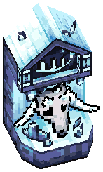](Snowy_Trophy.md)
* [冒险家协会（Adventurer's Guild）](Adventurer_s_Guild.md) 

#### 敌人

以下是在此级别上可遇到的[enemies](Enemies.md)列表:

* [冰岛战士（Icebound Warrior）](Icebound_Warrior.md) [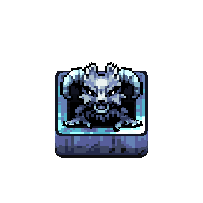](Icebound_Warrior.md)
* [冰伤残疾（Icebound Brute）](Icebound_Brute.md) [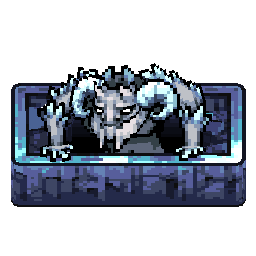](Icebound_Brute.md)
* [冰封野兽（Icebound Beast）](Icebound_Beast.md) [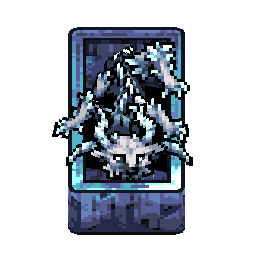](Icebound_Beast.md)
* [冰封指环（Icebound Band）](Icebound_Band.md) [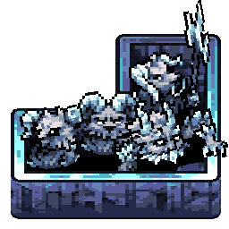](Icebound_Band.md)
* [冰岛堡垒（Icebound Bastion）](Icebound_Bastion.md) [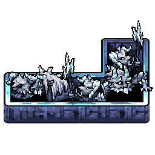](Icebound_Bastion.md)
* [冰患盾牌手（Icebound Shieldbearer）](Icebound_Shieldbearer.md) [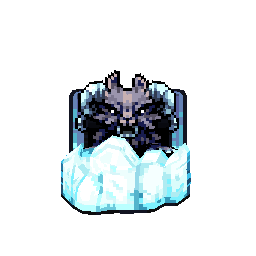](Icebound_Shieldbearer.md)
* [冰封投掷者（Icebound Hurler）](Icebound_Hurler.md) [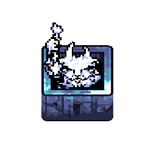](Icebound_Hurler.md)
* [冰球冠军（Icebound Champion）](Icebound_Champion.md) 
* [冰封嚎兽（Icebound Howler）](Icebound_Howler.md) [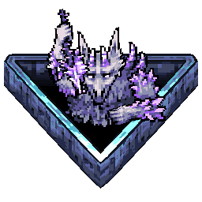](Icebound_Howler.md)
* [冰岛女王（Icebound Queen）](Icebound_Queen.md) [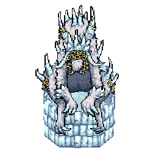](Icebound_Queen.md)

[共享导航](../navigation/nav-47f674e55b3c.md)

**分类**　[分类 · 关卡](../categories/Levels.md) · [分类 · 页面有导航框](../categories/Pages_with_navboxes.md)

[返回总入口](../%E7%90%83%E6%AF%94%E4%BC%A6%E6%88%98%E8%AE%B0%20Wiki.md) · [返回本分目录](%E7%9B%AE%E5%BD%95.md)
