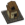
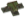
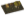
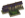
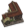
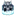

# 白雪海岸（The SNOWYxSHORES）

[原文与贡献者记录](https://ballxpit.wiki.gg/wiki/The_SNOWYxSHORES) · [修订 3724](https://ballxpit.wiki.gg/index.php?oldid=3724) · [返回目录](../%E7%90%83%E6%AF%94%E4%BC%A6%E6%88%98%E8%AE%B0%20Wiki.md)

## 基本信息

### 解锁所需齿轮（Gears to unlock）

2

### 建筑蓝图（Blueprints）

12

### 解锁内容（Unlocks）

*  [金牛座](https://ballxpit.wiki.gg/wiki/Golden_Bull?action=edit&redlink=1)
*  [治疗者的雕像](https://ballxpit.wiki.gg/wiki/Healer%27s_Effigy?action=edit&redlink=1)
* [弓箭手雕像](Archer_s_Effigy.md) 
* [石头（Stone）](Stone.md) 

**白雪海岸** 是 *[球比伦战记](Ball_x_Pit.md)* 的第二个 [关卡](Levels.md)。需要 2 个齿轮才能解锁。

## 解锁内容

通关本关卡后，玩家将解锁以下物品：

*  [金牛座](https://ballxpit.wiki.gg/wiki/Golden_Bull?action=edit&redlink=1)
*  [治疗者的雕像](https://ballxpit.wiki.gg/wiki/Healer%27s_Effigy?action=edit&redlink=1)
* [弓箭手雕像](Archer_s_Effigy.md) 
* [石头（Stone）](Stone.md) 

## 建筑蓝图

玩家可以在本关卡中获得以下 [建筑](Buildings.md)的建筑蓝图：

* [农场（Farm）](Farm.md) 
* [伐木场（Lumberyard）](Lumberyard.md) 
* [石矿场（Stone Mine）](Stone_Mine.md) 
* [守望塔（Watch Tower）](Watch_Tower.md) 
* [炼金术士（Alchemist）](Alchemist.md) 
* [车轮匠（Wheelwright）](Wheelwright.md) 
* [大学（University）](University.md) 
* [老兵小屋](Veteran_s_Hut.md) 
* [独栋住宅](Single_Family_Home.md) 
* [别墅（Villa）](Villa.md) 
* [白雪海岸奖杯](Snowy_Trophy.md) 
* [冒险者公会](Adventurer_s_Guild.md) 

## 敌人

本关卡可能遇到下列[敌人](Enemies.md)。

* [冰封战士](Icebound_Warrior.md) 
* [冰封蛮兽](Icebound_Brute.md) 
* [冰封野兽](Icebound_Beast.md) 
* [冰封指环](Icebound_Band.md) 
* [冰封要塞](Icebound_Bastion.md) 
* [冰封持盾者](Icebound_Shieldbearer.md) 
* [冰封投掷者](Icebound_Hurler.md) 
* [冰封勇士](Icebound_Champion.md) 
* [冰封嚎兽](Icebound_Howler.md) 
* [冰封女王](Icebound_Queen.md) 

[共享导航](../navigation/nav-47f674e55b3c.md)

**分类**　[分类 · 关卡](../categories/Levels.md) · [分类 · 带有导航框的页面](../categories/Pages_with_navboxes.md)

[返回总入口](../%E7%90%83%E6%AF%94%E4%BC%A6%E6%88%98%E8%AE%B0%20Wiki.md) · [返回本分目录](%E7%9B%AE%E5%BD%95.md)
