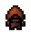
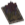

# 暗影（The Shade）

 

一名雇佣杀手。

[原文与贡献者记录](https://ballxpit.wiki.gg/wiki/The_Shade) · [修订 4326](https://ballxpit.wiki.gg/index.php?oldid=4326) · [返回目录](../%E7%90%83%E6%AF%94%E4%BC%A6%E6%88%98%E8%AE%B0%20Wiki.md)

## 基本信息

### 圆球（Ball）

[黑暗](Dark.md) 

### 解锁

建造 [陵墓](Mausoleum.md) 

### 能力

球从后方发射，其基础暴击率为10%。

**暗影** 是 *[球比伦战记](Ball_x_Pit.md)* 基础游戏中就包含的一名可玩的 [角色](Characters.md)。建造 [陵墓](Mausoleum.md)  即可解锁，其蓝图位于 [边境沙漠](The_LIMINALxDESERT.md) 。起始圆球为 [黑暗](Dark.md) 。

## 能力机制

与大多数角色不同，当暗影发射球时，并非从当前位置发射，而是从屏幕的**后方**发射，与当前水平位置对齐，并指向光标。此外，他们天生有10%的暴击率。

## 策略

* [仁慈穿刺者](Gracious_Impaler.md)——暗影天生自带10%的暴击概率，再加上其他暴击来源，以及这件装备在暴击时4/5/10%的立即击杀概率，因此能实现大量的立即击杀。
* [神射手穿刺矛](Deadeye_s_Impaler.md) - 升级为优雅钉头锤后，所有暴击伤害将直接击杀非首领敌人。
* [Kris Knife](https://ballxpit.wiki.gg/wiki/Kris_Knife?action=edit&redlink=1) - 额外刺击伤害
* [Shadow Blade](https://ballxpit.wiki.gg/wiki/Shadow_Blade?action=edit&redlink=1) - 击中敌人背部时，暴击率提升。

## [匹配机](Matchmaker.md) 配对 

### 好

### 坏

### 不兼容

* [临时西西弗斯](The_Makeshift_Sisyphus.md) 
* [驯鹰人](The_Falconer.md) 
* [文件：The Sentinel.png](https://ballxpit.wiki.gg/wiki/Special%3AUpload?wpDestFile=The_Sentinel.png) [哨兵](https://ballxpit.wiki.gg/wiki/The_Sentinel?action=edit&redlink=1)

## 基础属性

| 属性 | 属性 |
| --- | --- |
|  耐力 | 生命值未知 |
|  力量 | 基础伤害 - ? |
|  领导力 | 小球数量 - ?；小球伤害 - ? |
|  速度 | 球速 - ?；移动速度 - ? |
|  敏捷 | 暴击率 - ?；发射频率 - ? |
|  智力 | 范围效果强度 – 待确认；状态效果强度 - ?；被动效果强度 – 待确认 |

## 角色等级进展

[角色等级提升奖励](Character_Level_Mechanics.md)

| 角色等级 | 总经验值 | 升级奖励 | 选择项 |
| --- | --- | --- | --- |
| TBA | TBA | TBA | TBA |

## 冷知识

## 图片库

待完善

*此条目为 [待完善](../categories/Stubs.md). 你可以通过帮助 BALL x PIT 维基贡献一份力量。 [补充内容](https://ballxpit.wiki.gg/wiki/The_Shade?action=edit).*

[共享导航](../navigation/nav-334e23d2914f.md)

**分类**　[分类 · 角色](../categories/Characters.md) · [分类 · 文件链接失效的页面](../categories/Pages_with_broken_file_links.md) · [分类 · 待完善](../categories/Stubs.md) · [分类 · 带有导航框的页面](../categories/Pages_with_navboxes.md)

[返回总入口](../%E7%90%83%E6%AF%94%E4%BC%A6%E6%88%98%E8%AE%B0%20Wiki.md) · [返回本分目录](%E7%9B%AE%E5%BD%95.md)
