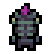
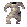
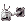
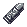
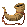
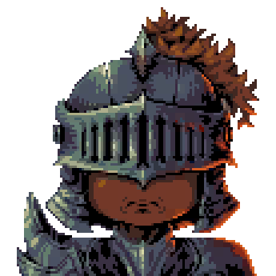

# 持盾者（The Shieldbearer）

 

前线的第一个防御。

[原文与贡献者记录](https://ballxpit.wiki.gg/wiki/The_Shieldbearer) · [修订 4290](https://ballxpit.wiki.gg/index.php?oldid=4290) · [返回目录](../%E7%90%83%E6%AF%94%E4%BC%A6%E6%88%98%E8%AE%B0%20Wiki.md)

#### 一般信息

##### 圆球（Ball）

[铁](Iron.md) 

##### 解锁

建筑物 [铁堡垒](Iron_Fortress.md) 

##### 能力

握着一个巨大的盾牌，反弹回击球。球每次从盾牌上弹出时，会增加100%的伤害。

**持盾者** 是一个可玩的 [性格](Characters.md) 在基本游戏版本中推出了 *[球比伦战记](Ball_x_Pit.md)*它们通过构建 [铁堡垒](Iron_Fortress.md)  据报道, [真菌森林](The_FUNGALxFOREST.md)  他们的起始球是 [铁](Iron.md) .

#### 能力的机械

作为他们的名字，盾牌携带者在他们的前面携带着一个大型的金属盾牌。每当球击中盾牌时，它会跳出，就像是墙壁或敌人,每当球弹出盾牌时，损伤增加100%。值得注意的是，这个盾牌 *没有* 保护自己免受敌方的射击。

#### 策略

* 盾牌载体在近距离和处理单目标伤害方面非常有效，因为它们能够在附近的敌人和他们的盾牌之间反复跳转球，以迅速升级伤害。这使得Balls具有强烈的击球效果和/或 procs,如 [辐射束（Radiation Beam）](Radiation_Beam.md) 、 [流血（Bleed）](Bleed.md) /[李克（Leech）](Leech.md) /[输血（Hemorrhage）](Hemorrhage.md) 、 [过度增长（Overgrowth）](Overgrowth.md) 、 [蚊子王（Mosquito King）](Mosquito_King.md) 、 [闪电虫（Lightning Bug）](Lightning_Bug.md)  另一方面，这使得它们不太适合穿透敌人的球，或者在击中时自杀。 [鬼魂（Ghost）](Ghost.md)  或是 [蛋袋（Egg Sac）](Egg_Sac.md) .
  + 特别值得注意的是, [钢铁（Steel）](Steel.md) ,作为它自己的防伤害防伤害设施与护盾的防伤害装置堆叠在一起， 给它一些最大的单一打击伤害潜力在游戏中。此外，弹射速度缓慢，使其更容易跟踪和反射与盾牌,[铁（Iron）](Iron.md) ).

##### 被动道具

* 由于盾牌手经常直接站在敌人面前，在他们与盾牌之间挥舞球，被动者喜欢 [钻石钻头（Diamond Hilted Dagger）](Diamond_Hilted_Dagger.md) 、  [手机风扇](https://ballxpit.wiki.gg/wiki/Hand_Fan?action=edit&redlink=1)、 [射手的矛（Reacher's Spear）](Reacher_s_Spear.md) 、 [铁制连体衣（Iron Onesie）](Iron_Onesie.md) 、 [哑铃（Platinum Dumbbell）](Platinum_Dumbbell.md)  和 [银子子弹（Silver Bullet）](Silver_Bullet.md)  所有这些都很有效。
* 许多盾牌载体的伤害来自 [小球（baby balls）](Balls.md#%E5%B0%8F%E7%90%83),所以被动的改善或与婴儿球的协同效应也与他们相对好，如 [婴儿摇铃（Baby Rattle）](Baby_Rattle.md) 、 [铁制连体衣（Iron Onesie）](Iron_Onesie.md)  和 [战争角（War Horn）](War_Horn.md) .
* 守护者的近距离游戏风格也经常使他们面临伤害的风险, [胸罩（Breastplate）](Breastplate.md) 、  [可怜洋葱（Wretched Onion）](https://ballxpit.wiki.gg/wiki/Wretched_Onion?action=edit&redlink=1)、 [棘的冠冕（Crown of Thorns）](Crown_of_Thorns.md) 、 [观察者的眼睛（Eye of the Beholder）](Eye_of_the_Beholder.md) 、  [保护的魅力](https://ballxpit.wiki.gg/wiki/Protective_Charm?action=edit&redlink=1)和  [尖刺项圈（Spiked Collar）](https://ballxpit.wiki.gg/wiki/Spiked_Collar?action=edit&redlink=1) 可以做好选择。
* 其他 [砂钟（Hourglass）](Hourglass.md)  与盾牌载体的主要力量相反，应避免/[被驱逐](Exorcist.md)  在可能的情况下。

#### 配对器

##### 很好。

* [战士（The Warrior）](The_Warrior.md)  勇士的起步球, [流血（Bleed）](Bleed.md) ,与盾牌载体的游戏风格非常好地协同化, [铁（Iron）](Iron.md)  创造的球 [输血（Hemorrhage）](Hemorrhage.md)  这也与盾牌载体重视重复击中同一个目标。
* [快枪手（The Itchy Finger）](The_Itchy_Finger.md) :Ichy Finger的高火速和分散的瞄准与盾牌手的近距离游戏风格很好地协同，因为盾牌的宽度有助于捕捉球的随机分布。
* [挥霍者（The Spendthrift）](The_Spendthrift.md)  同样，盾牌载体的盾牌非常有效地反复飞行，从Spendthrift爆发的火中捕捉球,

##### 坏的

* [暗影（The Shade）](The_Shade.md) /[杂耍者（The Juggler）](The_Juggler.md)  这些角色的不寻常的发射位置使得盾牌携手更难在盾牌和敌人之间抓住球。
* [临时西西弗斯（The Makeshift Sisyphus）](The_Makeshift_Sisyphus.md)  球球的缺失和击球损伤直接与盾牌载体的主要力量相反。

##### 不兼容

* [忏悔者（The Repentant）](The_Repentant.md) 
* [物理学家（The Physicist）](The_Physicist.md) 
* [自笞者（The Flagellant）](The_Flagellant.md) 
* [掘地者（The Tunneller）](The_Tunneller.md) 
* [战术家（The Tactician）](The_Tactician.md) 

#### 基本数据

| 属性 | 属性 |
| --- | --- |
|  耐力 | - 什么意思? |
|  力量 | 基地损坏? |
|  领导力 | 宝贝球计数?；婴儿球损伤? |
|  速度 | 球速?；移动速度? |
|  敏捷 | 关键机会?；发生火灾率? |
|  智力 | 公司发动力?；状态效应功率 - ?；动力? |

#### 性格水平的进步

[性格升级奖励](Character_Level_Mechanics.md)

| 性格水平 | 总经验值 | 提高奖励水平 | 选择 |
| --- | --- | --- | --- |
| TBA | TBA | TBA | TBA |

#### 冷知识

#### 图片库

待补充条目

*这是一个 [待补充条目](../categories/Stubs.md)你可以帮助BALL xPIT Wiki通过 [补充此条目](https://ballxpit.wiki.gg/wiki/The_Shieldbearer?action=edit).*

[共享导航](../navigation/nav-334e23d2914f.md)

**分类**　[分类 · 角色](../categories/Characters.md) · [分类 · 坚力](../categories/Stubs.md) · [分类 · 页面有导航框](../categories/Pages_with_navboxes.md)

[返回总入口](../%E7%90%83%E6%AF%94%E4%BC%A6%E6%88%98%E8%AE%B0%20Wiki.md) · [返回本分目录](%E7%9B%AE%E5%BD%95.md)
