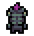
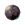
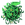
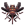
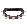
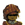
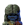

# 持盾者（The Shieldbearer）

[原文与贡献者记录](https://ballxpit.wiki.gg/wiki/The_Shieldbearer) · [修订 4290](https://ballxpit.wiki.gg/index.php?oldid=4290) · [返回目录](../%E7%90%83%E6%AF%94%E4%BC%A6%E6%88%98%E8%AE%B0%20Wiki.md)

## 持盾者 

前线的第一道防线。

## 基本信息

### 圆球（Ball）

[铁](Iron.md) 

### 解锁

建造 [铁堡](Iron_Fortress.md) 

### 能力

他持有一面巨大的盾牌，能够弹回击中的球；球每在盾牌上反弹一次，造成的伤害就会增加 100%。

**持盾者** 是 *[球比伦战记](Ball_x_Pit.md)* 基础游戏中就包含的一名可玩的 [角色](Characters.md)。建造 [铁堡](Iron_Fortress.md)  即可解锁，其蓝图位于 [真菌森林](The_FUNGALxFOREST.md) 。起始圆球为 [铁](Iron.md) 。

## 能力机制

顾名思义，持盾者在身前持有一面巨大的金属盾牌。每当球击中盾牌时，它就会像撞到墙壁或敌人一样反弹，反弹方向指向玩家的光标位置。每次球反弹时，其伤害都会增加 100%。需要注意的是，这面盾牌*无法*防御敌人的投射物。

## 策略

* 持盾者在近距范围内以及对单目标造成伤害方面极其有效，这得益于他们能够将球在附近的敌人之间反复反弹，并利用盾牌迅速增加伤害。这使得那些具有强大命中效果或触发效果的球变得非常强大。 [辐射束（Radiation Beam）](Radiation_Beam.md) 、 [流血（Bleed）](Bleed.md) /[水蛭（Leech）](Leech.md) /[大出血（Hemorrhage）](Hemorrhage.md) 、 [疯长（Overgrowth）](Overgrowth.md) 、 [蚊王（Mosquito King）](Mosquito_King.md) 、 [闪电虫（Lightning Bug）](Lightning_Bug.md)  等等都极其有效。相反，能够穿透敌人或在命中时自毁的圆球则不太适合，例如 [幽灵（Ghost）](Ghost.md)  或 [卵囊（Egg Sac）](Egg_Sac.md) 。
  + 特别值得注意的协同效应是与 [钢铁](Steel.md)  的搭配，其自身的伤害放大特性与护盾的伤害放大效果相得益彰，使其拥有游戏中最高的单次命中伤害潜力之一。此外，其缓慢的弹道速度让盾牌更容易追踪和反弹，而持盾者每局都会自带其组件之一（[铁](Iron.md) ）。

### 被动道具

* 由于持盾者经常直接站在敌人面前，在敌人与其盾牌之间发射球弹，因此像[钻石柄匕首](Diamond_Hilted_Dagger.md) 、[手扇](https://ballxpit.wiki.gg/wiki/Hand_Fan?action=edit&redlink=1)、[伸刺长矛](Reacher_s_Spear.md) 、[铁制连体衣](Iron_Onesie.md) 、[铂金哑铃](Platinum_Dumbbell.md)  以及[银弹](Silver_Bullet.md)  这样的被动道具都十分有效。
* 持盾者的大部分伤害来自[小球](Balls.md#%E5%B0%8F%E7%90%83)，因此能提升或与小球协同作用的被动道具也非常适合搭配使用，例如[婴儿摇铃](Baby_Rattle.md) 、[铁制连体衣](Iron_Onesie.md)  和[战争号角](War_Horn.md) 。
* 持盾者的近距离玩法也常常使他们面临受伤的风险，因此像 [胸甲](Breastplate.md) 、 [可怜洋葱](https://ballxpit.wiki.gg/wiki/Wretched_Onion?action=edit&redlink=1)、[荆棘王冠](Crown_of_Thorns.md) 、[观者之眼](Eye_of_the_Beholder.md) 、 [防护魅惑](https://ballxpit.wiki.gg/wiki/Protective_Charm?action=edit&redlink=1)以及  [尖刺项圈](https://ballxpit.wiki.gg/wiki/Spiked_Collar?action=edit&redlink=1)这样的防御被动道具，都是不错的选择。
* [沙漏](Hourglass.md)  与持盾者的主要优势完全相悖，应尽可能避免，或通过 [驱魔者](Exorcist.md)  移除。

## 配对系统

### 好

* [战士](The_Warrior.md) ：战士的初始球技 [流血](Bleed.md) ，与持盾者的玩法配合非常出色，并可与持盾者的 [铁](Iron.md)  融合，形成 [大出血](Hemorrhage.md) ，这也与持盾者注重反复攻击同一目标的特点相得益彰。
* [快枪手](The_Itchy_Finger.md) ：快枪手的高发射频率与分散的瞄准方式与持盾者的近距离玩法相得益彰，盾的宽度有助于捕捉球体的随机扩散。
* [挥霍者](The_Spendthrift.md) ：同样，持盾者的护盾在反复拦截挥霍者爆发性攻击中的球时非常有效，能够造成毁灭性的近距离伤害。

### 坏

* [暗影](The_Shade.md) /[杂耍者](The_Juggler.md) ：这些角色独特的发射姿势使得持盾者很难将球困在盾牌与敌人之间。
* [临时西西弗斯](The_Makeshift_Sisyphus.md) ：小球数量的不足以及命中时对小球的伤害直接违背了持盾者的核心优势，毕竟他们的命中时伤害非常强大。

### 不兼容

* [忏悔者](The_Repentant.md) 
* [物理学家](The_Physicist.md) 
* [自笞者](The_Flagellant.md) 
* [掘地者](The_Tunneller.md) 
* [战术家](The_Tactician.md) 

## 基础属性

| 属性 | 属性 |
| --- | --- |
|  耐力 | 生命值未知 |
|  力量 | 基础伤害 - ? |
|  领导力 | 小球数量 - ?；小球伤害 - ? |
|  速度 | 球速 - ?；移动速度 - ? |
|  敏捷 | 暴击率 - ?；发射频率 - ? |
|  智力 | 范围效果强度 – 待确认；状态效果强度 - ?；被动效果强度 – 待确认 |

## 角色等级进展

[角色等级提升奖励](Character_Level_Mechanics.md)

| 角色等级 | 总经验值 | 升级奖励 | 选择项 |
| --- | --- | --- | --- |
| TBA | TBA | TBA | TBA |

## 冷知识

## 图片库

待完善

*此条目为 [待完善](../categories/Stubs.md). 你可以通过帮助 BALL x PIT 维基贡献一份力量。 [补充内容](https://ballxpit.wiki.gg/wiki/The_Shieldbearer?action=edit).*

[共享导航](../navigation/nav-334e23d2914f.md)

**分类**　[分类 · 角色](../categories/Characters.md) · [分类 · 待完善](../categories/Stubs.md) · [分类 · 带有导航框的页面](../categories/Pages_with_navboxes.md)

[返回总入口](../%E7%90%83%E6%AF%94%E4%BC%A6%E6%88%98%E8%AE%B0%20Wiki.md) · [返回本分目录](%E7%9B%AE%E5%BD%95.md)
