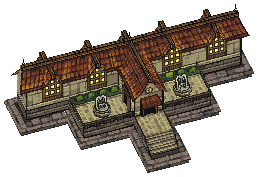

# 挥霍者（The Spendthrift）

 

一个有钱的商人过着奢侈的生活

[原文与贡献者记录](https://ballxpit.wiki.gg/wiki/The_Spendthrift) · [修订 4327](https://ballxpit.wiki.gg/index.php?oldid=4327) · [返回目录](../%E7%90%83%E6%AF%94%E4%BC%A6%E6%88%98%E8%AE%B0%20Wiki.md)

#### 一般信息

##### 圆球（Ball）

[吸血鬼](Vampire.md) 

##### 解锁

建筑物 [豪宅](Mansion.md) 

##### 能力

在宽弧中同时射出所有球

**挥霍者** 是一个可玩的 [性格](Characters.md) 在基本游戏版本中推出了 *[球比伦战记](Ball_x_Pit.md)*它们通过构建 [豪宅](Mansion.md)  据报道, [真菌森林](The_FUNGALxFOREST.md)  他们的起始球是 [吸血鬼](Vampire.md) .

#### 能力的机械

虽然大多数角色在连续的溪流中逐一发射他们的球，但Spendthrift却用散射枪的散射模式一次性发射**all**可用球。

#### 策略

[单击这里，添加一个策略!](https://ballxpit.wiki.gg/wiki/The_Spendthrift?action=edit&section=new)

#### [匹配机](Matchmaker.md) 配对 

##### 很好。

##### 坏的

##### 不兼容

* [同居者（The Cohabitants）](The_Cohabitants.md) 
* [临时西西弗斯（The Makeshift Sisyphus）](The_Makeshift_Sisyphus.md) 
* [File:The Recollector.png](https://ballxpit.wiki.gg/wiki/Special%3AUpload?wpDestFile=The_Recollector.png) [记忆者](https://ballxpit.wiki.gg/wiki/The_Recollector?action=edit&redlink=1)

#### 基本数据

| 属性 | 属性 |
| --- | --- |
|  耐力 | - 什么意思? |
|  力量 | 基地损坏? |
|  领导力 | 宝贝球计数?；婴儿球损伤? |
|  速度 | 球速?；移动速度? |
|  敏捷 | 关键机会?；发生火灾率? |
|  智力 | 公司发动力?；状态效应功率 - ?；动力? |

#### 性格水平的进步

[性格升级奖励](Character_Level_Mechanics.md)

| 性格水平 | 总经验值 | 提高奖励水平 | 选择 |
| --- | --- | --- | --- |
| TBA | TBA | TBA | TBA |

#### 冷知识

#### 图片库

待补充条目

*这是一个 [待补充条目](../categories/Stubs.md)你可以帮助BALL xPIT Wiki通过 [补充此条目](https://ballxpit.wiki.gg/wiki/The_Spendthrift?action=edit).*

[共享导航](../navigation/nav-334e23d2914f.md)

**分类**　[分类 · 角色](../categories/Characters.md) · [分类 · 有破损文件链接的页面](../categories/Pages_with_broken_file_links.md) · [分类 · 坚力](../categories/Stubs.md) · [分类 · 页面有导航框](../categories/Pages_with_navboxes.md)

[返回总入口](../%E7%90%83%E6%AF%94%E4%BC%A6%E6%88%98%E8%AE%B0%20Wiki.md) · [返回本分目录](%E7%9B%AE%E5%BD%95.md)
