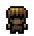
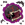

# 挥霍者（The Spendthrift）

[原文与贡献者记录](https://ballxpit.wiki.gg/wiki/The_Spendthrift) · [修订 4327](https://ballxpit.wiki.gg/index.php?oldid=4327) · [返回目录](../%E7%90%83%E6%AF%94%E4%BC%A6%E6%88%98%E8%AE%B0%20Wiki.md)

## 挥霍者 

一位富有的商人，过着奢侈的生活。

## 基本信息

### 圆球（Ball）

[吸血鬼](Vampire.md) 

### 解锁

建造 [豪宅](Mansion.md) 

### 能力

同时以宽弧线射出所有球。

**挥霍者** 是 *[球比伦战记](Ball_x_Pit.md)* 基础游戏中就包含的一名可玩的 [角色](Characters.md)。建造 [豪宅](Mansion.md)  即可解锁，其蓝图位于 [真菌森林](The_FUNGALxFOREST.md) 。起始圆球为 [吸血鬼](Vampire.md) 。

## 能力机制

与大多数角色连续发射多颗圆球不同，挥霍者会以类似霰弹枪的散射方式一次性发射 **全部** 可用圆球。

## 策略

[点击此处添加策略！](https://ballxpit.wiki.gg/wiki/The_Spendthrift?action=edit&section=new)

## [匹配机](Matchmaker.md) 配对 

### 好

### 坏

### 不兼容

* [同居者](The_Cohabitants.md) 
* [临时西西弗斯](The_Makeshift_Sisyphus.md) 
* [文件：The Recollector.png](https://ballxpit.wiki.gg/wiki/Special%3AUpload?wpDestFile=The_Recollector.png) [回忆者](https://ballxpit.wiki.gg/wiki/The_Recollector?action=edit&redlink=1)

## 基础属性

| 属性 | 属性 |
| --- | --- |
|  耐力 | 生命值未知 |
|  力量 | 基础伤害 - ? |
|  领导力 | 小球数量 - ?；小球伤害 - ? |
|  速度 | 球速 - ?；移动速度 - ? |
|  敏捷 | 暴击率 - ?；发射频率 - ? |
|  智力 | 范围效果强度 – 待确认；状态效果强度 - ?；被动效果强度 – 待确认 |

## 角色等级进展

[角色等级提升奖励](Character_Level_Mechanics.md)

| 角色等级 | 总经验值 | 升级奖励 | 选择项 |
| --- | --- | --- | --- |
| TBA | TBA | TBA | TBA |

## 冷知识

## 图片库

待完善

*此条目为 [待完善](../categories/Stubs.md). 你可以通过帮助 BALL x PIT 维基贡献一份力量。 [补充内容](https://ballxpit.wiki.gg/wiki/The_Spendthrift?action=edit).*

[共享导航](../navigation/nav-334e23d2914f.md)

**分类**　[分类 · 角色](../categories/Characters.md) · [分类 · 文件链接失效的页面](../categories/Pages_with_broken_file_links.md) · [分类 · 待完善](../categories/Stubs.md) · [分类 · 带有导航框的页面](../categories/Pages_with_navboxes.md)

[返回总入口](../%E7%90%83%E6%AF%94%E4%BC%A6%E6%88%98%E8%AE%B0%20Wiki.md) · [返回本分目录](%E7%9B%AE%E5%BD%95.md)
