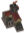
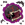
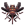
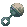

# 战术家（The Tactician）

[原文与贡献者记录](https://ballxpit.wiki.gg/wiki/The_Tactician) · [修订 4355](https://ballxpit.wiki.gg/index.php?oldid=4355) · [返回目录](../%E7%90%83%E6%AF%94%E4%BC%A6%E6%88%98%E8%AE%B0%20Wiki.md)

## 战术家 

一位退役将军，经验之丰富令人难以置信。

## 基本信息

### 圆球（Ball）

[铁](Iron.md) 

### 解锁

建造 [队长宿舍](Captain_s_Quarters.md) 

### 能力

战斗将采用回合制进行。

**战术家** 是 *[球比伦战记](Ball_x_Pit.md)* 基础游戏中就包含的一名可玩的 [角色](Characters.md)。建造 [队长宿舍](Captain_s_Quarters.md)  即可解锁，其蓝图位于 [阴燃深渊](The_SMOLDERINGxDEPTHS.md) 。起始圆球为 [铁](Iron.md) 。

## 能力说明

战术家将单局游戏的节奏彻底重构为“回合制”战斗模式，游戏在玩家和敌人之间交替进行“回合”。当轮到玩家时，他们可以自由移动和瞄准，而敌人和屏幕滚动则完全静止。一旦玩家发射出球，他们就会专注于这次射击，无法移动或改变瞄准方向，球会像往常一样反弹并造成伤害。当玩家所有的球都返回，或者玩家通过右键点击手动召回它们时，就轮到敌人了。在敌人的回合中，他们有几秒钟的时间前进、攻击和生成敌人，而玩家仍然无法移动。当敌人的回合结束时，又轮到玩家了，他们可以重新定位并计划下一次射击。

在战场上生成的任何拾取物，如宝石、[聚变反应堆](Fusion_Reactor.md)和[资源](Resources.md)，在出现时就会立即被收集。

## 策略

* 战术家战斗风格的更可预测性使得玩家能够安全地策划那些原本没有时间或空间去规划的复杂战术，这几乎适用于任何类型的构筑方式——无论是为命中时获取最大反弹效果的构筑方式，还是为扩散范围效果/状态效果伤害而设计的构筑方式。
* 在敌人回合期间，几秒钟的静止状态会让玩家变得非常脆弱，尤其是在面对那些更难躲避的攻击时。 [首领](../categories/Bosses.md)偶尔会导致不可避免的伤害。因此，那些帮助玩家承受或减轻伤害的被动道具，比如 [胸甲（Breastplate）](Breastplate.md) 、 [观者之眼（Eye of the Beholder）](Eye_of_the_Beholder.md) 、  [手镜](https://ballxpit.wiki.gg/wiki/Hand_Mirror?action=edit&redlink=1)、  [恋人的箭袋（Lover's Quiver）](https://ballxpit.wiki.gg/wiki/Lover%27s_Quiver?action=edit&redlink=1)、  [防护魅惑](https://ballxpit.wiki.gg/wiki/Protective_Charm?action=edit&redlink=1)、  [治疗者的雕像](https://ballxpit.wiki.gg/wiki/Healer%27s_Effigy?action=edit&redlink=1)等，以及能够治疗玩家的球类物品 [吸血鬼（Vampire）](Vampire.md) 、 [蚊王（Mosquito King）](Mosquito_King.md) 、 [File:Fruit.png](https://ballxpit.wiki.gg/wiki/Special%3AUpload?wpDestFile=Fruit.png) [水果](https://ballxpit.wiki.gg/wiki/Fruit?action=edit&redlink=1)等等，可能会非常有用。
* 在玩家的回合中，自由移动能力使他们能够轻松触发  [尖刺项圈](https://ballxpit.wiki.gg/wiki/Spiked_Collar?action=edit&redlink=1)，因为敌人由于距离过近而无法移动或攻击玩家。
* [婴儿摇铃](Baby_Rattle.md)  的分散瞄准效果可以通过让每次射击都能覆盖更广泛的潜在目标，从而独特地惠及战术家。多种不同的敌人位置布局可能会迫使玩家只选择一两个目标。当这些目标死亡后，剩余的球将白白浪费，因为它们会沿相同的路径飞行，错过任何附近的敌人。然而，通过分散瞄准，球将能够沿略有不同的路径飞行，有可能击中那些未被直接瞄准的敌人。

## [匹配机](Matchmaker.md) 配对 

### 好

* [杂耍者](The_Juggler.md)  - 通过能够将子弹抛向敌人上方，让玩家的瞄准更加精准。特别适用于对付敌人层叠、首领和小首领，实现敌人与后墙之间的连续命中。

### 坏

* [文件：The Scrupulous Scoundrel.png](https://ballxpit.wiki.gg/wiki/Special%3AUpload?wpDestFile=The_Scrupulous_Scoundrel.png) [卑鄙无赖](https://ballxpit.wiki.gg/wiki/The_Scrupulous_Scoundrel?action=edit&redlink=1) - 每次射击都会显著降低玩家对球路径的控制力。

### 不兼容

* [快枪手](The_Itchy_Finger.md) 
* [持盾者](The_Shieldbearer.md) 
* [自笞者](The_Flagellant.md) 
* [畅饮者](The_Carouser.md) 
* [文件：The Scandalmonger.png](https://ballxpit.wiki.gg/wiki/Special%3AUpload?wpDestFile=The_Scandalmonger.png)  [Scandalmonger](https://ballxpit.wiki.gg/wiki/The_Scandalmonger?action=edit&redlink=1)

## 基础属性

| 属性 | 属性 |
| --- | --- |
|  耐力 | 生命值未知 |
|  力量 | 基础伤害 - ? |
|  领导力 | 小球数量 - ?；小球伤害 - ? |
|  速度 | 球速 - ?；移动速度 - ? |
|  敏捷 | 暴击率 - ?；发射频率 - ? |
|  智力 | 范围效果强度 – 待确认；状态效果强度 - ?；被动效果强度 – 待确认 |

## 角色等级进展

[角色等级提升奖励](Character_Level_Mechanics.md)

| 角色等级 | 总经验值 | 升级奖励 | 选择项 |
| --- | --- | --- | --- |
| TBA | TBA | TBA | TBA |

## 冷知识

## 图片库

待完善

*此条目为 [待完善](../categories/Stubs.md). 你可以通过帮助 BALL x PIT 维基贡献一份力量。 [补充内容](https://ballxpit.wiki.gg/wiki/The_Tactician?action=edit).*

[共享导航](../navigation/nav-334e23d2914f.md)

**分类**　[分类 · 角色](../categories/Characters.md) · [分类 · 文件链接失效的页面](../categories/Pages_with_broken_file_links.md) · [分类 · 待完善](../categories/Stubs.md) · [分类 · 带有导航框的页面](../categories/Pages_with_navboxes.md)

[返回总入口](../%E7%90%83%E6%AF%94%E4%BC%A6%E6%88%98%E8%AE%B0%20Wiki.md) · [返回本分目录](%E7%9B%AE%E5%BD%95.md)
