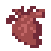

# 蹑足者（The Tiptoer）

 

一个小费者,

[原文与贡献者记录](https://ballxpit.wiki.gg/wiki/The_Tiptoer) · [修订 3988](https://ballxpit.wiki.gg/index.php?oldid=3988) · [返回目录](../%E7%90%83%E6%AF%94%E4%BC%A6%E6%88%98%E8%AE%B0%20Wiki.md)

#### 一般信息

##### 圆球（Ball）

[激光 （水平 / Horizontal）](Laser_Horizontal.md) 

##### 解锁

建筑物 [隐秘神殿](Hidden_Temple.md) 

##### 能力

没有被敌人发现 (除了老板和迷你老板),

**蹑足者** 是一个可玩的 [性格](Characters.md) 在 *[球比伦战记](Ball_x_Pit.md)*引入于 [影子更新](https://ballxpit.wiki.gg/wiki/The_Shadow_Update?action=edit&redlink=1)它们通过构建 [隐秘神殿](Hidden_Temple.md)  据报道, [阴燃深渊](The_SMOLDERINGxDEPTHS.md)  他们的起始球是 [激光 （水平 / Horizontal）](Laser_Horizontal.md) .

#### 能力的机械

**TBA**

#### 配对器

**TBA**

#### 策略

[单击这里，添加一个策略!](https://ballxpit.wiki.gg/wiki/The_Tiptoer?action=edit&section=new)

#### 基本数据

| 属性 | 属性 |
| --- | --- |
|  耐力 | - 什么意思? |
|  力量 | 基地损坏? |
|  领导力 | 宝贝球计数?；婴儿球损伤? |
|  速度 | 球速?；移动速度? |
|  敏捷 | 关键机会?；发生火灾率? |
|  智力 | 公司发动力?；状态效应功率 - ?；动力? |

#### 性格水平的进步

[性格升级奖励](Character_Level_Mechanics.md)

| 性格水平 | 总经验值 | 提高奖励水平 | 选择 |
| --- | --- | --- | --- |
| TBA | TBA | TBA | TBA |

#### 冷知识

#### 图片库

待补充条目

*这是一个 [待补充条目](../categories/Stubs.md)你可以帮助BALL xPIT Wiki通过 [补充此条目](https://ballxpit.wiki.gg/wiki/The_Tiptoer?action=edit).*

[共享导航](../navigation/nav-334e23d2914f.md)

**分类**　[分类 · 角色](../categories/Characters.md) · [分类 · 坚力](../categories/Stubs.md) · [分类 · 页面有导航框](../categories/Pages_with_navboxes.md)

[返回总入口](../%E7%90%83%E6%AF%94%E4%BC%A6%E6%88%98%E8%AE%B0%20Wiki.md) · [返回本分目录](%E7%9B%AE%E5%BD%95.md)
