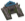

# 蹑足者（The Tiptoer）

 

踮着脚的人。

[原文与贡献者记录](https://ballxpit.wiki.gg/wiki/The_Tiptoer) · [修订 3988](https://ballxpit.wiki.gg/index.php?oldid=3988) · [返回目录](../%E7%90%83%E6%AF%94%E4%BC%A6%E6%88%98%E8%AE%B0%20Wiki.md)

## 基本信息

### 圆球（Ball）

[激光（水平）](Laser_Horizontal.md) 

### 解锁

建造 [隐秘神殿](Hidden_Temple.md) 

### 能力

无法被敌人发现（除首领和小首领外），但生命值大幅减少。

**提普托尔**是*[球比伦战记](Ball_x_Pit.md)*中的可操控[角色](Characters.md)，于[暗影更新](https://ballxpit.wiki.gg/wiki/The_Shadow_Update?action=edit&redlink=1)中登场。通过建造[隐秘神殿](Hidden_Temple.md)  即可解锁该角色，其蓝图位于[阴燃深渊](The_SMOLDERINGxDEPTHS.md) 。其初始球为[激光（水平）](Laser_Horizontal.md) 。

## 能力机制

**TBA**

## 配对系统

**TBA**

## 策略

[点击此处添加策略！](https://ballxpit.wiki.gg/wiki/The_Tiptoer?action=edit&section=new)

## 基础属性

| 属性 | 属性 |
| --- | --- |
|  耐力 | 生命值未知 |
|  力量 | 基础伤害 - ? |
|  领导力 | 小球数量 - ?；小球伤害 - ? |
|  速度 | 球速 - ?；移动速度 - ? |
|  敏捷 | 暴击率 - ?；发射频率 - ? |
|  智力 | 范围效果强度 – 待确认；状态效果强度 - ?；被动效果强度 – 待确认 |

## 角色等级进展

[角色等级提升奖励](Character_Level_Mechanics.md)

| 角色等级 | 总经验值 | 升级奖励 | 选择项 |
| --- | --- | --- | --- |
| TBA | TBA | TBA | TBA |

## 冷知识

## 图片库

待完善

*此条目为 [待完善](../categories/Stubs.md). 你可以通过帮助 BALL x PIT 维基贡献一份力量。 [补充内容](https://ballxpit.wiki.gg/wiki/The_Tiptoer?action=edit).*

[共享导航](../navigation/nav-334e23d2914f.md)

**分类**　[分类 · 角色](../categories/Characters.md) · [分类 · 待完善](../categories/Stubs.md) · [分类 · 带有导航框的页面](../categories/Pages_with_navboxes.md)

[返回总入口](../%E7%90%83%E6%AF%94%E4%BC%A6%E6%88%98%E8%AE%B0%20Wiki.md) · [返回本分目录](%E7%9B%AE%E5%BD%95.md)
