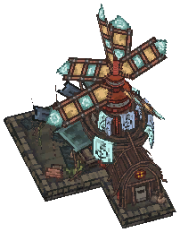
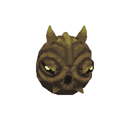
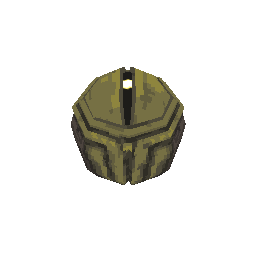
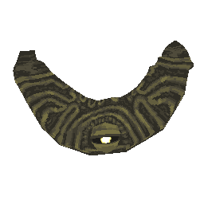
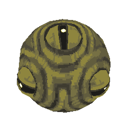

# 浩瀚虚空（The VASTxVOID）

[原文与贡献者记录](https://ballxpit.wiki.gg/wiki/The_VASTxVOID) · [修订 3711](https://ballxpit.wiki.gg/index.php?oldid=3711) · [返回目录](../%E7%90%83%E6%AF%94%E4%BC%A6%E6%88%98%E8%AE%B0%20Wiki.md)

#### 一般信息

##### 解锁所需齿轮（Gears to unlock）

5

##### 建筑蓝图（Blueprints）

9

##### 解锁条件（Unlocks）

标签

**浩瀚虚空** 才是第八位和末位, [的水平](Levels.md) 在 *[球比伦战记](Ball_x_Pit.md)*需要5个齿轮才能解锁

#### 建筑蓝图

玩家可以在此关卡中获取以下 [建筑](Buildings.md) 的蓝图 :

* [战士协会（Warrior's Guild）](Warrior_s_Guild.md) 
* [医院（Hospital）](Hospital.md) 
* [射手协会（Marksman's Guild）](Marksman_s_Guild.md) 
* [大博物馆（Grand Museum）](Grand_Museum.md) 
* [车车工厂（Wagon Factory）](Wagon_Factory.md) 
* [资本中心（Capitolium）](Capitolium.md) 
* [聚会之家（Party House）](Party_House.md) 
* [球场（Ball House）](Ball_House.md) 
* [虚空奖杯（Void Trophy）](Void_Trophy.md) 

#### 敌人

以下是在此级别上可遇到的[enemies](Enemies.md)列表:

* [月灵（Moonling）](Moonling.md) 
* [月球弓箭手（Moonling Archer）](Moonling_Archer.md) 
* [月亮的地质（Moonling Geode）](Moonling_Geode.md) 
* [月石（Moonrock）](Moonrock.md) 
* [废除（Voidling）](Voidling.md) 
* [半月月亮（Crescent Moonling）](Crescent_Moonling.md) 
* [衰落的月球（Waning Moonling）](Waning_Moonling.md) 
* [月族（Moonkin）](Moonkin.md) 
* [月族晶洞（Moonkin Geode）](Moonkin_Geode.md) 
* [月亮（The Moon）](The_Moon.md) 

#### 冷知识

* 它是唯一一个没有 [圆球](Balls.md) 或 [被动物品](Passives.md) 的锁的级别。

[共享导航](../navigation/nav-47f674e55b3c.md)

**分类**　[分类 · 关卡](../categories/Levels.md) · [分类 · 页面有导航框](../categories/Pages_with_navboxes.md)

[返回总入口](../%E7%90%83%E6%AF%94%E4%BC%A6%E6%88%98%E8%AE%B0%20Wiki.md) · [返回本分目录](%E7%9B%AE%E5%BD%95.md)
