# 浩瀚虚空（The VASTxVOID）

[原文与贡献者记录](https://ballxpit.wiki.gg/wiki/The_VASTxVOID) · [修订 3711](https://ballxpit.wiki.gg/index.php?oldid=3711) · [返回目录](../%E7%90%83%E6%AF%94%E4%BC%A6%E6%88%98%E8%AE%B0%20Wiki.md)

## 基本信息

### 解锁所需齿轮（Gears to unlock）

5

### 建筑蓝图（Blueprints）

9

### 解锁内容（Unlocks）

不适用

**浩瀚虚空** 是 *[球比伦战记](Ball_x_Pit.md)* 的第八个也是最后一个 [关卡](Levels.md)。需要 5 个齿轮才能解锁。

## 建筑蓝图

玩家可以在本关卡中获得以下 [建筑](Buildings.md)的建筑蓝图：

* [战士公会](Warrior_s_Guild.md) [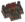](Warrior_s_Guild.md)
* [医院（Hospital）](Hospital.md) [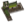](Hospital.md)
* [射手公会](Marksman_s_Guild.md) [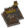](Marksman_s_Guild.md)
* [大博物馆](Grand_Museum.md) [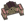](Grand_Museum.md)
* [马车工厂](Wagon_Factory.md) [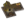](Wagon_Factory.md)
* [议事殿（Capitolium）](Capitolium.md) [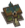](Capitolium.md)
* [派对之家（Party House）](Party_House.md) [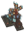](Party_House.md)
* [圆球屋（Ball House）](Ball_House.md) [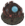](Ball_House.md)
* [虚空奖杯（Void Trophy）](Void_Trophy.md) [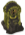](Void_Trophy.md)

## 敌人

本关卡可能遇到下列[敌人](Enemies.md)。

* [月灵（Moonling）](Moonling.md) [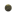](Moonling.md)
* [月灵弓箭手](Moonling_Archer.md) [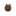](Moonling_Archer.md)
* [月灵晶洞](Moonling_Geode.md) 
* [月岩（Moonrock）](Moonrock.md) [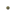](Moonrock.md)
* [虚空幼体（Voidling）](Voidling.md) 
* [新月月灵](Crescent_Moonling.md) [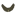](Crescent_Moonling.md)
* [残月月灵](Waning_Moonling.md) [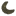](Waning_Moonling.md)
* [月族（Moonkin）](Moonkin.md) [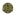](Moonkin.md)
* [月族晶洞](Moonkin_Geode.md) [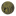](Moonkin_Geode.md)
* [月球（The Moon）](The_Moon.md) [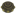](The_Moon.md)

## 冷知识

* 这是唯一一个通关后不会解锁[圆球](Balls.md)或[被动道具](Passives.md)的关卡。

[共享导航](../navigation/nav-47f674e55b3c.md)

**分类**　[分类 · 关卡](../categories/Levels.md) · [分类 · 带有导航框的页面](../categories/Pages_with_navboxes.md)

[返回总入口](../%E7%90%83%E6%AF%94%E4%BC%A6%E6%88%98%E8%AE%B0%20Wiki.md) · [返回本分目录](%E7%9B%AE%E5%BD%95.md)
