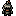

# 战士（The Warrior）

 

一个流浪的战士。

[原文与贡献者记录](https://ballxpit.wiki.gg/wiki/The_Warrior) · [修订 2350](https://ballxpit.wiki.gg/index.php?oldid=2350) · [返回目录](../%E7%90%83%E6%AF%94%E4%BC%A6%E6%88%98%E8%AE%B0%20Wiki.md)

## 基本信息

### 圆球（Ball）

[流血](Bleed.md) 

### 解锁

N/A（游戏开始时可获取）

### 能力

默认角色，无特殊游戏特性。

**战士** 是 *[球比伦战记](Ball_x_Pit.md)* 中每场对局开始时即可使用的默认可玩 [角色](Characters.md)。他们没有独特的角色能力或特点，起始圆球为 [流血](Bleed.md) 。

## 关卡

由于战士没有住房，他们无法获得其他角色在4级、7级和9级时通常能获得的住房能力解锁和升级，也无法从[老兵小屋](Veteran_s_Hut.md)中获得经验值加成。

[角色等级提升奖励](Character_Level_Mechanics.md)

| 角色等级 | 总经验值 | 升级奖励 | 选择项 |
| --- | --- | --- | --- |
| 3 | 857 | [收获升级](Harvest_Upgrades_Character_Bonus.md) |  [木材大师](https://ballxpit.wiki.gg/wiki/Wood_Master?action=edit&redlink=1) 或  [石匠凿岩者](https://ballxpit.wiki.gg/wiki/Stonepiercer?action=edit&redlink=1) |
| 6 | 3,574 | [收获升级](Harvest_Upgrades_Character_Bonus.md) |  [长柄镰刀（Long Sickle）](https://ballxpit.wiki.gg/wiki/Long_Sickle?action=edit&redlink=1) 或  [小麦收割机](https://ballxpit.wiki.gg/wiki/Wheat_Harvester?action=edit&redlink=1) |
| 10 | 14,069 | [收获升级](Harvest_Upgrades_Character_Bonus.md) |  [石匠凿手](https://ballxpit.wiki.gg/wiki/Stonepiercer?action=edit&redlink=1) 或  [时间守护者](https://ballxpit.wiki.gg/wiki/Time_Keeper?action=edit&redlink=1) |
| ... | ... | ... |  |

## 策略

除了专注于那些与 [流血](Bleed.md)  相融合或产生协同作用的圆球和被动道具外，战士的整体策略无需针对任何内置角色特性进行补偿或调整。因此，战士是尝试不同圆球融合或被动组合的最佳角色之一。同时，战士与其他任何角色搭配起来也毫无障碍。

## 冷知识

## 图片库

* 战士正在 [骸骨墓园](The_BONExYARD.md)  中攻击一些敌人。

  

待完善

*此条目为 [待完善](../categories/Stubs.md). 你可以通过帮助 BALL x PIT 维基贡献一份力量。 [补充内容](https://ballxpit.wiki.gg/wiki/The_Warrior?action=edit).*

[共享导航](../navigation/nav-334e23d2914f.md)

**分类**　[分类 · 角色](../categories/Characters.md) · [分类 · 待完善](../categories/Stubs.md) · [分类 · 带有导航框的页面](../categories/Pages_with_navboxes.md)

[返回总入口](../%E7%90%83%E6%AF%94%E4%BC%A6%E6%88%98%E8%AE%B0%20Wiki.md) · [返回本分目录](%E7%9B%AE%E5%BD%95.md)
