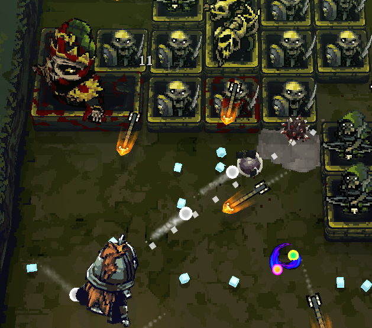

# 战士（The Warrior）

 

一个流浪的战士。

[原文与贡献者记录](https://ballxpit.wiki.gg/wiki/The_Warrior) · [修订 2350](https://ballxpit.wiki.gg/index.php?oldid=2350) · [返回目录](../%E7%90%83%E6%AF%94%E4%BC%A6%E6%88%98%E8%AE%B0%20Wiki.md)

#### 一般信息

##### 圆球（Ball）

[流血](Bleed.md) 

##### 解锁

N/A (在比赛开始时可用)

##### 能力

默认角色，没有特殊的游戏规律。

**战士** 是可播放的基底 [性格](Characters.md) 在每场游戏开始时可用 *[球比伦战记](Ball_x_Pit.md)*。他们没有独特的性格能力或怪异的性格能力，而且他们的起始球是 [流血](Bleed.md) .

#### 关卡

战士没有住房，因此无法在 4、7 和 9 级获得其他角色通常可解锁或升级的住房能力，也无法获得来自下列建筑的经验值加成： [退伍军人小屋](Veteran_s_Hut.md).

[性格升级奖励](Character_Level_Mechanics.md)

| 性格水平 | 总经验值 | 水平向上提升 Perk | 选择 |
| --- | --- | --- | --- |
| 3 | 857 | [提高收获](Harvest_Upgrades_Character_Bonus.md) |  [木材师](https://ballxpit.wiki.gg/wiki/Wood_Master?action=edit&redlink=1) 或是  [石头破碎者](https://ballxpit.wiki.gg/wiki/Stonepiercer?action=edit&redlink=1) |
| 6 | 3,574 | [提高收获](Harvest_Upgrades_Character_Bonus.md) |  [长柄镰刀（Long Sickle）](https://ballxpit.wiki.gg/wiki/Long_Sickle?action=edit&redlink=1) 或是  [麦机](https://ballxpit.wiki.gg/wiki/Wheat_Harvester?action=edit&redlink=1) |
| 10 | 14,069 | [提高收获](Harvest_Upgrades_Character_Bonus.md) |  [石头破碎者](https://ballxpit.wiki.gg/wiki/Stonepiercer?action=edit&redlink=1) 或是  [时间守护者](https://ballxpit.wiki.gg/wiki/Time_Keeper?action=edit&redlink=1) |
| ... | ... | ... |  |

#### 策略

除了关注球和被动的进化或协同的球和被动的 [流血](Bleed.md)  具体地说, " 勇士 " 的一般战略不需要任何补偿或与任何内在的性格怪异打交道。因此，勇士是一个更好的人物之一用来试验不寻常的球核聚变或被动组合。他们也是无摩擦的配对与任何其他性格。

#### 冷知识

#### 图片库

* 勇士攻击一些敌人 [骸骨墓园（The BONExYARD）](The_BONExYARD.md) .

  

待补充条目

*这是一个 [待补充条目](../categories/Stubs.md)你可以帮助BALL xPIT Wiki通过 [补充此条目](https://ballxpit.wiki.gg/wiki/The_Warrior?action=edit).*

[共享导航](../navigation/nav-334e23d2914f.md)

**分类**　[分类 · 角色](../categories/Characters.md) · [分类 · 坚力](../categories/Stubs.md) · [分类 · 页面有导航框](../categories/Pages_with_navboxes.md)

[返回总入口](../%E7%90%83%E6%AF%94%E4%BC%A6%E6%88%98%E8%AE%B0%20Wiki.md) · [返回本分目录](%E7%9B%AE%E5%BD%95.md)
