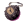
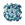
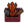
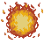
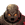

# 时间（Time）

击中敌人后会生成时间陷阱，陷阱在场上停留 2.0/2.5/3.0 秒，并将其中的敌人冻结。

[原文与贡献者记录](https://ballxpit.wiki.gg/wiki/Time) · [修订 4348](https://ballxpit.wiki.gg/index.php?oldid=4348) · [返回目录](../%E7%90%83%E6%AF%94%E4%BC%A6%E6%88%98%E8%AE%B0%20Wiki.md)

## 基本信息

### 初始角色（Starting Character）

-

### 解锁

通关《球比伦战记》

### 命中效果（On-Hit Effects）

自爆

### 状态效果（Status Effects）

生成时间陷阱

### 由状态效果触发

命中时，范围效果

## 进化（Evolutions）

### 进化成

[黑洞](Black_Hole.md) , [侵蚀](Erosion.md) , [炼狱](Inferno.md) , [迷恋](Lovestruck.md) , [时间炸弹](Time_Bomb.md) , [时间停止](Timestop.md) , [扭曲](Warp.md) 

**时间** 是 [基础圆球](Balls.md#%E5%9F%BA%E7%A1%80%E5%9C%86%E7%90%83) 在游戏中引入 [暗影更新](https://ballxpit.wiki.gg/wiki/The_Shadow_Update?action=edit&redlink=1) 的 *[球比伦战记](Ball_x_Pit.md)*. 通过通关即可解锁。 [阴燃深渊](The_SMOLDERINGxDEPTHS.md) .

这是一种类似 [卵囊](Egg_Sac.md)  的单次使用“冷却时间”球，命中时它会爆炸成 *时间陷阱*，在内部形成一个巨大的圆形效果区域，使敌人陷入冻结状态。

## 关卡

| 等级 | 伤害 | 效果 |
| --- | --- | --- |
| 1 |  x(3.5 至 6.5) | 击中敌人后，会爆炸形成一个时间陷阱，该陷阱会在场上停留2.0秒，并将敌人冻结在其中。 |
| 2 |  x(3.5 至 6.5) | 击中敌人后，会触发时间陷阱，该陷阱会在场上停留 2.5 秒，并将敌人冻结在其中。 |
| 3 |  x(3.5 至 6.5) | 击中敌人后，会爆炸进入一个时间陷阱，该陷阱会在场上停留 3.0 秒，并将敌人冻结在其中。 |

## 进化

| 组合 | 进化 |
| --- | --- |
|  时间（Time） + [太阳（Sun）](Sun.md)  | [黑洞（Black Hole）](Black_Hole.md)  |
|  时间（Time） + [风（Wind）](Wind.md)  | [侵蚀（Erosion）](Erosion.md)  |
|  时间（Time） + [灼烧（Burn）](Burn.md)  | [炼狱（Inferno）](Inferno.md) （\*） |
|  时间（Time） + [魅惑（Charm）](Charm.md)  | [迷恋（Lovestruck）](Lovestruck.md)  |
|  时间（Time） + [炸弹（Bomb）](Bomb.md)  | [时间炸弹（Time Bomb）](Time_Bomb.md)  |
|  时间（Time） + [冻结（Freeze）](Freeze.md)  | [时间停止（Timestop）](Timestop.md)  |
|  时间（Time） + [光（Light）](Light.md)  | [扭曲（Warp）](Warp.md)  |

* 可以进一步进化。

## 策略

* 时间（Time）是基础伤害相当可观的基础圆球之一。然而，它的进化选项相对有限，因此有时让时间保持原始形态、发挥其功能性反而更有利。
  + 对于 [持球者](The_Ballbearer.md)  来说，这一点更为明显，因为他们拥有足够的特殊球位，可以在积攒更强圆球组合的同时，把时间留在手中。

## 更新记录

## 冷知识

## 图片库

[共享导航](../navigation/nav-63012059ef49.md)

**分类**　[分类 · 基础圆球](../categories/Base_Balls.md) · [分类 · 圆球](../categories/Balls.md) · [分类 · 带有导航框的页面](../categories/Pages_with_navboxes.md)

[返回总入口](../%E7%90%83%E6%AF%94%E4%BC%A6%E6%88%98%E8%AE%B0%20Wiki.md) · [返回本分目录](%E7%9B%AE%E5%BD%95.md)
