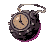

# 时间（Time）

敌机在野外停留2.0/2.5/3.0秒里面冻结敌人

[原文与贡献者记录](https://ballxpit.wiki.gg/wiki/Time) · [修订 4348](https://ballxpit.wiki.gg/index.php?oldid=4348) · [返回目录](../%E7%90%83%E6%AF%94%E4%BC%A6%E6%88%98%E8%AE%B0%20Wiki.md)

#### 一般信息

##### 开始的性格

-

##### 解锁

清除 SmolederingxDEPTHS 代码

##### 命中效果（On-Hit Effects）

自杀

##### 状态效果（Status Effects）

斯派恩时间

##### 由于状态影响

热点，范围效果

#### 发展情况（Evolutions）

##### 演变为

[黑洞](Black_Hole.md) 、 [侵蚀](Erosion.md) 、 [在地狱里](Inferno.md) 、 [爱情者](Lovestruck.md) 、 [时间炸弹](Time_Bomb.md) 、 [时间限制](Timestop.md) 、 [变形](Warp.md) 

**时间** 是一个 [基球](Balls.md#%E5%9F%BA%E7%A1%80%E5%9C%86%E7%90%83) 在 [阴影更新](https://ballxpit.wiki.gg/wiki/The_Shadow_Update?action=edit&redlink=1) 的 *[球比伦战记](Ball_x_Pit.md)*通过清除被解锁。 [阴燃深渊](The_SMOLDERINGxDEPTHS.md) .

和"冷却"球类似 [蛋袋](Egg_Sac.md)  爆炸成 *时间线* 产生一个巨大的圆形效果冻结了内部的敌人

#### 关卡

| 等级 | 伤害 | 影响 |
| --- | --- | --- |
| 1 |  x(3.5至6.5) | 敌人在野外停留了2.0秒里面冻结了敌人 ／ |
| 2 |  x(3.5至6.5) | 敌机在战场上停留2.5秒里面冻结了敌人 ／ |
| 3 |  x(3.5至6.5) | 敌人在野外停留了3.0秒里面的敌人被冻结了 ／ |

#### 发展情况

| 组合 | 进化 |
| --- | --- |
|  时间（Time） + [太阳（Sun）](Sun.md)  | [黑洞（Black Hole）](Black_Hole.md)  |
|  时间（Time） + [风（Wind）](Wind.md)  | [侵蚀（Erosion）](Erosion.md)  |
|  时间（Time） + [灼烧（Burn）](Burn.md)  | [在地狱里（Inferno）](Inferno.md) （\*） |
|  时间（Time） + [迷人（Charm）](Charm.md)  | [爱情者（Lovestruck）](Lovestruck.md)  |
|  时间（Time） + [炸弹（Bomb）](Bomb.md)  | [时间炸弹（Time Bomb）](Time_Bomb.md)  |
|  时间（Time） + [冻结（Freeze）](Freeze.md)  | [时间限制（Timestop）](Timestop.md)  |
|  时间（Time） + [光（Light）](Light.md)  | [变形（Warp）](Warp.md)  |

* 可以进一步发展。

#### 策略

* 从原始价值来说，时间是比以前更好的基准球之一，因为它具有惊人的强大能力，加上它多少缺乏进化的人才库，意味着有时保持时间的实用性可能比较有利。
  + 情况更是如此 [持球者（The Ballbearer）](The_Ballbearer.md) ,因为他们有足够的特殊球槽保持一个时间在他们的后口袋里， 同时建设更强大的球组合。

#### 更新记录

#### 冷知识

#### 图片库

[共享导航](../navigation/nav-63012059ef49.md)

**分类**　[分类 · 基础圆球](../categories/Base_Balls.md) · [分类 · 圆球](../categories/Balls.md) · [分类 · 页面有导航框](../categories/Pages_with_navboxes.md)

[返回总入口](../%E7%90%83%E6%AF%94%E4%BC%A6%E6%88%98%E8%AE%B0%20Wiki.md) · [返回本分目录](%E7%9B%AE%E5%BD%95.md)
