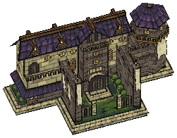

# 大学（University）

增加 < stat\_ intelligence.png> 情报缩放级别。

[原文与贡献者记录](https://ballxpit.wiki.gg/wiki/University) · [修订 3361](https://ballxpit.wiki.gg/index.php?oldid=3361) · [返回目录](../%E7%90%83%E6%AF%94%E4%BC%A6%E6%88%98%E8%AE%B0%20Wiki.md)

#### 信息（Information）

##### 分类（Category）

战争

##### 子类（Subcategory）

统计规模

##### 蓝图位置（Blueprint location）

[SNOWYxSHORES](The_SNOWYxSHORES.md)

##### 基础资源消耗（Base resource cost）

 200  20  5

##### 建造点消耗（Build point cost）

8

在六个国家规模建筑中，大学增加了所有字符的<stat\_intelligence.png> Intelligences 国家等级。这种数字扩展奖励从基层E级增加到D级，但随着建筑升级，可进一步增加到最高的S级。每个增加的统计规模级别都相当于对该统计中的每个点所应用的相关能力的比例奖励的增加。将这栋大楼全面升级为5级，从而获得了SRAK的成绩。

被动效果与升级

| 等级 | 图片 | 描述 | 资源消耗 | 建造点消耗 | 拆除 |
| --- | --- | --- | --- | --- | --- |
| 1 |  | 将 \< stat\_ intelligence.png\> 情报推广到 D (随着你的 \< stat\_ Intelligence. png\> 情报的提高， 范围效果 Power 等相关国家将更快改善) |  200  20  5 | 8 |  200  20  5 |
| 2 |  | 将 \< stat\_ intelligence.png\> 情报推广到 C (随着你的 \< stat\_ Intelligence. png\> 情报提高， 范围效果 Power 等相关国家将更快改善) |  30  25  5 | 8 |  230  45  10 |
| 3 |  | 将 \< stat\_ intelligence.png\> 情报推广到 B (随着你的 \< stat\_ Intelligence. png\> 情报提高， 范围效果 Power 等相关国家将更快改善) |  60  50  10 | 24 |  290  95  20 |
| 4 |  | 将 \< stat\_ intelligence.png\> 情报推广到 A (随着你的 \< stat\_ Intelligence. png\> 情报提高， 范围效果 Power 等相关国家将更快改善) |  150  125  25 | 40 |  440  220  45 |
| 5 |  | 将 \< stat\_ intelligence.png\> 情报扩增到 S( 随着您的 \< stat\_ Intelligence. png\> 情报的提高， 范围效果 Power 等相关数据将更快提高) |  300  250  50 | 56 |  740  470  95 |

[共享导航](../navigation/nav-d4956b01aa56.md)

**分类**　[分类 · 建筑](../categories/Buildings.md) · [分类 · 战争](../categories/Warfare.md) · [分类 · 统计规模](../categories/Stat_Scaling.md) · [分类 · 页面有导航框](../categories/Pages_with_navboxes.md)

[返回总入口](../%E7%90%83%E6%AF%94%E4%BC%A6%E6%88%98%E8%AE%B0%20Wiki.md) · [返回本分目录](%E7%9B%AE%E5%BD%95.md)
