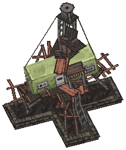
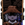
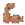
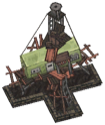

# 不稳定塔（Unstable Tower）

[原文与贡献者记录](https://ballxpit.wiki.gg/wiki/Unstable_Tower) · [修订 3410](https://ballxpit.wiki.gg/index.php?oldid=3410) · [返回目录](../%E7%90%83%E6%AF%94%E4%BC%A6%E6%88%98%E8%AE%B0%20Wiki.md)

[白发囤积者](The_Hoary_Hoarder.md)  的房子。

## 信息（Information）

### 分类（Category）

住房

### 子类（Subcategory）

住房

### 蓝图位置（Blueprint location）

[天堂之门](The_HEAVENLYxGATES.md) 

### 基础资源消耗（Base resource cost）

 100  30

### 建造点消耗（Build point cost）

30

**不稳定塔** 是 *[球比伦战记](Ball_x_Pit.md)* 作为其中一部分在 [自然主义者更新](https://ballxpit.wiki.gg/wiki/Naturalist_Update?action=edit&redlink=1) 中加入的一种角色住房 [建筑物](Buildings.md)。建造隐秘神殿会解锁 [白发囤积者](The_Hoary_Hoarder.md)  作为可游玩的 [角色](Characters.md)。当 [角色获得足够的经验值](Character_Level_Mechanics.md) 达到等级4时，这座建筑会解锁一项被动能力：所有角色都会获得  [力量](https://ballxpit.wiki.gg/wiki/Strength?action=edit&redlink=1) 加成。这座建筑的能力可以在不直接升级建筑本体的情况下，通过将角色升级到以下等级来进一步提升。注意，拆除角色的房屋将使该角色无法参与收获模式或关卡对局，并将其从所有建筑任务中移除，直到其房屋重建完成（不过该角色仍会保留之前的所有进度）。

被动效果与升级

| 等级 | 图片 | 说明 | 资源消耗 | 建造点消耗 | 拆除 | 角色等级要求 |
| --- | --- | --- | --- | --- | --- | --- |
| 1 |  | 一个属于老巢收藏家的房子。 |  100  30 | 30 |  100  30 | - |
| 1 | - | 一个属于老巢收藏家的房子。 所有角色的力量值增加 +1  [力量](https://ballxpit.wiki.gg/wiki/Strength?action=edit&redlink=1)。此效果会影响特殊圆球造成的伤害。 | - | - |  100  30 | 4 |
| 2 | - | 一个属于老巢收藏家的房子。 所有角色获得 +2 的额外加成  [力量](https://ballxpit.wiki.gg/wiki/Strength?action=edit&redlink=1)。该加成会影响特殊圆球造成的伤害。 | - | - |  100  30 | 7 |
| 3 | - | 一个属于老巢收藏家的房子。 所有角色获得 +3 的额外加成  [力量](https://ballxpit.wiki.gg/wiki/Strength?action=edit&redlink=1)。该加成会影响特殊圆球造成的伤害。 | - | - |  100  30 | 9 |

[共享导航](../navigation/nav-d4956b01aa56.md)

**分类**　[分类 · 建筑](../categories/Buildings.md) · [分类 · 住房](../categories/Housing.md) · [分类 · 带有导航框的页面](../categories/Pages_with_navboxes.md)

[返回总入口](../%E7%90%83%E6%AF%94%E4%BC%A6%E6%88%98%E8%AE%B0%20Wiki.md) · [返回本分目录](%E7%9B%AE%E5%BD%95.md)
