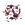
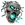

# 吸血鬼（Vampire）

每次命中有 4.5% / 6% / 6% 的概率恢复 1 / 1 / 2 点生命值。

[原文与贡献者记录](https://ballxpit.wiki.gg/wiki/Vampire) · [修订 4215](https://ballxpit.wiki.gg/index.php?oldid=4215) · [返回目录](../%E7%90%83%E6%AF%94%E4%BC%A6%E6%88%98%E8%AE%B0%20Wiki.md)

## 基本信息

### 初始角色（Starting Character）

[挥霍者](The_Spendthrift.md) 

### 解锁

默认解锁

### 状态效果（Status Effects）

治疗玩家

### 由状态效果触发

命中时

## 进化（Evolutions）

### 进化成

[蚊王](Mosquito_King.md) , [蚊群](Mosquito_Swarm.md) , [吸魂者](Soul_Sucker.md) , [魅魔](Succubus.md) , [吸血鬼领主](Vampire_Lord.md) , [僵尸](Zombie.md) 

**吸血鬼** 是 *[球比伦战记](Ball_x_Pit.md)* 基础游戏中就包含的一种 [基础圆球](Balls.md#%E5%9F%BA%E7%A1%80%E5%9C%86%E7%90%83)。默认解锁，是 [挥霍者](The_Spendthrift.md)  的起始圆球。

## 关卡

| 等级 | 伤害 | 效果 |
| --- | --- | --- |
| 1 |  x(3.5 至 6.5) | 每次命中有 4.5% 的概率恢复 1 点生命值 |
| 2 |  x(3.5 至 6.5) | 每次命中有 6% 的概率恢复 1 点生命值 |
| 3 |  x(3.5 至 6.5) | 每次命中有 6% 的概率恢复 2 点生命值 |

## 进化

| 组合 | 进化 |
| --- | --- |
|  吸血鬼（Vampire） + [育巢母体（Brood Mother）](Brood_Mother.md)  | [蚊王（Mosquito King）](Mosquito_King.md) （\*） |
|  吸血鬼（Vampire） + [卵囊（Egg Sac）](Egg_Sac.md)  | [蚊群（Mosquito Swarm）](Mosquito_Swarm.md) （\*） |
|  吸血鬼（Vampire） + [幽灵（Ghost）](Ghost.md)  | [吸魂者（Soul Sucker）](Soul_Sucker.md) （\*） |
|  吸血鬼（Vampire） + [魅惑（Charm）](Charm.md)  | [魅魔（Succubus）](Succubus.md) （\*） |
|  吸血鬼（Vampire） + [流血（Bleed）](Bleed.md)  ／  吸血鬼（Vampire） + [黑暗（Dark）](Dark.md)  | [吸血鬼领主（Vampire Lord）](Vampire_Lord.md) （\*） |
|  吸血鬼（Vampire） + [肉身（Flesh）](Flesh.md)  | [僵尸（Zombie）](Zombie.md)  |

* 可以进一步进化。

## 策略

## 更新记录

## 冷知识

## 图片库

[共享导航](../navigation/nav-63012059ef49.md)

**分类**　[分类 · 基础圆球](../categories/Base_Balls.md) · [分类 · 圆球](../categories/Balls.md) · [分类 · 带有导航框的页面](../categories/Pages_with_navboxes.md)

[返回总入口](../%E7%90%83%E6%AF%94%E4%BC%A6%E6%88%98%E8%AE%B0%20Wiki.md) · [返回本分目录](%E7%9B%AE%E5%BD%95.md)
