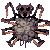

# 吸血鬼主（Vampire Lord）

每一次命中可造成3堆流血。 治愈1健康， 并在至少10/10/9堆流血击中敌人时消耗所有堆血。

[原文与贡献者记录](https://ballxpit.wiki.gg/wiki/Vampire_Lord) · [修订 4154](https://ballxpit.wiki.gg/index.php?oldid=4154) · [返回目录](../%E7%90%83%E6%AF%94%E4%BC%A6%E6%88%98%E8%AE%B0%20Wiki.md)

#### 一般信息

##### 由

[吸血鬼](Vampire.md)  + ([流血](Bleed.md)  或是 [黑暗](Dark.md) )

##### 开始的性格

-

##### 状态效果（Status Effects）

[流血](https://ballxpit.wiki.gg/wiki/Status_Effects?action=edit&redlink=1)健康玩者，健康玩者健康，健康玩者，健康玩者，健康玩玩者，健康玩玩者,

##### 由于状态影响

命中时

#### 发展情况（Evolutions）

##### 演变为

[诺斯法拉图](Nosferatu.md) 

#### 进化配方

|  |  |  |  |  |  |  |
| --- | --- | --- | --- | --- | --- | --- |
|  |  |  |  |  |  |  |
| [吸血鬼（Vampire）](Vampire.md)  |  |  |  | [流血（Bleed）](Bleed.md)  或是 [黑暗（Dark）](Dark.md)  清除骨院 |  |  |
|  |  |  |  |  |  |  |
|  |  | 吸血鬼主（Vampire Lord） |  |  |  |  |

#### 关卡

| 等级 | 伤害 | 影响 |
| --- | --- | --- |
| 1 |  x(4.2至8.0) | 每次命中都会造成3堆流血，治愈1个健康，并在至少10堆流血击中敌人时消耗所有堆血。 ／ |
| 2 |  x(4.2至8.0) | 每次命中都会造成3堆流血，治愈1个健康，并在至少10堆流血击中敌人时消耗所有堆血。 ／ |
| 3 |  x(4.2至8.0) | 每一次命中都会造成3堆流血，治愈1个健康，在至少9堆流血击中敌人时消耗所有堆血。 ／ |

#### 发展情况

| 组合 | 进化 |
| --- | --- |
|  吸血鬼主（Vampire Lord） + [蜘蛛女王（Spider Queen）](Spider_Queen.md)  + [蚊子王（Mosquito King）](Mosquito_King.md)  | [诺斯法拉图（Nosferatu）](Nosferatu.md)  |

#### 策略

#### 更新记录

#### 冷知识

#### 图片库

[共享导航](../navigation/nav-63012059ef49.md)

**分类**　[分类 · 进化圆球](../categories/Evolved_Balls.md) · [分类 · 圆球](../categories/Balls.md) · [分类 · 页面有导航框](../categories/Pages_with_navboxes.md)

[返回总入口](../%E7%90%83%E6%AF%94%E4%BC%A6%E6%88%98%E8%AE%B0%20Wiki.md) · [返回本分目录](%E7%9B%AE%E5%BD%95.md)
