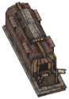

# 老兵小屋（Veteran's Hut）

[原文与贡献者记录](https://ballxpit.wiki.gg/wiki/Veteran%27s_Hut) · [修订 3403](https://ballxpit.wiki.gg/index.php?oldid=3403) · [返回目录](../%E7%90%83%E6%AF%94%E4%BC%A6%E6%88%98%E8%AE%B0%20Wiki.md)

[潜伏者](The_Embedded.md)  的房子。

## 信息（Information）

### 分类（Category）

住房

### 子类（Subcategory）

住房

### 蓝图位置（Blueprint location）

[白雪海岸](The_SNOWYxSHORES.md) 

### 基础资源消耗（Base resource cost）

 5

### 建造点消耗（Build point cost）

10

**老兵小屋** 是 *[球比伦战记](Ball_x_Pit.md)* 中的一种角色住房 [建筑物](Buildings.md)。建造老兵小屋可解锁[潜伏者](The_Embedded.md)  作为可游玩的[角色](Characters.md)。一旦该[角色获得足够的经验值](Character_Level_Mechanics.md)达到4级，该建筑将解锁一项被动能力，：位于老兵小屋效果范围内的每个角色在升级时都会获得额外经验值。可以在不直接升级建筑本体的情况下，通过继续提升角色等级来进一步提升该建筑的能力。注意，拆除角色的住宅将使该角色无法参与收获模式或关卡对局，并将其从任何建筑任务中移除，直到其住宅重建完成（不过该角色仍保留之前的所有进度）。

被动效果与升级

| 等级 | 图片 | 说明 | 资源消耗 | 建造点消耗 | 拆除 | 角色等级要求 |
| --- | --- | --- | --- | --- | --- | --- |
| 1 |  | 供“潜伏者”居住的房子。 |  5 | 10 |  5 | - |
| 1 | - | 供“潜伏者”居住的房子。 附近房屋的居民可获得20%的经验加成。 | - | - |  5 | 4 |
| 2 | - | 供“潜伏者”居住的房子。 附近房屋的居民可获得25%的经验加成。 | - | - |  5 | 7 |
| 3 | - | 供“潜伏者”居住的房子。 附近房屋的居民可获得30%的经验加成。 | - | - |  5 | 9 |

[共享导航](../navigation/nav-d4956b01aa56.md)

**分类**　[分类 · 建筑](../categories/Buildings.md) · [分类 · 住房](../categories/Housing.md) · [分类 · 带有导航框的页面](../categories/Pages_with_navboxes.md)

[返回总入口](../%E7%90%83%E6%AF%94%E4%BC%A6%E6%88%98%E8%AE%B0%20Wiki.md) · [返回本分目录](%E7%9B%AE%E5%BD%95.md)
