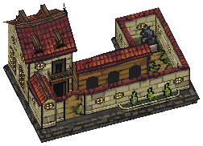

# 别墅（Villa）

一个房子 [沉思者](The_Cogitator.md) .

[原文与贡献者记录](https://ballxpit.wiki.gg/wiki/Villa) · [修订 3395](https://ballxpit.wiki.gg/index.php?oldid=3395) · [返回目录](../%E7%90%83%E6%AF%94%E4%BC%A6%E6%88%98%E8%AE%B0%20Wiki.md)

#### 信息（Information）

##### 分类（Category）

住房

##### 子类（Subcategory）

住房

##### 蓝图位置（Blueprint location）

[白雪海岸](The_SNOWYxSHORES.md) 

##### 基础资源消耗（Base resource cost）

 10

##### 建造点消耗（Build point cost）

15

其他 **别墅** 是一个字符的住房 [建筑物](Buildings.md) 在 *[球比伦战记](Ball_x_Pit.md)*建构 Villa 的 Villa 解锁。 建构 Villa 的 Villa , [沉思者](The_Cogitator.md)  作为一个可播放的 [性格](Characters.md)一次, [字符获得了足够的经验值](Character_Level_Mechanics.md) 达到4级，这栋建筑解锁了被动能力，附近小麦田的重新生长速度更快。这座建筑的功能可以通过进一步提高，而不是直接升级建筑本身，进一步提高下面所述的特性。请注意，拆除一个角色的房子将使这个角色不适用于收获模式或水平运行，并将它们从任何建筑任务中移除，直到他们的房子重建 (尽管角色仍然会保留之前的所有进展)。

被动效果与升级

| 等级 | 图片 | 描述 | 资源消耗 | 建造点消耗 | 拆除 | 性格水平要求 |
| --- | --- | --- | --- | --- | --- | --- |
| 1 |  | 相形者之家的一栋房子的一栋房子。 |  10 | 15 |  10 | - |
| 1 | - | 相形者之家的一栋房子的一栋房子。 在附近的小麦田地增长25%。 | - | - |  10 | 4 |
| 2 | - | 相形者之家的一栋房子的一栋房子。 在附近的小麦田地增长了35%。 | - | - |  10 | 7 |
| 3 | - | 相形者之家的一栋房子的一栋房子。 附近的小麦田地增长了45%。 | - | - |  10 | 9 |

[共享导航](../navigation/nav-d4956b01aa56.md)

**分类**　[分类 · 建筑](../categories/Buildings.md) · [分类 · 住房](../categories/Housing.md) · [分类 · 页面有导航框](../categories/Pages_with_navboxes.md)

[返回总入口](../%E7%90%83%E6%AF%94%E4%BC%A6%E6%88%98%E8%AE%B0%20Wiki.md) · [返回本分目录](%E7%9B%AE%E5%BD%95.md)
