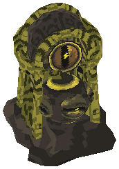
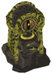

# 虚空奖杯（Void Trophy）

每用一名角色通关浩瀚虚空（VASTxVOID），所有角色都会获得基础伤害加成。

[原文与贡献者记录](https://ballxpit.wiki.gg/wiki/Void_Trophy) · [修订 3371](https://ballxpit.wiki.gg/index.php?oldid=3371) · [返回目录](../%E7%90%83%E6%AF%94%E4%BC%A6%E6%88%98%E8%AE%B0%20Wiki.md)

## 信息（Information）

### 分类（Category）

战争

### 子类（Subcategory）

通关奖励

### 蓝图位置（Blueprint location）

[浩瀚虚空](The_VASTxVOID.md) 

### 基础资源消耗（Base resource cost）

 800  30

### 建造点消耗（Build point cost）

24

**虚空奖杯**是八座通关奖励建筑之一。首次通关[浩瀚虚空](The_VASTxVOID.md) 即可获得蓝图，普通敌人不会掉落。奖杯为所有角色提供基础伤害加成。不同角色先后通关同一关卡时，奖杯加成会自动提高。每名角色以普通速度通关基础关卡时，增加一份基础加成。以快速至快速＋9 通关基础关卡，以及以普通、快速至快速＋9 通关新游戏＋至新游戏＋9 时，每名角色每完成一档均增加基础加成的 1/10。理论上限为基础加成的 238 倍。PC 版玩家启用 Twitch 扩展并使用[伪救世主](The_False_Messiah.md) 后，上限提升至基础加成的 249.9 倍。建成可解锁「奖杯」（Trophy）成就。

被动效果与升级

| 图片 | 说明 | 资源消耗 | 建造点消耗 | 拆除 | 基础加成 | 最大奖励 | 使用 Twitch 扩展功能获得最高奖励 |
| --- | --- | --- | --- | --- | --- | --- | --- |
|  | 每用一名角色通关浩瀚虚空（VASTxVOID），基础伤害 +1。此后该角色每完成一级快速难度（Fast tier）或新游戏＋（New Game+），额外 +0.1。 |  800  30 | 24 |  800  30 | +1 基础伤害 | +238 基础伤害 | +249.9 基础伤害 |

[共享导航](../navigation/nav-d4956b01aa56.md)

**分类**　[分类 · 建筑](../categories/Buildings.md) · [分类 · 战争](../categories/Warfare.md) · [分类 · 通关奖励](../categories/Completion_Bonus.md) · [分类 · 带有导航框的页面](../categories/Pages_with_navboxes.md)

[返回总入口](../%E7%90%83%E6%AF%94%E4%BC%A6%E6%88%98%E8%AE%B0%20Wiki.md) · [返回本分目录](%E7%9B%AE%E5%BD%95.md)
