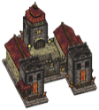

# 作战室（War Room）

让角色自行完成关卡。

[原文与贡献者记录](https://ballxpit.wiki.gg/wiki/War_Room) · [修订 3389](https://ballxpit.wiki.gg/index.php?oldid=3389) · [返回目录](../%E7%90%83%E6%AF%94%E4%BC%A6%E6%88%98%E8%AE%B0%20Wiki.md)

## 信息（Information）

### 分类（Category）

战争

### 子类（Subcategory）

将军

### 蓝图位置（Blueprint location）

[阴燃深渊](The_SMOLDERINGxDEPTHS.md)

### 基础资源消耗（Base resource cost）

 300  50

### 建造点消耗（Build point cost）

20

作战室允许指定一名角色在后台自动进行关卡挑战，无需玩家额外输入指令。完成这些挑战后，将获得一定奖励，包括额外  金币，以及  小麦、 木材或  石头。当角色被分配到该建筑时，无法参与收获模式或关卡挑战，且作战室挑战也不会为角色提供任何经验值。该建筑/功能不可升级，作战室挑战的奖励也不会受到其他建筑提供的任何加成或功能的影响。

被动效果与升级

| 等级 | 图片 | 说明 | 资源消耗 | 建造点消耗 | 拆除 |
| --- | --- | --- | --- | --- | --- |
| 1 |  | 派遣角色自行完成关卡。 |  300  50 | 20 |  300  50 |

### 机制

选择“作战室”建筑后，会弹出一个窗口，其中有一个插槽可以分配一个角色。选择角色后，玩家可以选择该角色在任意难度／新游戏＋或快速难度下完成过常规单局的任何关卡。每个关卡都有一组资源，这些资源将在完成“作战室”任务时作为奖励发放，同时还有完成该任务所需的时间，这两者对所有角色都是相同的。选择关卡后，完成时间将实时开始倒计时，不过在游戏关闭时，此倒计时会暂停，且不受[工人工会](Worker_s_Guild_Building.md)能力的影响。

在被分配到该建筑时，角色会显示为“探索中”，无法用于收获任务或常规玩家操作的关卡挑战（其选择框会显示但颜色较暗且不可选择）。在作战室运行期间，可以通过作战室菜单随时更换分配的角色，而不会丢失进度，前提是替换角色之前已在同一关卡完成了常规关卡挑战，并且随后又被分配到该建筑；然而，如果直接将当前分配的作战室角色移除或直接分配到另一个建筑而不进行替换，则该挑战的所有进度将失效。

完成单局游戏后，作战室建筑会显示一个飘在其上的感叹号徽章，玩家需手动选择作战室并点击“收集”按钮，才能领取单局奖励，并让指定的角色再次恢复正常使用状态。

作战室关卡运行时间与奖励

| 等级 | 单局完成时间 | 单局奖励 |
| --- | --- | --- |
| [血腥草原](The_BONExYARD.md) | 12分钟 |  200  5 |
| [白雪海岸](The_SNOWYxSHORES.md) | 14分钟 |  100  15 |
| [边境沙漠](The_LIMINALxDESERT.md) | 15分钟 |  150  10 |
| [真菌森林](https://ballxpit.wiki.gg/wiki/SHROOMxFOREST?action=edit&redlink=1) | 21分钟 |  200  20 |
| [血腥草原](The_GORYxGRASSLANDS.md) | 18分钟 |  300  50 |
| [阴燃深渊](The_SMOLDERINGxDEPTHS.md) | 23分钟 |  400  40 |
| [天堂之门](The_HEAVENLYxGATES.md) | 25分钟 |  700  150 |
| [浩瀚虚空](The_VASTxVOID.md) | 30分钟 |  1,000  100 |

[共享导航](../navigation/nav-d4956b01aa56.md)

**分类**　[分类 · 建筑](../categories/Buildings.md) · [分类 · 战争](../categories/Warfare.md) · [分类 · 通用](../categories/General.md) · [分类 · 带有导航框的页面](../categories/Pages_with_navboxes.md)

[返回总入口](../%E7%90%83%E6%AF%94%E4%BC%A6%E6%88%98%E8%AE%B0%20Wiki.md) · [返回本分目录](%E7%9B%AE%E5%BD%95.md)
