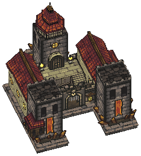

# 战争室（War Room）

将字符发送到完整级别。

[原文与贡献者记录](https://ballxpit.wiki.gg/wiki/War_Room) · [修订 3389](https://ballxpit.wiki.gg/index.php?oldid=3389) · [返回目录](../%E7%90%83%E6%AF%94%E4%BC%A6%E6%88%98%E8%AE%B0%20Wiki.md)

#### 信息（Information）

##### 分类（Category）

战争

##### 子类（Subcategory）

总

##### 蓝图位置（Blueprint location）

[SMOLDERINGxDEPTHS](The_SMOLDERINGxDEPTHS.md)

##### 基础资源消耗（Base resource cost）

 300  50

##### 建造点消耗（Build point cost）

20

构建战室允许在虚拟级别上发送单个指定字符， 在背景背景中发送， 无需额外的玩家输入， 完成其中之一， 以奖金的形式给予一定的运行奖励。  黄金以及其中之一  麦子,  木，或  石头。指定到此大楼时， 收割模式运行或关卡运行时没有字符可用， 战争室运行不给予任何字符经验值。这一建筑/可容纳性无法升级，战争室经营的奖励不受其他建筑物奖金或能力的影响。

被动效果与升级

| 等级 | 图片 | 描述 | 资源消耗 | 建造点消耗 | 拆除 |
| --- | --- | --- | --- | --- | --- |
| 1 |  | 发送字符到完成级别的自己 |  300  50 | 20 |  300  50 |

##### 机械工

选择战室大楼时， 产生一个窗口， 带有可以指定单个字符的位置。在选择一个字符后，播放器可以选择该字符先前在任何困难/新游戏+或快速阶梯上完成正常运行的任何级别。每一级都有一套资源，在战争室运行结束后作为奖励支付，以及完成作战室运行所需的时间，两者对所有人物都是相同的。一旦选择了关卡， 运行完成时间将开始实时倒计时， 但是游戏关闭时的倒倒计时暂停， 并且不受此功能的影响 [工人协会](Worker_s_Guild_Building.md).

当指定到此大楼时， 字符将被显示为“ 探索” , 并且不能用于收割运行或普通的播放器控制级别运行( 显示它们的选择框， 但被缩小， 无法选择) 。在战争室通过战争室菜单运行的作战室菜单运行期间，可以随时改变指定字符的指定字符，但不得失去进步，只要替换字符以前也完成了同一水平的常规级别运行，然后被分配到该级别;然而，删除或直接将目前指定的作战室字符分配给另一栋大楼，而没有同时替换将无效此运行中的所有进度。

一旦运行完成，作战室大楼将展示一个悬浮在上面的感叹点徽章，玩家随后将需要手动选择战争室并单击“集合”按钮，以便同时标出运行奖励并允许指定字符再次使用。

战室跑时报和奖赏

| 等级 | 运行完成时间 | 冲冲冲 |
| --- | --- | --- |
| [BONExYARD](The_BONExYARD.md) | 12分钟 |  200  5 |
| [SNOWYxSHORES](The_SNOWYxSHORES.md) | 14分钟 |  100  15 |
| [LIMINALxDESERT](The_LIMINALxDESERT.md) | 15分钟 |  150  10 |
| [SHROOMxFOREST](https://ballxpit.wiki.gg/wiki/SHROOMxFOREST?action=edit&redlink=1) | 21分钟 |  200  20 |
| [GORYxGRASSLANDS](The_GORYxGRASSLANDS.md) | 18分钟 |  300  50 |
| [SMOLDERINGxDEPTHS](The_SMOLDERINGxDEPTHS.md) | 23分钟 |  400  40 |
| [HEAVENLYxGATES](The_HEAVENLYxGATES.md) | 25分钟 |  700  150 |
| [VASTxVOID](The_VASTxVOID.md) | 30分钟 |  1,000  100 |

[共享导航](../navigation/nav-d4956b01aa56.md)

**分类**　[分类 · 建筑](../categories/Buildings.md) · [分类 · 战争](../categories/Warfare.md) · [分类 · 总](../categories/General.md) · [分类 · 页面有导航框](../categories/Pages_with_navboxes.md)

[返回总入口](../%E7%90%83%E6%AF%94%E4%BC%A6%E6%88%98%E8%AE%B0%20Wiki.md) · [返回本分目录](%E7%9B%AE%E5%BD%95.md)
